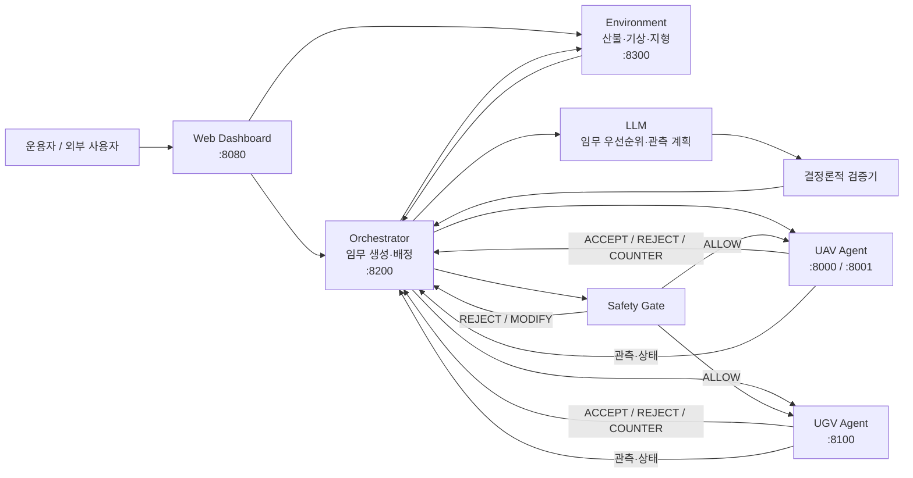

# ADAIR 기능 요구사항 명세서
**AI 기반 산불 대응 멀티에이전트 시뮬레이션 시스템**

- 프로젝트명: ADAIR
- 기준 저장소: `Xn0w/Codyssey_M2-1`
- 기준 브랜치: `main`
- 작성 기준: 2026-10-14
- 구현 기준: PR #50 병합 완료 상태
- 공개 서비스: `http://3.37.210.229:8080/`
- 요구사항 우선순위: Must / Should / Could
- 구현 상태: 구현 / 부분 구현 / 후속

---

## 1. 목적과 범위

ADAIR는 산불 상황에서 UAV(무인항공기)와 UGV(무인지상차량)의 관측·대응 임무를 통합 조정하는 멀티에이전트 시뮬레이션 시스템이다.

시스템은 산불·기상·지형·도로·자원 상태를 바탕으로 임무를 생성하고, 각 자원의 수행 가능성과 Safety 조건을 검증한 뒤 실행한다. 생성형 AI는 임무 우선순위와 관측 계획을 제안하지만, 실제 실행 권한은 갖지 않는다.

본 명세서는 다음을 정의한다.

1. 서비스의 핵심 기능 요구사항
2. AI 활용 요구사항
3. 비기능 요구사항
4. 시스템 아키텍처와 데이터 흐름
5. 요구사항별 구현·검증 기준
6. 사용자 피드백에서 도출한 후속 개선 요구사항

### 범위에서 제외하는 사항

- 실제 산불 현장 운용 성능 보장
- 실제 열화상 센서 기반 탐지
- RAG, 멀티모달 LLM, 장기 메모리
- 모든 지형·교차로·고속 주행 조건에 대한 안전성 보장

---

## 2. 시스템 아키텍처



### 핵심 실행 흐름

```
산불 신고·관측
    ↓
Environment 상태 확인
    ↓
Task 생성 / 재평가
    ↓
[선택적] LLM 계획 제안
    ↓
결정론적 검증
    ↓
Local Agent 수행 가능성 평가
    ↓
Safety 검증
    ↓
자원 예약·실행
    ↓
관측 / 임무 결과
    ↓
Environment 갱신
    ↓
필요 시 재평가·재할당
```

## 3. 기능 요구사항

<table>
  <thead>
    <tr>
      <th>ID</th>
      <th>기능</th>
      <th>요구사항</th>
      <th>우선순위</th>
      <th>구현 상태</th>
      <th>검증 기준</th>
    </tr>
  </thead>
  <tbody>
    <tr><td nowrap>FR-01</td><td nowrap>산불 이벤트 입력</td><td nowrap>시스템은 신고 또는 관측으로 화재 위치·상태를 입력받아 대응 절차를 시작해야 한다.</td><td nowrap>Must</td><td nowrap>구현</td><td nowrap>신고/관측 입력 후 Task 생성 확인</td></tr>
    <tr><td nowrap>FR-02</td><td nowrap>환경 상태 관리</td><td nowrap>Environment는 산불 확산, 기상, 지형 및 지도 정보를 관리하고 총괄에 제공해야 한다.</td><td nowrap>Must</td><td nowrap>구현</td><td nowrap>환경 API 및 CA 상태 갱신 확인</td></tr>
    <tr><td nowrap>FR-03</td><td nowrap>Task 생성·재평가</td><td nowrap>총괄은 환경 상태를 바탕으로 Task를 생성하고, 상태 변화 시 영향을 받는 Task를 재평가해야 한다.</td><td nowrap>Must</td><td nowrap>구현</td><td nowrap>통합 시나리오에서 Task 생성·재평가 로그 확인</td></tr>
    <tr><td nowrap>FR-04</td><td nowrap>자원 상태 관리</td><td nowrap>총괄은 UAV·UGV의 가용 상태, 현재 임무 및 수행 가능성을 구분하여 관리해야 한다.</td><td nowrap>Must</td><td nowrap>구현</td><td nowrap>자원 상태·현재 Task 조회 및 변경 확인</td></tr>
    <tr><td nowrap>FR-05</td><td nowrap>Local 수행 가능성 평가</td><td nowrap>각 Agent는 제안된 임무에 <code>ACCEPT / REJECT / COUNTER</code>로 응답하고, 거절·역제안 시 사유를 제공해야 한다.</td><td nowrap>Must</td><td nowrap>구현</td><td nowrap>평가 API 응답 및 사유 필드 확인</td></tr>
    <tr><td nowrap>FR-06</td><td nowrap>임무 우선순위 AI 추천</td><td nowrap>LLM은 입력으로 제공된 유효 임무 후보 안에서 임무 우선순위와 판단 근거를 제안해야 한다.</td><td nowrap>Must</td><td nowrap>구현</td><td nowrap>LLM 호출 결과 및 검증 로그 확인</td></tr>
    <tr><td nowrap>FR-07</td><td nowrap>AI 관측 계획</td><td nowrap>LLM은 정적 지도·관측 정보·자원 상태를 바탕으로 예상 관측 구역과 자원별 관측 순서를 제안해야 한다.</td><td nowrap>Must</td><td nowrap>구현</td><td nowrap><code>observation_planner</code> 결과 및 관련 시험 확인</td></tr>
    <tr><td nowrap>FR-08</td><td nowrap>AI 출력 검증·Fallback</td><td nowrap>LLM 출력은 형식, 입력 상태, 유효 ID, 중복·누락 등을 검증해야 하며 실패 시 규칙 기반 계획으로 대체해야 한다.</td><td nowrap>Must</td><td nowrap>구현</td><td nowrap>비정상 출력·시간초과 시 <code>RULE_FALLBACK</code> 확인</td></tr>
    <tr><td nowrap>FR-09</td><td nowrap>Safety 실행 관문</td><td nowrap>Local Agent가 수락한 임무도 Safety 검증을 통과하기 전에는 실행할 수 없어야 한다.</td><td nowrap>Must</td><td nowrap>구현</td><td nowrap><code>ALLOW</code>일 때만 실행되고 <code>REJECT</code> 시 실행되지 않음 확인</td></tr>
    <tr><td nowrap>FR-10</td><td nowrap>UAV 임무 수행</td><td nowrap>UAV Agent는 배정된 임무를 평가하고 출동·관측·복귀 상태를 총괄에 제공해야 한다.</td><td nowrap>Must</td><td nowrap>구현</td><td nowrap>UAV 출동·관측·복귀 흐름 및 상태 확인</td></tr>
    <tr><td nowrap>FR-11</td><td nowrap>UGV 임무 수행</td><td nowrap>UGV Agent는 도로 접근성과 임무 가능성을 평가하고 지상 임무·복귀를 수행해야 한다.</td><td nowrap>Must</td><td nowrap>구현</td><td nowrap>UGV 평가·경로·출동·복귀 흐름 확인</td></tr>
    <tr><td nowrap>FR-12</td><td nowrap>관측 결과 반영</td><td nowrap>UAV·UGV의 관측 결과는 Environment 상태 또는 총괄의 인지 상태에 반영되어 후속 판단에 사용되어야 한다.</td><td nowrap>Must</td><td nowrap>구현</td><td nowrap>관측 전·후 환경/인지 상태 변화 확인</td></tr>
    <tr><td nowrap>FR-13</td><td nowrap>재할당·재계획</td><td nowrap>거절, 환경 변화, 접근 차단, 자원 상태 변화 등으로 기존 임무가 어려워지면 총괄은 재평가 또는 재할당해야 한다.</td><td nowrap>Must</td><td nowrap>구현</td><td nowrap>REJECT 후 새 <code>decision_id</code> 및 대체 후보 평가 확인</td></tr>
    <tr><td nowrap>FR-14</td><td nowrap>중복 실행 방지</td><td nowrap>동일 실행 요청이 중복 전달되더라도 같은 명령이 반복 실행되지 않도록 실행 단위를 식별해야 한다.</td><td nowrap>Must</td><td nowrap>구현</td><td nowrap>실행 멱등성 시험 및 중복 방지 확인</td></tr>
    <tr><td nowrap>FR-15</td><td nowrap>실행 이력 기록</td><td nowrap>시스템은 주요 판단, 자원 응답, Safety 결과, 실행 및 관측 이벤트를 추적 가능한 형태로 기록해야 한다.</td><td nowrap>Must</td><td nowrap>구현</td><td nowrap>SQLite/이벤트 로그에서 실행 이력 확인</td></tr>
    <tr><td nowrap>FR-16</td><td nowrap>통합 관제판</td><td nowrap>웹 관제판은 산불 확산, 기상, UAV·UGV 상태, 출동 현황, ETA 및 주요 이벤트를 한 화면에서 제공해야 한다.</td><td nowrap>Must</td><td nowrap>구현</td><td nowrap>공개/로컬 관제 화면에서 상태 표시 확인</td></tr>
    <tr><td nowrap>FR-17</td><td nowrap>외부 서비스 제공</td><td nowrap>평가자는 별도 개발환경 없이 공개 URL을 통해 웹 관제 서비스에 접근할 수 있어야 한다.</td><td nowrap>Must</td><td nowrap>구현</td><td nowrap>외부망에서 공개 URL 접속 확인</td></tr>
  </tbody>
</table>

## 4. AI 활용 요구사항

<table>
  <thead>
    <tr>
      <th>ID</th>
      <th>요구사항</th>
      <th>구현 기준</th>
    </tr>
  </thead>
  <tbody>
    <tr><td nowrap>AI-01</td><td nowrap>LLM은 실행 명령을 직접 생성·전송하지 않는다.</td><td nowrap>AI 출력은 총괄의 계획 입력으로만 사용</td></tr>
    <tr><td nowrap>AI-02</td><td nowrap>LLM이 새로운 좌표·자원·임무 ID를 임의로 생성하지 못하도록 후보와 출력 형식을 제한한다.</td><td nowrap>허용된 ID 검증</td></tr>
    <tr><td nowrap>AI-03</td><td nowrap>입력 상태와 AI 출력의 정합성을 검증한다.</td><td nowrap><code>state_version</code>, <code>input_hash</code> 등으로 상태 확인</td></tr>
    <tr><td nowrap>AI-04</td><td nowrap>관측 계획 검증 실패 시 오류 정보를 제공해 1회 재요청할 수 있다.</td><td nowrap>재시도 후에도 실패하면 fallback</td></tr>
    <tr><td nowrap>AI-05</td><td nowrap>LLM 장애가 전체 임무 흐름을 중단시키지 않아야 한다.</td><td nowrap>규칙 기반 계획으로 대체</td></tr>
    <tr><td nowrap>AI-06</td><td nowrap>LLM 호출에는 실행 보호 한도를 둔다.</td><td nowrap>기본 timeout 60초, 실행당 최대 50회</td></tr>
    <tr><td nowrap>AI-07</td><td nowrap>모의 센서 정보와 AI 판단은 실제 센서 측정값과 구분해야 한다.</td><td nowrap><code>SIMULATED</code> 등 출처 구분</td></tr>
  </tbody>
</table>

## 5. 비기능 요구사항

<table>
  <thead>
    <tr>
      <th>ID</th>
      <th>항목</th>
      <th>요구사항</th>
      <th>우선순위</th>
      <th>현재 상태</th>
    </tr>
  </thead>
  <tbody>
    <tr><td nowrap>NFR-01</td><td nowrap>안전성</td><td nowrap>Safety 검증 전 실행 명령을 전달하지 않아야 한다.</td><td nowrap>Must</td><td nowrap>충족</td></tr>
    <tr><td nowrap>NFR-02</td><td nowrap>추적성</td><td nowrap>Task·Decision·실행·관측의 관계를 ID와 로그로 추적할 수 있어야 한다.</td><td nowrap>Must</td><td nowrap>충족</td></tr>
    <tr><td nowrap>NFR-03</td><td nowrap>일관성</td><td nowrap>재평가 시 새 <code>decision_id</code>를 발급하고 현재 결정과 일치하는 응답만 반영해야 한다.</td><td nowrap>Must</td><td nowrap>충족</td></tr>
    <tr><td nowrap>NFR-04</td><td nowrap>장애 대응</td><td nowrap>LLM 실패 또는 검증 실패가 전체 서비스 중단으로 이어지지 않아야 한다.</td><td nowrap>Must</td><td nowrap>충족</td></tr>
    <tr><td nowrap>NFR-05</td><td nowrap>멱등성</td><td nowrap>중복 실행 요청으로 동일 물리 명령이 반복 수행되지 않아야 한다.</td><td nowrap>Must</td><td nowrap>충족</td></tr>
    <tr><td nowrap>NFR-06</td><td nowrap>보안</td><td nowrap>API Key 등 비밀값은 환경변수로 관리하고 저장소에 커밋하지 않아야 한다.</td><td nowrap>Must</td><td nowrap>충족</td></tr>
    <tr><td nowrap>NFR-07</td><td nowrap>데이터 출처</td><td nowrap>실제 관측값, 시나리오 입력값, 모의 센서값을 구분할 수 있어야 한다.</td><td nowrap>Must</td><td nowrap>부분 충족</td></tr>
    <tr><td nowrap>NFR-08</td><td nowrap>사용성</td><td nowrap>주요 화재·자원 상태를 관제 화면 한 곳에서 확인할 수 있어야 한다.</td><td nowrap>Must</td><td nowrap>충족</td></tr>
    <tr><td nowrap>NFR-09</td><td nowrap>배포성</td><td nowrap>외부 사용자가 공개 URL을 통해 관제 화면에 접근할 수 있어야 한다.</td><td nowrap>Must</td><td nowrap>충족</td></tr>
    <tr><td nowrap>NFR-10</td><td nowrap>시험 가능성</td><td nowrap>주요 통합·총괄·환경 기능은 자동 시험으로 회귀 검증할 수 있어야 한다.</td><td nowrap>Must</td><td nowrap>충족</td></tr>
    <tr><td nowrap>NFR-11</td><td nowrap>실행 환경</td><td nowrap>통합 논리 시험은 PX4·Gazebo 없이도 실행 가능해야 하며, 물리 시뮬레이션은 별도 환경에서 검증할 수 있어야 한다.</td><td nowrap>Should</td><td nowrap>충족</td></tr>
    <tr><td nowrap>NFR-12</td><td nowrap>AI 투명성</td><td nowrap>생성형 AI가 만든 판단·계획과 일반 시뮬레이션 데이터를 사용자 또는 로그에서 구분할 수 있어야 한다.</td><td nowrap>Should</td><td nowrap>부분 충족</td></tr>
  </tbody>
</table>

### 명시적으로 요구하지 않는 수치

현재 근거가 없는 아래 항목은 임의의 SLA로 정의하지 않는다.

* 전체 서비스 응답시간 3초/5초 이하
* 99% 이상의 가용성
* 동시 사용자 수
* 실제 재난 현장 운용 신뢰도

LLM의 **60초 timeout**은 서비스 응답 SLA가 아니라 호출 보호 한도이다.

## 6. 시스템 인터페이스 요구사항

### 6.1 Local Agent 응답

```
{
  "task_id": "TASK_101",
  "decision_id": "DEC_001",
  "resource_id": "A-uav1",
  "verdict": "ACCEPT | REJECT | COUNTER",
  "reason": "...",
  "counter_offer": null
}
```

원칙:

* `ACCEPT`만 Safety 검증으로 전달
* `REJECT / COUNTER`는 사유를 기록하고 총괄이 재평가
* 동일 Task 재평가 시 새 `decision_id` 사용
* 현재 결정과 일치하지 않는 오래된 응답은 실행에 반영하지 않음

### 6.2 공간정보 변환

```
Environment grid/cell
   ↓
Spatial Mapper
   ↓
lat/lon
   ↓
UAV·UGV 실행 계층
```

관측 결과는 반대 방향으로 다시 Environment의 격자 상태에 매핑할 수 있어야 한다.

## 7. 사용자 피드백 기반 개선 요구사항

아래 항목은 사용자 10명의 테스트에서 반복적으로 나온 의견을 요구사항 형태로 변환한 것이다.

<table>
  <thead>
    <tr>
      <th>ID</th>
      <th>개선 요구사항</th>
      <th>우선순위</th>
      <th>상태</th>
    </tr>
  </thead>
  <tbody>
    <tr><td nowrap>UX-01</td><td nowrap><code>col/row</code> 또는 격자 ID와 함께 일반 사용자가 이해할 수 있는 지명·위치 설명을 제공한다.</td><td nowrap>Should</td><td nowrap>반영 예정</td></tr>
    <tr><td nowrap>UX-02</td><td nowrap>풍향을 숫자뿐 아니라 지도 위 방향 표시로 시각화한다.</td><td nowrap>Should</td><td nowrap>반영 예정</td></tr>
    <tr><td nowrap>UX-03</td><td nowrap>신고 → 출동 → 도착 → 임무 완료/복귀 흐름을 시간순 타임라인으로 제공한다.</td><td nowrap>Should</td><td nowrap>반영 예정</td></tr>
    <tr><td nowrap>UX-04</td><td nowrap>UAV 이동 목적과 현재 임무를 일반 사용자용 표현으로 표시한다.</td><td nowrap>Should</td><td nowrap>반영 예정</td></tr>
    <tr><td nowrap>UX-05</td><td nowrap>위치·기상 수치의 소수점 표시를 필요한 수준으로 제한해 가독성을 높인다.</td><td nowrap>Could</td><td nowrap>반영 예정</td></tr>
    <tr><td nowrap>UX-06</td><td nowrap>지도 클릭을 이용한 위치 지정 방식의 도입 가능성을 검토한다.</td><td nowrap>Could</td><td nowrap>후속 검토</td></tr>
  </tbody>
</table>

- 개선 반영 커밋: 4849ce3 web/app.py 좌표·기상값 소수점 표시 정리
- 개선 전·후 화면: docs/intergration/media/fb-6_compare.png

## 8. 검증 계획과 증빙

<table>
  <thead>
    <tr>
      <th>검증 영역</th>
      <th>검증 방법</th>
      <th>주요 증빙</th>
    </tr>
  </thead>
  <tbody>
    <tr><td nowrap>Environment</td><td nowrap>CA 산불 확산·계약 시험</td><td nowrap><code>environment/tests</code>, 통합 시험</td></tr>
    <tr><td nowrap>Local Agent</td><td nowrap>ACCEPT/REJECT/COUNTER 흐름 시험</td><td nowrap>통합 계약 및 IT 시험</td></tr>
    <tr><td nowrap>Safety</td><td nowrap>ACCEPT 이후 Safety 호출·거절 시 미실행 확인</td><td nowrap>Orchestrator/통합 시험</td></tr>
    <tr><td nowrap>LLM 우선순위</td><td nowrap>LLM 호출·검증·fallback 확인</td><td nowrap><code>orchestrator/llm.py</code>, 관련 시험</td></tr>
    <tr><td nowrap>LLM 관측 계획</td><td nowrap>계획 생성, 유효 ID 검증, timeout fallback 확인</td><td nowrap><code>observation_planner.py</code>, <code>test_observation_planner.py</code></td></tr>
    <tr><td nowrap>UAV/UGV 통합</td><td nowrap>출동·관측·복귀 및 재평가 흐름</td><td nowrap>통합 실행 기록</td></tr>
    <tr><td nowrap>멱등성</td><td nowrap>중복 실행 방지 시험</td><td nowrap><code>test_exec_idempotency.py</code></td></tr>
    <tr><td nowrap>관제판</td><td nowrap>산불·자원·ETA·상태 표시 확인</td><td nowrap>웹 관제판 및 사용자 테스트</td></tr>
    <tr><td nowrap>외부 배포</td><td nowrap>팀 외부망에서 공개 URL 접속</td><td nowrap><code>http://3.37.210.229:8080/</code></td></tr>
    <tr><td nowrap>사용자 평가</td><td nowrap>서로 다른 사용자 10명의 정성 피드백</td><td nowrap><code>docs/common/ADAIR_사용자_피드백.md</code></td></tr>
  </tbody>
</table>

## 9. 구현 상태 및 제한사항

### 구현 확인

* Environment–Orchestrator–UAV/UGV 연동
* Local Agent 수행 가능성 평가
* Safety 실행 관문
* LLM 임무 우선순위 추천
* LLM 관측 계획 및 결정론적 검증
* 규칙 기반 fallback
* 실행·관측 로그
* 웹 통합 관제
* GitHub Actions 자동 시험
* 외부 공개 웹 서비스
* 사용자 10명 테스트

### 제한사항

* 대표 정상 통합 시연에서는 LLM 관측 계획을 비활성화했다.
* 열화상 관측은 실제 센서가 아니라 모의 데이터이다.
* UGV 일부 교차로·지형 경계 조건에는 추가 검증이 필요하다.
* 60 km/h 및 일부 장거리 UGV 조건은 검증이 완료되지 않았다.
* 일부 통합 실행에서 총괄 임무 배정이 진행되지 않은 사례가 있어 원인 분석이 필요하다.
* Heartbeat, Retry, STALE/OFFLINE 전이 등 일부 장애 대응은 전체 범위에서 완전 검증된 기능으로 주장하지 않는다.

## 10. 요구사항 추적 요약

```
문제 정의
  ↓
산불·기상·지형·도로 상태 통합
  ↓
Task 생성
  ↓
AI 계획 + 규칙 기반 제어
  ↓
Local Agent 수행 가능성 평가
  ↓
Safety
  ↓
UAV / UGV 실행
  ↓
관측 결과 반영
  ↓
재평가·재할당
  ↓
웹 관제 및 로그
```

본 명세는 현재 `main`에 반영된 구현을 기준으로 작성하였으며, 사용자 피드백 기반 UI 개선은 일부 반영하여 구현하였다.
