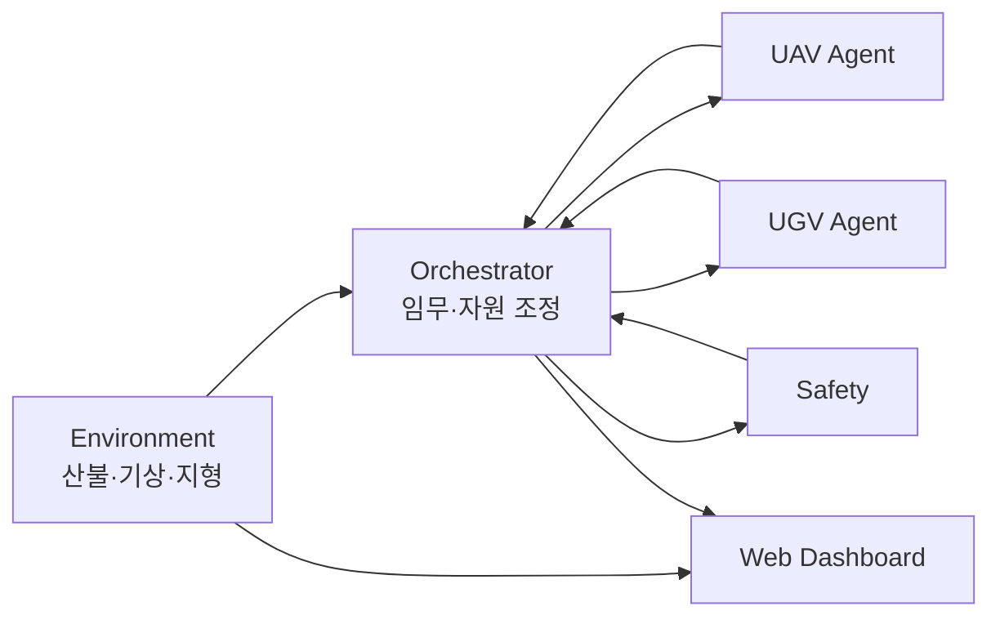

# ADAIR
## AI 기반 산불 대응 멀티에이전트 시뮬레이션 시스템

ADAIR는 산불 상황에서 **UAV(무인항공기)와 UGV(무인지상차량)의 관측·대응 임무를 통합 조정**하는 멀티에이전트 시뮬레이션 시스템입니다.

산불 확산, 기상, 지형, 도로, 자원 상태를 바탕으로 임무를 생성하고, AI가 제안한 계획도 검증 절차를 통과한 경우에만 실행 흐름에 반영합니다.

> **핵심 흐름**  
> 산불 신고 → UAV 관측 → 환경 갱신 → UGV/지상자원 투입 → 임무 수행 → 복귀

---

## 1. 핵심 기능

- CA 기반 산불 확산 및 기상·지형 정보 연동
- 강원 인제 실지형·도로망 기반 시뮬레이션
- UAV·UGV 멀티에이전트 임무 배정
- Local Agent의 `ACCEPT / REJECT / COUNTER` 수행 가능성 평가
- Safety 검증 후 실행
- LLM 기반 임무 우선순위 추천 및 관측 계획
- 임무 결과에 따른 환경 상태 갱신·재평가
- 웹 기반 실시간 통합 관제
- GitHub Actions 기반 자동 통합 시험

### 웹 관제판

관제판에서는 다음 정보를 한 화면에서 확인할 수 있습니다.

- 산불 발생 및 확산 상태
- 풍속·풍향 등 환경정보
- UAV 위치·이동 궤적·비행 상태
- UGV·지상자원 출동 상태 및 ETA
- 도로 차단 및 임무 진행 상태
- 총괄 판단과 주요 이벤트

URL 주소 -> http://3.37.210.229:8080/
---

## 2. 시스템 구조



| 구성 요소 | 역할 |
|---|---|
| Environment | 산불 확산, 기상, 지형, 위험정보 관리 |
| Orchestrator | 임무 생성, AI 계획 검증, 자원 배정, 실행 상태 관리 |
| UAV Agent | 비행 가능성 평가, 관측, 복귀 |
| UGV Agent | 도로 접근성 평가, 지상 임무, 복귀 |
| Safety | 실행 전 안전 조건 검증 |
| Web Dashboard | 산불·자원·임무 상태 통합 시각화 |

---

## 3. AI 활용

ADAIR의 LLM은 장비를 직접 제어하지 않고 **임무 계획을 제안하는 계층**으로 사용합니다.

| 기능 | 역할 |
|---|---|
| 임무 순서 추천 | 위험도가 비슷한 임무 묶음에서 우선순위와 근거 제안 |
| 관측 계획 | 예상 화재 구역과 UAV·UGV별 관측 순서 제안 |

```text
LLM 계획
   ↓
결정론적 검증
   ↓
Local Agent 수행 가능성 평가
   ↓
Safety 검증
   ↓
자원 예약·실행
```

출력 형식, 입력 상태, 유효한 임무·자원·구역 ID 등을 검증하며, LLM 호출 또는 검증 실패 시 규칙 기반 계획으로 대체합니다.

> 대표 정상 통합 시연에서는 사전 검증되지 않은 UGV 경로 사용을 피하기 위해 LLM 관측 계획을 비활성화했습니다.  
> LLM 기능은 별도 시험으로 검증했습니다.

---

## 4. 기술 스택

| 영역 | 기술 |
|---|---|
| Backend | Python, FastAPI |
| Simulation | CA 산불 모델, PX4, Gazebo |
| AI | OpenAI-compatible LLM API (`gpt-5.5`) |
| Data | SQLite, Raster/DEM, 도로망 |
| Frontend | Web Dashboard |
| Test / CI | Pytest, GitHub Actions |
| Version Control | Git, GitHub |

---

## 5. 실행 방법

### 요구 환경

- Python 3.10 이상
- 저장소 루트에서 실행

### 설치

```bash
git clone https://github.com/Xn0w/Codyssey_M2-1.git
cd Codyssey_M2-1

python -m venv .venv
```

Windows:

```bash
.venv\Scripts\activate
```

Linux / macOS:

```bash
source .venv/bin/activate
```

```bash
python -m pip install -r requirements-integrated.txt
```

### 기본 통합 실행

PX4·Gazebo 없이도 통합 로직을 실행할 수 있습니다.

```bash
python run_integrated.py
```

### 웹 관제 포함 트윈 실행

```bash
python run_servers.py start --twin
```

상태 확인:

```bash
python run_servers.py status
```

종료:

```bash
python run_servers.py stop
```

### 주요 화면

| 화면 | 주소 |
|---|---|
| 통합 관제판 | `http://127.0.0.1:8080` |
| 3D 관제 화면 | `http://127.0.0.1:8080/inje3d` |
| 총괄 판단 화면 | `http://127.0.0.1:8200/board` |
| UGV 상황판 | `http://127.0.0.1:8100/view` |

---

## 6. 서버 구성

| 모듈 | 포트 |
|---|---:|
| Environment | 8300 |
| UAV Agent 1 | 8000 |
| UAV Agent 2 | 8001 |
| UGV | 8100 |
| Orchestrator | 8200 |
| Web Dashboard | 8080 |

현재 기본 실행은 로컬 주소(`127.0.0.1`) 기준입니다.

### 환경변수

`.env.example`을 참고해 `.env`를 생성합니다.

```env
OPENAI_API_KEY=
DATA_GO_KR_SERVICE_KEY=
```

실제 API Key나 개인정보는 저장소에 커밋하지 않습니다.

---

## 7. 자동 시험

GitHub Actions는 `main` 대상 push 및 Pull Request에서 통합·총괄·환경 시험을 자동 실행합니다.

대표 시험:

```bash
python -m tests.it_cases
python -m tests.it_patch_checks
python -m tests.int01_orch_dispatch_check
python -m tests.int02_extinguish_check
python -m tests.int03_orch_panel_check
python -m tests.int04_05_check
python -m pytest -q orchestrator
python -m pytest -q environment/tests
```

실제 서버·기체가 필요한 실기동 시험과 CI의 모의 시험은 구분합니다.

---

## 8. 사용자 테스트 및 피드백

팀원 5명이 각각 서로 다른 사용자 2명에게 테스트와 피드백을 받아 **총 10명의 사용자 의견**을 수집했습니다.

### 주요 긍정 의견

- 실제 지형 기반 산불 확산 표현이 이해에 도움
- 화재와 대응 자원 상태를 한 화면에서 확인하기 편리함
- UAV·UGV 출동 상태와 ETA 확인이 유용함

### 주요 개선 의견

- `col / row` 대신 지명 또는 지도 클릭 방식 필요
- 개발자 중심 용어를 일반 사용자용 표현으로 개선
- 풍향을 지도 위 화살표로 시각화
- 신고 → 출동 → 도착 → 복귀 타임라인 필요
- UAV 이동 목적을 더 명확하게 표시
- 실제 영상·객체·물리 효과 확대

수집된 의견을 바탕으로 **관제판의 정보 전달력과 조작성 개선**을 우선 과제로 선정했습니다.

- 상세 피드백: [`ADAIR_사용자_피드백.md`](ADAIR_사용자_피드백.md)

---

## 9. 알려진 제한사항

- 대표 정상 통합 시연에서는 LLM 관측 계획 기능을 비활성화했습니다.
- 열화상 관측은 실제 센서가 아닌 모의 데이터(`SIMULATED`)를 사용합니다.
- 일부 UGV 교차로·지형 경계 조건은 추가 검증이 필요합니다.
- 60 km/h 및 일부 장거리 UGV 조건은 검증이 완료되지 않았습니다.
- 일부 통합 실행에서 총괄 임무 배정이 진행되지 않은 사례가 있어 원인 분석이 필요합니다.
- 외부 공개 배포는 별도 확인이 필요하며, 현재 기본 서버 구성은 로컬 실행 기준입니다.

---

## 10. 팀 구성

| 이름 | 담당 |
|---|---|
| 김은주 | Environment — 산불 확산·기상·지형 |
| 김동현 | UAV Agent |
| 박유홍 | UGV Agent |
| 이원규 | 시스템 통합·관제·로그 |
| 박수진 | 총괄 Orchestrator·Safety, UGV PX4 연동 |

---

## 11. 주요 문서

- [프로젝트 기획서](ADAIR%20프로젝트%20기획서.md)
- [사용자 테스트 및 피드백](ADAIR_사용자_피드백.md)
- [통합 실행 안내](INTEGRATION_README.md)
- [Integration Contract](docs/intergration/01.%20Integration%20Contract.md)
- [Integration Test Cases](docs/intergration/02.%20Integration%20Test%20Cases.md)
- 파트별 구현·발표 자료: `docs/common/`

---

## 12. 배포·발표

- 공개 서비스 URL: **[확인 필요]**
- 발표 자료: **[확인 필요]**
- 시연 영상: **[확인 필요]**

---

## Repository

https://github.com/Xn0w/Codyssey_M2-1
