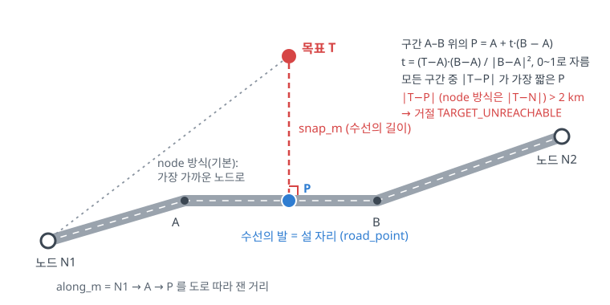
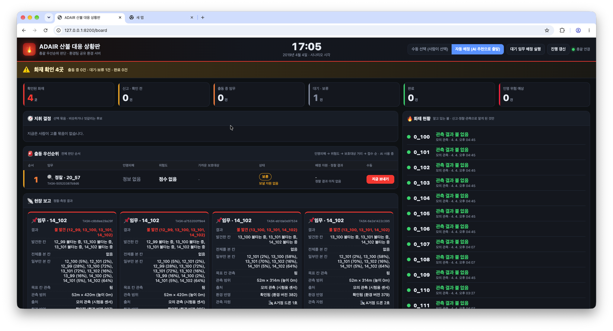
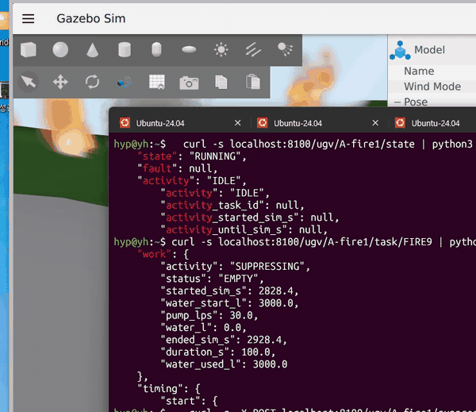
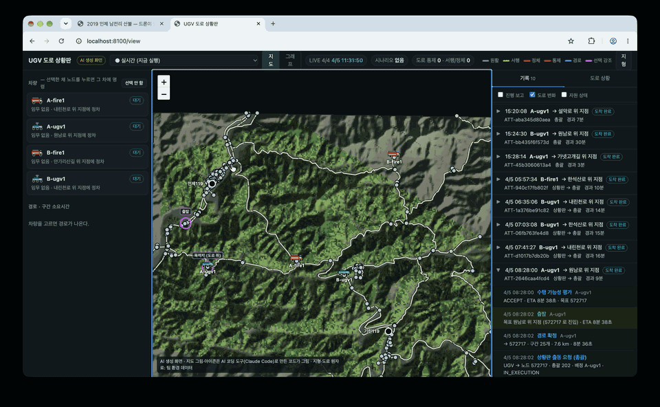

# UGV 파트 정리 — 발표용

> **한눈에 보기**
> - UGV는 총괄의 **수행 가능성 평가(evaluate)** 요청에 도로로 갈 수 있는지와 걸리는 시간(ETA)을 답하고, **실행(execute)** 요청을 받으면 도로를 따라 가서 도착 위치를 보고합니다.
> - 길은 **Dijkstra 알고리즘**으로, 거리가 아니라 **가장 빨리 가는 길**을 찾습니다.
> - 처음엔 **Gazebo(PX4)** 로 달렸지만 시연 배속 100을 따라가지 못해, 통합은 **sim(UGV 서버가 직접 위치 계산)** 으로 했습니다 ([0장 참조](#0-sim으로-결정한-이유)).
> - 팀 시연과 같은 조건(2019 인제 트윈, 배속 100)에서 **4대가 총괄 요청으로 26번 출동해 모두 도착**했습니다 (2026-10-11).
> - 갈 수 없는 목표(도로에서 2 km 넘게 먼 산속)를 주면 **`TARGET_UNREACHABLE`로 거절**하고 총괄은 보류합니다 — 통합 환경과 팀 main 총괄 모두에서 확인했습니다.
> - 발표에서는 도로 상황판의 **다시 보기**로 출동 → 경로 → 주행 → 도착 과정을 보여 줍니다.

| 항목 | 내용 |
|---|---|
| 담당 | UGV (지상 자원 — 무인 지상 차량·소방차) |
| 기준 코드 | 팀 저장소 `feat/ugv-road-view` (4대 구성 포함, 도로 판단 AI 제외) |
| 시험 기간 | 2026-10-10 ~ 10-11 (시험 목록 5장. 배속 측정은 0장). 로컬 = macOS, Gazebo = Windows WSL |
| 발표 범위 | UAV·UGV가 환경 모델의 화재를 관측하고, 총괄이 모아 인지 지도를 만드는 과정 (진화·살수 제외) |
| 자료 | 근거 [`docs/ugv/evidence/`](../ugv/evidence/) · 영상 [`docs/ugv/media/`](../ugv/media/) · 상세 [`ugv/UGV_README.md`](../../ugv/UGV_README.md) |

---

## 0. sim으로 결정한 이유

처음에는 PX4가 제공하는 차량 모델 r1_rover(최고 2 m/s, 시속 7 km)로 Gazebo에서 달렸습니다. 경로를 PX4 미션으로 보내 도로를 따라 도착했고 ETA도 맞았습니다(실제/예상 1.01~1.05). 실제 차처럼 보이려면 Gazebo를 빠르게 돌려야 해서, 화면(GUI)을 켜고 4배까지 시험한 뒤 화면을 끄고 배속을 따로 쟀습니다.

| 날짜 | 환경 | 요청 배속 | 실제 배속 |
|---|---|---|---|
| 10/3 | Windows WSL, 화면 끔, PX4 기본 빈 월드 | 10 | 3.5 ~ 4.2 |
| 10/3 | Windows WSL, 화면 끔, 도로를 배치한 월드 | 4 | 3.77 |
| 10/5·10/11 | Windows WSL, **화면 켬**, 도로를 배치한 월드 | 4 | **3.2** |
| 10/5–10/6 | Windows WSL, 화면 끔, 도로를 배치한 월드 | 10 | 중앙값 6.3 (순간 0.5–2까지 떨어짐) |
| 10/11 | 로컬, 화면 끔, 도로를 배치한 월드 (참고) | 10 | 9.99 (주행 성공) |
| 10/11 | 로컬, 화면 끔, 도로를 배치한 월드 (참고) | 30 | PX4 시동 점검 실패 |

팀 시연은 배속 100인데 어느 환경도 10을 넘지 못했습니다. 그래서 **통합은 sim**(UGV 서버가 도로 선형을 따라 시속 60 km로 위치를 계산)으로 하고, **Gazebo는 "실제 차량 모델로도 같은 경로·ETA로 달린다"는 단독 근거**로만 씁니다. Gazebo를 통합하려면 Gazebo를 따로 느리게 돌리는 게 아니라 차량 모델 속도를 올려 시연 배속에 맞춰야 합니다 (발표 이후 과제, [9장](#9-가정과-한계)).


---

## 1. 역할

```
총괄 ── 수행 가능성 평가 (evaluate) ──▶ UGV ── ACCEPT(ETA·경로) / REJECT(사유)
총괄 ── 실행 (execute) ─────────────▶ UGV ── 도로를 따라 주행 → 도착
총괄 ◀── 진행 조회 (task) ─────────── UGV
UGV  ── 시뮬레이션 시각 (/health) ──▶ 환경 모듈
```

| UGV가 맡는 것 | UGV가 맡지 않는 것 |
|---|---|
| 수행 가능성 평가: ACCEPT(ETA·경로) / REJECT(사유) | 어느 차를 어디로 보낼지 → **총괄** |
| 도로를 따라 주행, 위치·진행 보고 | 열화상 관측값 계산 → **총괄 모의 센서** |
| 도로 통제·혼잡 반영, 막히면 우회 | 화재 확산 → **환경 모듈** |
| 판단·주행·이상을 시각과 함께 기록 | |

UGV 서버 하나(포트 8100)가 차량 4대(인제119·기린119에 UGV 1대, 소방차 1대씩)를 맡습니다. 도로망은 강원 인제 실제 도로 자료(노드 664개, 도로 820개)입니다. 노드 = 교차로와 도로 끝점.


> **발표 표현:** "UGV가 열화상으로 불을 찾았다" ✗ → "UGV가 관측 위치까지 도로로 가서 위치를 보고했고, 총괄의 모의 센서가 그 위치에서 관측값을 만들었다" ✓

---

## 2. 구현한 것 / 안 한 것

**실행까지 확인한 기능**

| 기능 | 어디서 확인 |
|---|---|
| 상태 조회 (위치·상태·지금 도로·임무·시각) | sim, PX4 |
| 수행 가능성 평가 — ACCEPT(최단 시간 경로, ETA) / REJECT(사유) | 단독 재현 (5-3 ③), 거절은 통합 환경·팀 main 총괄에서도 (5-3 ⑦) |
| 도로를 따라 주행 → 도착 | sim 4대, PX4/Gazebo 1대 |
| 주행 중 앞길이 막히면 우회 | UGV 단독 재현 |
| 같은 요청이 두 번 와도 한 번만 출발 / 정지하면 임무 취소 | UGV 단독 재현 |
| 주행 이상 감지 (멈춤·경로 이탈·차량 이상) → 사용 불능(UNAVAILABLE) | PX4/Gazebo |
| 환경 모듈 시계 따라가기 ([4장 시각 기준](#4-입력과-출력-api)) | 통합 시연 환경 |
| 도로 상황판 (`/view`): 차량·경로·막힌 도로 표시, 실행 기록 다시 보기 (화면에 "AI 생성 화면" 상시 표시) | 모든 환경 |
| 도로 상황판에서 직접 지시 (차를 골라 노드·지점으로 출동, 운영자 예외) | 모든 환경 |
| **총괄과 연동, 4대 동시 운용** | **통합 시연 환경 (배속 100)** |

**미완성·미통합 기능 (기본 꺼짐)**

| 기능 | 켜는 법 | 구현 범위 | 미완성·미통합 사유 |
|---|---|---|---|
| 소방차 방수 | `UGV_SUPPRESSION=1` | **부분 구현** — 물탱크·펌프 상태 모델(Python)과 Gazebo 물줄기 표시(플러그인)까지. 기능 작동은 확인 | 환경 모듈과의 상호작용(불을 끄는 효과) 미구현. 발표 범위(진화 제외) 밖 |
| 짐 싣기·운반 | — | 적재 한도·싣는 곳 경유 코드만 | 총괄이 짐을 보내지 않음 |

도로 판단 AI(막힌 도로 앞에서 우회·대기 결정)는 이 PR에 없고 별도 PR(`feat/ugv-road-ai`)에서 다룹니다.

**하지 않은 것 (발표 이후 과제)**
- UGV 자체 센서 측정 (지금은 총괄 모의 센서가 대신함)
- 배터리로 판단·복귀 — 지금은 표시용이라 배터리가 0 %가 되어도 거절하거나 멈추지 않음
- Gazebo 차량을 시연 배속 100·시속 60 km로 (지금 차량 모델은 2 m/s)
- 사용 불능(UNAVAILABLE) 자동 해제 (지금은 수동으로 요청 — Swagger에서 `POST /ugv/{id}/stop`, 또는 도로 상황판에서 그 차에 직접 지시)

---

## 3. 어떻게 판단하나

### 3-1. 수행 가능성 평가(evaluate)의 순서

| 순서 | 확인 | 안 되면 |
|---|---|---|
| ① | 목표까지 거리 재기: 가장 가까운 도로 노드가 **2 km 안**인가 | 거절 `TARGET_UNREACHABLE` |
| ② | 차가 사용 불능(UNAVAILABLE)인가 | 거절 `FAILSAFE_ACTIVE` / `COMMUNICATION_FAILURE` |
| ③ | 다른 임무 중인가 | 거절 `BUSY` |
| ④ | 길이 있나 (Dijkstra) | 다 막힘 `ROAD_BLOCKED` / 안 이어짐 `TARGET_UNREACHABLE` |
| ⑤ | 모두 통과 | **수락** + ETA + 경로 |

평가만 하고 **차는 움직이지 않습니다.**

**①의 거리 재기는 수선의 발로 합니다.** 목표 T에서 도로 선형의 각 구간 A–B에 수선을 내려 발 P를 구하고, 가장 짧은 것을 고릅니다. 설 자리를 고르는 방식은 두 가지입니다.

- **road_point (기본, 10/11부터):** 수선의 발 **P(도로 중간)**에 섭니다. 노드 사이가 길 때 목표에 더 가까이 섭니다. |T−P|가 2 km를 넘으면 거절. 오케스트레이터 요청은 `target_mode`를 보내지 않으므로 기본값인 이 방식을 씁니다
- **node:** 목표에서 가장 가까운 **노드**에 섭니다. 노드까지 2 km가 넘으면 거절. 10/11 이전 기본값이라 **이 문서의 시험 ①~⑦은 모두 이 방식**이고, ⑧만 `road_point`입니다

**총괄의 UGV 열화상은 반경 600 m 상시 + 2 km 지형 시선이고(팀 main, 10/12), UGV 수락 거리 2 km와 같습니다.** UGV는 도로 위 점에 서서 목표에 더 가까이 갑니다 (기본값 `road_point`). 통합 시험 결과는 5-3 ⑧(선 자리↔목표 중앙값 505 m → 392 m, 불 탐지 54 % → 67 %)과 이 브랜치 코드로 다시 돌린 ⑨(301 m, 82 %)입니다.



```
P = A + t·(B − A),   t = (T − A)·(B − A) / |B − A|²   (0보다 작으면 0, 1보다 크면 1 → 구간 끝점)
snap_m  = |T − P|                         목표에서 설 자리까지 직선거리
along_m = 도로 시작 노드 → P 를 도로를 따라 잰 거리   (ugv/road_point.py)
```

### 3-2. 비용 = 지나가는 데 걸리는 시간

```
도로 하나의 비용(초) = 도로 길이 ÷ 속도 × 혼잡 배율
  속도 = min(도로 제한속도(최저 50 km/h), 차량 최고속도 60 km/h)
통제된 도로 = 비용 무한대  →  경로에서 저절로 빠짐
ETA = 경로에 있는 도로 비용의 합
```

같은 거리라도 느린 도로·혼잡한 도로는 비용이 큽니다. 그래서 **가까운 길이 아니라 빠른 길**을 찾습니다.

### 3-3. Dijkstra 알고리즘


- 선 위 숫자: 그 도로를 지나는 데 걸리는 시간(분)
- 점 아래 숫자: 출발점 A에서 그 점까지 지금까지 아는 가장 짧은 시간
- 색: 초록 = 확정 · 주황 = 지금 확정 · 파랑 = 후보 · 회색 = 아직 모름(∞)

**규칙은 하나입니다: 후보 중 가장 짧은 점을 확정하고, 그 이웃의 시간을 다시 계산한다.**

| 단계 | 확정 | A | B | C | D | E | F |
|---|---|---|---|---|---|---|---|
| 시작 | — | 0 | ∞ | ∞ | ∞ | ∞ | ∞ |
| 1 | A | **0** | 4 (A) | 2 (A) | ∞ | ∞ | ∞ |
| 2 | C | **0** | 3 (C) | **2** | 10 (C) | 12 (C) | ∞ |
| 3 | B | **0** | **3** | **2** | 8 (B) | 12 (C) | ∞ |
| 4 | D | **0** | **3** | **2** | **8** | 10 (D) | 14 (D) |
| 5 | E | **0** | **3** | **2** | **8** | **10** | 13 (E) |
| 6 | F | **0** | **3** | **2** | **8** | **10** | **13** |

숫자 = 지금까지 아는 가장 짧은 시간, 괄호 = 어디를 거쳐 왔나, 굵게 = 확정

- **결과:** A → C → B → D → E → F, 13분
- **눈여겨볼 곳:** B는 A에서 바로 가면 4분, C를 거치면 3분 → 가까워 보이는 길이 빠른 길은 아님
- **왜 가장 짧은 후보부터 확정해도 되나:** 다른 후보를 거쳐 오면 그 후보까지 이미 더 오래 걸렸고, 걸리는 시간은 음수가 될 수 없으니 더 짧아질 수 없습니다
- 실제 코드는 가장 짧은 후보를 빨리 꺼내려고 우선순위 큐(힙)를 씁니다 (`ugv/road_graph.py`)

### 3-4. 달리는 중에는

| 상황 | UGV가 하는 일 |
|---|---|
| 0.5초마다 | 남은 거리·시간·지금 도로를 기록 |
| 앞길에 통제가 생김 | 지금 위치에서 Dijkstra 다시 → **우회** |
| 다른 길이 없음 | 가까운 노드에 서고 임무 실패 (`ROAD_BLOCKED`), 차는 정상 |
| 60초 동안 10 m 못 감 / 경로에서 100 m 벗어남 / 차량 이상(시동 꺼짐·모드 이탈·위치 수신 끊김) | 임무 실패, 차는 사용 불능(UNAVAILABLE). 정지 명령으로 해제 |

## 4. 입력과 출력 (API)

전체 사양 `ugv/API_DEFINE.md`, 필드 설명 `ugv/UGV_README.md` 3장

| 요청 | 하는 일 |
|---|---|
| `GET /ugv` | 전체 차량 상태 |
| `POST /ugv/{id}/evaluate` | **수행 가능성 평가** — ACCEPT / REJECT (주행 안 함) |
| `POST /ugv/{id}/execute` | **실행** — 바로 `STARTED`, 주행은 뒤에서 |
| `GET /ugv/{id}/task/{task_id}` | 어디쯤인지, 도착 위치 |
| `POST /ugv/{id}/stop` | 정지 (임무 취소) |
| `GET /ugv/{id}/route` | 지금 경로와 남은 거리·시간 |
| `GET /health` | 서버 상태 |
| `POST /roads/{road_id}/block` | 도로 통제 (시험용) |
| `GET /view` | 도로 상황판 |
| `GET /history/runs/{run_id}` | 지난 실행 기록 |

**보내는 것** (evaluate, execute 같음)
```json
{"task_id": "T1", "decision_id": "D1",
 "target": {"lat": 38.02845, "lon": 128.1309}}
```

**받는 것** (실제 결과, 2026-10-11)
```json
{"verdict": "ACCEPT", "eta_sec": 344,
 "target_node": {"node_id": "494959", "snap_m": 40.7},
 "path": ["A", "495012", "…"]}
```
→ ACCEPT, 344초 걸림, 목표에서 40.7 m 떨어진 노드 494959에 섬. 이어서 실행하면 실제 348.9초에 도착 (5-3 ④, [영상 02](https://drive.google.com/file/d/1bw5k8rbyBo672su-RLFyA5ibGpZNnINr/view): Swagger 평가 → 실행 → 도착)


**도착하면** (총괄은 이 위치로 관측값을 만듦)
```json
"observation": {"observation_type": "ROAD_STATUS", "arrived_node": "494959",
  "position": {"lat": 38.028786, "lon": 128.130717}}
```

| 기준 | 값 |
|---|---|
| 좌표 | 위도·경도 (WGS84 — GPS가 쓰는 세계 공통 좌표계. 환경 모듈·드론과 같은 기준) |
| 시각 | 시뮬레이션 초. UGV는 1초마다 환경 모듈 `/health`의 시각을 읽어 자기 시계를 맞추고, 환경이 10초 넘게 응답하지 않으면 마지막 시각부터 혼자 흘림 (`UGV_TIME_SCALE` 배속). ETA·기록·도로 통제 시각이 모두 이 시계 기준 |
| 단위 | m, s, 속도는 설정에서 km/h |
| 임무 상태 | STARTED → IN_PROGRESS → COMPLETED / FAILED / CANCELLED |
| 차량 상태 | READY / RUNNING / UNAVAILABLE |

---

## 5. 테스트

### 5-1. 시험 환경

| 환경 | 구성 | 어디서 |
|---|---|---|
| **Gazebo** | PX4 SITL + Gazebo(r1_rover) + UGV 서버(`UGV_DRIVER=px4`). 시나리오 없이 도로 상황판에서 직접 지시 | Windows WSL |
| **통합 시연 환경** | 아래 표 (UGV 단독 호출·자동시험도 이 코드로) | 로컬 (macOS) |
| **팀 저장소 그대로** | 팀 main 총괄·환경 + 이 UGV 코드 (관측 계획 없음, 트윈 불이 첫 칸에서 꺼짐). 거절 확인용 (5-3 ⑦) | 로컬 |

**통합 시연 환경의 구성** — 팀 시연 조건을 두고 총괄만 바꿨습니다.

| 부분 | 쓴 것 | 팀 저장소 main과 비교 |
|---|---|---|
| 실행 방식 | `run_servers.py start --twin`(⑦은 `ugv/tools/run_twin_ugv.sh final`), 2019 인제 트윈, 배속 100, 도로 통제·혼잡 없음 | 같음 |
| 총괄 | [총괄 테스트 저장소](https://github.com/sujinpark50-gif/ADAIR) `feat/orchestrator-final` @ `221a497`(10/8): 관측 계획, 출동 전 확인(PROBE), UGV 열화상 시야 600 m~2 km(지형 시선), 불 따라가기 | main에는 관측 계획이 없음 (총괄 코드 약 4,800줄 차이) |
| 환경 모듈·웹 | 총괄 테스트 저장소 버전 (불이 번져 UGV를 계속 부름) + 팀 main의 웹 관제판(총괄이 아는 불만 표시) | main 트윈에서는 불이 금방 잦아들어 UGV를 거의 부르지 않음 |
| 수락 거리와 관측 범위 | UGV 수락 2 km = 총괄 시야 2 km | 같음 (10/12 main 반영) |
| UGV | ⑥~⑧은 도로 AI 브랜치(`feat/ugv-road-ai`) 코드를 AI 끄고, ⑨는 이 브랜치(`feat/ugv-road-view`) 코드 (둘 다 4대) | main에 머지 전 |
| 총괄 기본값 | UGV 열화상·지상 자동 정찰 켬 (10/9 팀 합의) | 같음 (`25a0183`) |
| 총괄 AI 모델 | **로컬에서만** `claude-sonnet-4`(copa). 관측 계획 10번 중 5번 AI(응답 20~42초), 5번은 AI 응답 형식 오류로 규칙 계획 대체 | `gpt-5.5` (팀 기본) |

### 5-2. 시연 시나리오와 시험용 변형

**팀 시연 시나리오 (2019 인제 트윈, `run_servers.py start --twin`)** — 2019-04-04 14:45 인제 남전리 산불을 환경 모델로 재현한 것입니다. 환경은 35분 단위(CA 한 단계)로 불을 번지게 하고, 신고 2분 뒤 총괄이 자동으로 초기 정찰을 보냅니다. 드론 2대(인제119)와 소방차가 총괄 요청으로 움직이고(UGV는 아래 `dispatch` 구성부터), 운용자 도구(사람 운용자 대신 총괄 `/tasks`에 요청을 넣는 스크립트 2개: `twin_operator.py`는 일몰 뒤 드론 순찰, `twin_ground_dispatch.py`는 불 확인 시 소방차의 마을회관 방어 출동)가 함께 뜹니다. 배속 100, 도로 통제·혼잡 없음.

**네 구성** — 같은 트윈을 네 가지로 켭니다. `ugv/tools/run_twin_ugv.sh <구성>` 한 줄이며, 모두 저장소에 남깁니다.

| 구성 | 무엇이 다른가 | 쓰인 곳 |
|---|---|---|
| `main` | 팀 main 총괄 동작 그대로: UGV 열화상·지상 자동 정찰 끔(`ORCH_UGV_THERMAL=0 ORCH_AUTO_RECON_GROUND=0`) → UGV는 출동하지 않고 드론 순찰·소방차 방어만 | 비교용 |
| `dispatch` | 신고 때 총괄이 UGV도 출동시킴 (10/9 팀 합의, `25a0183` 기본값) | 5-3 ⑥ 통합 시험 |
| `nodrone` | 드론 출동 불가: 드론 서버를 띄우지 않음 → 신고 때 총괄 자동 정찰이 드론에 닿지 못해(`LOCAL_UNREACHABLE`) 총괄이 스스로 UGV를 보냄. 운용자 요청 없음 | 시연 (총괄 자체 판단) |
| `final` | `dispatch` + 거절 요청 1건 자동(시뮬레이션 40분, `ugv/tools/twin_reject_request.py --auto`) | 5-3 ⑦, 시연 |
| `thermal` | 기존 마을회관 방어 출동을 UGV로(`TWIN_DISPATCH_ARGS="--types UGV --site NAMJEON1_HALL,INJE_REST_AREA"`, 남전1리 마을회관·인제휴게소) + UGV 전용 열화상 요청 자동(시뮬레이션 20분부터 30분마다 불타는 칸, 최대 6건, `ugv/tools/twin_thermal_request.py --auto`). 팀 main은 열화상 임무가 대부분 드론 전용이라 UGV 열화상 출동·2 km 지형 시선 관측을 보이려고 넣음 | 시연, [`2026-10-12_thermal`](../ugv/evidence/2026-10-12_thermal/) |

거절 요청을 원하는 때에 손으로 넣으려면 `dispatch`로 켠 뒤 `.venv/bin/python ugv/tools/twin_reject_request.py`를 실행합니다 (발표 중 순간을 고를 때).

| 시험 | 시나리오를 어떻게 바꿨나 |
|---|---|
| 일반 주행 (5-3 ⑥) | 위 `dispatch`. UGV만 4대로 늘리고, 총괄은 총괄 테스트 저장소 버전 (5-1) |
| 최종 통합 시나리오 (거절 포함, 5-3 ⑦) | 일반 주행과 같고, 운용자가 도로에서 2 km 넘게 먼 산속 칸을 총괄 `/tasks`로 한 건 요청해 `TARGET_UNREACHABLE` 거절을 받음 (위 `final`) |

### 5-3. 한 시험 전체

구성별로: ①–⑤는 UGV 단독(총괄 없음), ⑥은 총괄 배정만으로 돌린 통합 시험(`dispatch`, 거절 없음), ⑦은 거절 요청을 더한 최종 구성(`final`, 5-2·7-2), ⑧은 ⑦을 설 자리 `road_point`로 다시 돌린 것, ⑨는 같은 `final`을 이 브랜치 코드로 다시 돌린 것입니다. ⑥–⑧은 도로 AI 브랜치 코드를 AI 끄고 돌린 결과입니다. 다시 보기용 기록(`history_*.jsonl`)은 각 근거 폴더에 있습니다.

| # | 날짜 | 환경 | 시험 | 결과 | 근거 · 영상 |
|---|---|---|---|---|---|
| 1 | 10/11 | 로컬 | **UGV 자동시험** `tests/test_ugv_*.py` — UGV 모듈 함수를 직접 검사 (속도 계산, 도로 위 점, 환경 시계, 상황판) | **5개 통과** (이 브랜치, 10/11) | `2026-10-11_road_view/pytest_and_cases.txt` |
| 2 | 10/10 | 로컬 | **오케스트레이터 쪽 자동시험** (`orchestrator/tests/`) 중 UGV 관련 4개 파일 — 진짜 UGV 서버 대신 가짜 UGV 응답(`FakeUgv`)을 꽂고, 총괄이 UGV 열화상 임무를 주는지·연기로 드론이 못 볼 때 UGV를 보내는지·드론 사용 불능 시 UGV로 대체하는지 확인 | 9개 통과, 4개 건너뜀 — 건너뛴 4개(`test_live_ugv.py`)는 `ORCH_LIVE_UGV=1`로 실제 UGV 서버를 띄워야 도는 연동 시험 | `2026-10-10/pytest_ugv.txt` |
| 3 | 10/10 | 로컬 | 경우별 재현 18건 (수락·거절 3종·중복·우회·막힘 실패·정지), 배속 200 | **18건 모두 기대대로** (이 브랜치로 10/11 다시 돌려 같음) | `2026-10-10/ugv_cases_sim.json` |
| 4 | 10/11 | 로컬 | Swagger 수행 가능성 평가 → 실행 (UGV 서버만, 시나리오·AI 없음, 배속 5) | ETA 344초 → 실제 348.9초 (오차 1%) | `2026-10-11_swagger/history_swagger_*`, [영상 02](https://drive.google.com/file/d/1bw5k8rbyBo672su-RLFyA5ibGpZNnINr/view) |
| 5 | 10/11 | Gazebo (WSL, 화면 켬) | 1대 직접 지시 2회 + 3D 트윈 LIVE·QGroundControl | 모두 도착, 배속 3.26·3.23, ETA 대비 1.05, 경로 이탈 95%가 0.76 m 이하 | `2026-10-11_gazebo`, [영상 07](https://drive.google.com/file/d/1FDUeMzhDdScPLViCn4qkAXgzBJ7bsy9N/view) |
| 6 | 10/11 | 통합 시연 환경 (4대) | 총괄 요청 출동, AI 끔 | **출동 26회 모두 도착** (A-ugv1 13, B-ugv1 12, A-fire1 1) · 열화상 26회 중 14회 불 탐지 | `2026-10-11_twin4`, [영상 01](https://drive.google.com/file/d/1Ic2o8N6mWVAHP95pXV_fdyWmRf5ojPiC/view) |
| 7 | 10/11 | 통합 시연 환경 (4대) + 팀 main 총괄, 최종 통합 시나리오 (5-2 `final`) | 일반 주행 + 운용자 거절 요청 1건 (도로에서 2.2 km 먼 산속 칸 20_57) | A-ugv1·B-ugv1 모두 `TARGET_UNREACHABLE` (노드까지 2201 m > 허용 2000 m) → 총괄 보류 `NO_FEASIBLE_CANDIDATE` · 출동 없음. 팀 main 총괄에서도 같은 거절 (트윈 불이 일찍 꺼져 UGV 정찰 출동은 0회) | `2026-10-11_final`, [영상 09](https://drive.google.com/file/d/1gaAT6Zct-FrcqPuWq4ibnaslTJCdRTlK/view) |
| 8 | 10/11 | 통합 시연 환경 (4대), `final`, **설 자리 `road_point`** | ⑦과 같음, UGV 기본값만 도로 위 점 | 도착 19회·실패 0 · 열화상 18회 중 불 탐지 12회(67 %, ⑥은 54 %) · 목표가 지형에 가림 3회(17 %, ⑥은 23 %) · 선 자리↔목표 중앙값 392 m(⑥은 505 m) · 거절은 ⑦과 같음 | `2026-10-11_final` ③ |
| 9 | 10/11 | 통합 시연 환경 (4대), `final`, **이 브랜치 코드** (도로 AI 없음, `road_point`) | ⑦과 같음 | 도착 23회·실패 0 · 열화상 22회 중 불 탐지 18회(82 %) · 목표 가림 2회(9 %) · 선 자리↔목표 중앙값 301 m · 거절·보류 ⑦과 같음 | `2026-10-11_road_view` |

근거 폴더: [`2026-10-10`](../ugv/evidence/2026-10-10/) · [`2026-10-11_twin4`](../ugv/evidence/2026-10-11_twin4/) · [`2026-10-11_swagger`](../ugv/evidence/2026-10-11_swagger/) · [`2026-10-11_gazebo`](../ugv/evidence/2026-10-11_gazebo/) · [`2026-10-11_gazebo_speed`](../ugv/evidence/2026-10-11_gazebo_speed/) · [`2026-10-11_final`](../ugv/evidence/2026-10-11_final/) · [`2026-10-11_road_view`](../ugv/evidence/2026-10-11_road_view/)

### 5-4. 영상 ([구글 드라이브 폴더](https://drive.google.com/drive/folders/1mKf7SWaMMfgTkvHFlNM9OuFESxECjyqy), 가로 1280 px, 소리 없음. GIF는 저장소 `docs/ugv/media/`)

| 영상 | 어느 시험 | 내용 | 길이 | 편집 |
|---|---|---|---|---|
| [01 통합 일반주행 4대 3D트윈](https://drive.google.com/file/d/1Ic2o8N6mWVAHP95pXV_fdyWmRf5ojPiC/view) | 통합 시연 환경 4대, 일반 주행 (5-3 ⑥) | 총괄 요청 출동 → 도착 → 관측 | 2분 30초 | 다른 화면 10초 잘라냄, 2배속 재생 |
| [02 UGV단독 Swagger 평가·실행](https://drive.google.com/file/d/1bw5k8rbyBo672su-RLFyA5ibGpZNnINr/view) | 로컬 UGV 단독 호출 (5-3 ④) | Swagger 수행 가능성 평가 → 실행 → 도로 상황판 | 1분 22초 | 2배속 재생 |
| [07 Gazebo 1대 직접지시 3D트윈·QGC](https://drive.google.com/file/d/1FDUeMzhDdScPLViCn4qkAXgzBJ7bsy9N/view) | Gazebo 1대 (5-3 ⑤) | 도로 상황판 직접 지시, 3D 화면·QGroundControl 동시 표시. UGV 2 m/s, 시뮬레이션 4배속 | 59초 | 없음 |
| [08 Gazebo 소방차 방수표시](https://drive.google.com/file/d/1LxS15i7fFwyW3IC_bP5gZEL3C1U2dunj/view) | Gazebo 단독, 소방차 방수 표시 (시험 아님, 발표 자료용 7-3) | Swagger `/suppress`로 방수 시작 → Gazebo 물줄기. UGV 2 m/s | 33초 | 없음 |
| [09 최종통합 거절 도로상황판](https://drive.google.com/file/d/1gaAT6Zct-FrcqPuWq4ibnaslTJCdRTlK/view) | 최종 통합 시나리오, 팀 main 총괄 (5-3 ⑦) | 운용자 거절 요청 → A-ugv1·B-ugv1 REJECT TARGET_UNREACHABLE이 기록 탭에 반복해 쌓임 | 90초 | 없음 (GIF는 30~90초 3배속) |
| [10 도로상황판 총괄 UGV출동요청](https://drive.google.com/file/d/1SY68U-cmPt6lgy0qlqBAr5AMy7e0-hpU/view) | `thermal` 구성 (10/12) | 도로 상황판에서 인제119 A 지점에 UGV 출동 요청 → 총괄이 A-ugv1 배정 → 수행 가능성 평가 수락·경로 확정(11.3 km)·주행·도착 | 33초 | 편집 없음 |

---

## 6. 실행 방법과 다른 파트 연결

### 6-1. 실행

**자동시험 · 경우별 재현** — 코드를 고친 뒤 확인. 다른 서버 없이 UGV만으로 돕니다 (5-3 ①~③).

```bash
.venv/bin/python -m pytest tests/test_ugv_*.py -q                                   # 자동시험 5개
.venv/bin/python docs/ugv/evidence/2026-10-10/ugv_cases.py /tmp/ugv_cases.json      # 7-2 거절·실패 동작 18건 재현
```

**로컬 — 한 기계에서 전부**

```bash
# [A] 최종 통합 시나리오 (5-2 final) — 팀 시연 시나리오 그대로(도로 시나리오 없음, AI 없음) + 시뮬레이션 40분에 거절 요청 1건 자동
bash ugv/tools/run_twin_ugv.sh final                   # main / dispatch 로 바꾸면 다른 구성 (5-2)
.venv/bin/python run_servers.py stop
#     거절 요청을 손으로: bash ugv/tools/run_twin_ugv.sh dispatch 로 켠 뒤 .venv/bin/python ugv/tools/twin_reject_request.py

# [B] UGV 서버만 (5-3 ④, Swagger·도로 상황판 확인용) — 도로 시나리오 변수를 주지 않으면 모든 도로가 뚫림
UGV_DRIVER=sim .venv/bin/python -m uvicorn ugv.server:app --port 8100

# [C] Gazebo 1대 (5-3 ⑤) — A-ugv1만 PX4, 나머지 sim. 총괄·트윈 없이 UGV 서버만 뜨고 도로 상황판에서 직접 지시
SPEED=4 ./ugv/tools/px4-start.sh A-ugv1                                              # WSL, PX4 빌드 필요
UGV_DRIVER=px4 UGV_PX4_RESOURCES=A-ugv1 UGV_TIME_SCALE=4 .venv/bin/python -m uvicorn ugv.server:app --port 8100
```

**원격 — UGV 서버를 다른 기계에서.** 총괄 쪽은 `config.py`의 `UGV_SERVER_URL`을 UGV 기계 주소로 바꿉니다. 명령은 로컬과 같고 주소 변수와 `--host 0.0.0.0`만 더합니다.

```bash
# [A'] 최종 통합 시나리오 — 총괄·환경은 상대 기계. 거절 요청은 아무 기계에서나 --env/--orch 를 주어 실행
#      .venv/bin/python ugv/tools/twin_reject_request.py --auto --env http://<환경>:8300 --orch http://<총괄>:8200
UGV_DRIVER=sim UGV_ENV_URL=http://<환경>:8300 UGV_ORCH_URL=http://<총괄>:8200 \
  .venv/bin/python -m uvicorn ugv.server:app --host 0.0.0.0 --port 8100

# [C'] Gazebo 1대 — PX4 기계에서 UGV_HOST 로 UGV 서버 주소를 알려 줌
UGV_HOST=<UGV 기계> SPEED=4 ./ugv/tools/px4-start.sh A-ugv1
UGV_DRIVER=px4 UGV_PX4_RESOURCES=A-ugv1 UGV_TIME_SCALE=4 UGV_ENV_URL=http://<환경>:8300 UGV_ORCH_URL=http://<총괄>:8200 \
  .venv/bin/python -m uvicorn ugv.server:app --host 0.0.0.0 --port 8100

```

- 도로 시나리오(`UGV_SCENARIO`)는 UGV 서버만 읽습니다. 총괄·환경은 바꿀 것 없음
- Gazebo는 PX4 `SPEED` = `UGV_TIME_SCALE`로 맞춥니다. UGV 시계가 Gazebo 시간을 따르므로 배속 100 트윈과는 같이 돌리지 않습니다 ([0장 참조](#0-sim으로-결정한-이유))
- 주소: 3D 트윈 `http://<웹>:8080/inje3d`, 도로 상황판 `http://<UGV>:8100/view`, Swagger `http://<UGV>:8100/docs`

### 6-2. 누구와 무엇을 주고받나

| 상대 | 무엇을 |
|---|---|
| 총괄 → UGV | 상태 조회, 평가, 주행 시작, 진행 조회 |
| UGV → 환경 모듈 | 지금 시각 (`/health`) |
| 웹 관제판 → UGV | 차량 위치·상태 표시 |
| UGV → 총괄 | 도로 상황판에서 출동 요청할 때만 |

**총괄이 UGV를 쓰는 흐름** (통합 시연 환경의 총괄 기준)

1. 출동 전 확인: 쉬고 있는 UGV마다 구역별로 수행 가능성 평가(PROBE)를 요청 → REJECT면 그 구역에서 뺌
2. 고른 차에 다시 수행 가능성 평가 → 실행
3. 진행 조회로 도착 확인
4. 도착 위치에서 모의 열화상 관측 (지형 시선 계산)

명령은 **총괄만** 내립니다. 도로 상황판의 직접 지시는 운영자 예외이고, 이때 총괄 임무는 실패(`OPERATOR_OVERRIDE`)로 닫혀 다른 차에 다시 맡겨집니다.

---

## 7. 발표에서 보여줄 동작

### 7-1. 통합 시험 그대로 돌리고, 다시 보기로 과정을 보여 준다

시연은 **최종 통합 시나리오**([5-2](#5-2-시연-시나리오와-시험용-변형) `final`)로 돌립니다 — 5-3 ⑥의 일반 주행에 거절 요청 한 건을 더한 것입니다.

```bash
bash ugv/tools/run_twin_ugv.sh final                  # 3D 트윈 http://127.0.0.1:8080/inje3d · 도로 상황판 http://127.0.0.1:8100/view, 시뮬레이션 40분에 거절 1건 (7-2)
.venv/bin/python run_servers.py stop
```

**시험에서 실제로 돌아간 과정** — 총괄 요청 → 수행 가능성 평가 → 출발 → 주행·진행 보고 → 도착 → 총괄이 그 위치에서 관측


| 장면 | 영상 |
|---|---|
| 총괄 요청으로 4대 출동 → 도착 → 관측 | [영상 01](https://drive.google.com/file/d/1Ic2o8N6mWVAHP95pXV_fdyWmRf5ojPiC/view) |

배속 100에서는 출동 한 번이 몇 초라 실시간으로는 과정이 안 보입니다. 그래서 UGV 서버가 남긴 실행 기록을 도로 상황판에서 **천천히 다시 재생**해 출동 → 경로 → 주행 → 도착을 보여 줍니다.

**다시 보기 사용법** (도로 상황판 `/view`)


1. 화면 위 실행 선택 칸에서 "과거 10/11 …" 실행을 고릅니다 (기본은 "실시간")
2. 화면 아래 ▶ 재생, 배속(60×)을 고르고 막대를 끌어 시각을 옮깁니다
3. 왼쪽 차량을 누르면 그 차의 경로와 구간별 소요시간, 오른쪽 기록 탭에서 평가 → 출발 → 진행 → 도착 사건이 보입니다

**어느 기록을 볼 수 있나 — 경우별**

| 상황 | 되나 | 방법 |
|---|---|---|
| 진행 중인 실행을 실시간으로 | 됨 | 선택 칸 "● 실시간" (기본) |
| 진행 중인 실행을 처음부터 다시 | **안 됨** — 목록에는 지난 실행만 뜨고 지금 실행은 빠짐 | 실행을 끝내고(아래) 다시 보기 |
| 끝낸 실행을 다시 보기 (시연에서 쓰는 방식) | 됨 | `run_servers.py stop` 뒤 UGV 서버만 띄우면 방금 실행이 "과거 …"로 목록에 뜸 (기록은 `ugv/.state/history`, 최근 30개) |
| 저장소 근거 폴더의 기록을 다른 날·다른 기계에서 | 됨 | 기록 폴더를 지정해 UGV 서버만 띄움 (아래) |

```bash
# 끝낸 실행 다시 보기 — 전체 시연을 끝낸 뒤 UGV 서버만
.venv/bin/python run_servers.py stop
UGV_DRIVER=sim .venv/bin/python -m uvicorn ugv.server:app --port 8100
# → http://127.0.0.1:8100/view 선택 칸에서 "과거 …" 고르기

# 저장소 근거 폴더의 기록 — 서버가 떠 있지 않은 상태에서 (8100 포트에 서버가 있으면 실패)
mkdir -p /tmp/ugv_replay
cp docs/ugv/evidence/2026-10-11_twin4/history_twin4_20261011T025527.jsonl /tmp/ugv_replay/20261011T025527.jsonl
UGV_HISTORY_DIR=/tmp/ugv_replay UGV_DRIVER=sim .venv/bin/python -m uvicorn ugv.server:app --port 8100
```
- 실행 기록 폴더(`UGV_HISTORY_DIR`)를 따로 두는 이유: 서버를 띄울 때마다 새 기록이 생기고 최근 30개만 남겨서, 저장소 기본 폴더에 섞으면 오래된 기록이 지워집니다

| 순서 | 보여 줄 것 | 화면 |
|---|---|---|
| 1 | 총괄 요청이 들어와 평가·출발 (기록 탭의 "수행 가능성 평가 → 출발 → 경로 확정") | 기록 탭 |
| 2 | 선택한 차의 경로와 구간별 소요시간 (Dijkstra 결과) | 왼쪽 표 |
| 3 | 도로를 따라 주행, 진행 보고 | 지도 + 기록 |
| 4 | 도착 → 총괄이 그 위치에서 관측 | 3D 트윈 |

### 7-2. 거절·실패 동작

거절·실패 동작은 UGV 단독 재현(5-3 ③, 18건)으로 시험했습니다. 통합 시험(5-3 ⑥)은 총괄 배정만으로 돌려 거절이 나오지 않았고(불이 모두 도로 2 km 안), 마지막 통합 시험만 운용자 도구 `ugv/tools/twin_reject_request.py`로 도로에서 2 km 넘게 먼 산속 칸을 요청해 거절 1건(`TARGET_UNREACHABLE`)을 포함시킨 최종 구성으로 돌렸습니다. 불·도로 시나리오는 그대로이고 총괄 `/tasks` 요청 한 건만 더한 것입니다.

결과 (5-3 ⑦, [`2026-10-11_final`](../ugv/evidence/2026-10-11_final/)):

```
총괄  TASK_RECEIVED   OPERATOR-REJECT:20_57   (시뮬레이션 3060초)
UGV   B-ugv1 REJECT TARGET_UNREACHABLE — 가장 가까운 도로 노드가 2201 m 떨어짐 (허용 2000 m)
UGV   A-ugv1 REJECT TARGET_UNREACHABLE — 같은 사유
총괄  TASK_HOLD NO_FEASIBLE_CANDIDATE   (소방차 2대는 요청 종류가 UGV라 TYPE_NOT_ALLOWED)
```




영상: [영상 09](https://drive.google.com/file/d/1gaAT6Zct-FrcqPuWq4ibnaslTJCdRTlK/view) (도로 상황판 기록 탭, 1분 30초. GIF는 30~90초 구간을 3배속)

- 같은 시험을 팀 main 총괄(관측 계획 없음)에서도 돌려 같은 거절·보류가 나왔습니다. 팀 main 총괄은 거절 사유를 가리지 않고 다음 후보로 넘어가고, 후보가 없으면 보류합니다. 이 실행은 트윈 불이 일찍 꺼져 UGV 정찰 출동은 없었습니다.
- 총괄은 보류한 요청을 환경 이벤트가 들어올 때마다 다시 평가합니다 (실제 138초 동안 27회, UGV는 매번 같은 거절). 출동은 일어나지 않아 동작에는 문제가 없고, 원인과 해결 방안은 [8-2](#8-2-겪은-문제)에 있습니다.
- 도로 상황판 기록 탭에는 "수행 가능성 평가 · REJECT · TARGET_UNREACHABLE"이 차례로 쌓입니다. 다시 보기 기록: `history_final_20261011T124401.jsonl`, `history_final_main_20261011T125624.jsonl`.

### 7-3. 미완성·미통합 기능의 발표 자료용 영상 (시연 동작 아님)

아래는 통합 시연에 들어가지 않는 **미완성·미통합 기능**입니다 ([2장](#2-구현한-것--안-한-것)). 일부는 동작까지 만들어져 있어, 발표 임팩트용으로 영상이나 다시 보기를 곁들일 수 있습니다.

| 내용 | 파일 | 비고 |
|---|---|---|
| Gazebo 1대 직접 지시, 3D 화면·QGroundControl 동시 표시 | [영상 07](https://drive.google.com/file/d/1FDUeMzhDdScPLViCn4qkAXgzBJ7bsy9N/view), GIF 0장 | 실제 차량 모델 주행 (UGV 2 m/s, 시뮬레이션 4배속) |
| 소방차 방수: Gazebo에서 소방차가 물줄기를 뿜음 (`/suppress` 호출) | [영상 08](https://drive.google.com/file/d/1LxS15i7fFwyW3IC_bP5gZEL3C1U2dunj/view), GIF 아래 | 부분 구현·미통합 (2장). 화면 표시만, 환경의 불은 꺼지지 않음 |




---

## 8. 통합

### 8-1. 팀 main과 다르게 한 것 (합의, PR에 포함)

| 항목 | 팀 main | 이 문서 기준 | 근거 |
|---|---|---|---|
| 도로 통제·혼잡 시나리오 | 기본 켬 (`inje_girin.csv`) | 기본 끔 — 모든 도로 뚫림 | 10/7 결정, `580c036` |
| UGV 모의 열화상·지상 자동 정찰 | 기본 켬 (반영됨) | 기본 켬 | 10/9 팀 합의, `25a0183` |
| sim 주행 속도 | 2 m/s (Gazebo 차량 기준) | 60 km/h, 도로 최저 50 km/h | 10/7 결정, `936dff1` |
| 차량 수 | 3대 | 4대 (B-fire1 추가) | 10/10 결정, `8164d1c` |

### 8-2. 겪은 문제

| 문제 | 왜 | 지금 |
|---|---|---|
| 총괄이 시작 직후 첫 정찰을 받고 배정을 안 함 (가끔) | 원인 미확정 | 접수 뒤 일정 시간 배정이 없으면 총괄이 배정을 다시 시도 |
| 총괄이 UGV 명령을 스스로 취소하고 같은 명령을 반복 (`SNAPSHOT_CHANGED`) | 판단할 때와 보낼 때 상태가 달라짐 | 같은 이유로 반복 실패한 자원은 그 임무에 배정하지 않음 |
| 총괄이 거절된 요청을 환경 이벤트마다 다시 평가 (5-3 ⑦, 138초에 27회) | 보류 재개 조건 `NEW_RESOURCE_OR_INPUT`이 거절 사유를 구분하지 않음 — "지금 바쁨"과 "물리적으로 못 감"을 같게 다룸 (팀 main `orchestrator/api.py` 같은 코드) | 후보 전원이 물리적 사유(`TARGET_UNREACHABLE`·`ROAD_BLOCKED`)로 거절한 보류는 재개 조건을 운용자 확인으로 두어 자동 재평가에서 뺌. 총괄 테스트 저장소의 `PHYSICAL_REJECTS` 구분을 보류 재시도에도 씀 |


---

## 9. 가정과 한계

| 항목 | 가정·한계 |
|---|---|
| 관측 | UGV 센서 없음. 총괄 모의 센서가 도착 위치로 만듦 |
| 속도 | sim 시속 60 km (도로 최저 50 km/h) |
| 도로 상황 | 기본 시연에서는 통제·혼잡을 꺼서 모든 도로가 뚫려 있음 |
| 배터리 | 표시용 (sim 1 km당 1 % 감소). 0 %가 되어도 거절·정지하지 않음 |
| 이상 판정 | 60초 동안 10 m 미만 = 멈춤, 100 m 초과 = 경로 이탈 |
| Gazebo | 차량 모델 r1_rover 최고 2 m/s(약 7 km/h). 시연 배속에 맞추려면 시속 60 km 모델이 필요함 |
| 통합 시험 | 총괄 테스트 저장소 버전의 총괄과 함께 돌린 결과 (5-1). 거절은 팀 main 총괄에서도 확인 (5-3 ⑦) |

**발표 이후 과제:** 배터리로 왕복 가능 여부 판단 · 환경 모듈과 연동한 소화(방수) 기능 구현 · Gazebo 차량 모델을 시속 60 km로 바꿔 시연 배속에 통합

---

## 10. 발표 범위

관측 영역은 팀 main에 잘못 올라가 있던 UGV 열화상 관측 범위(차 주변 450 m 정사각형, 지형 무시)를 반경 600 m 상시 + 2 km 지형 시선으로 고쳤습니다 (`ASSUMED_GROUND_LOS_V1`, UGV 수락 거리 2 km와 같음). 화면에서 눈에 띄는 부분은 아니고, 드론과 겹치는 부분도 있으며 Gazebo 시연도 따로 있으므로, 발표 시간 관계상 UGV는 다음 두 가지면 충분하다고 봅니다.

1. **알고리즘** — 수행 가능성 평가와 Dijkstra 경로 ([3장](#3-어떻게-판단하나))
2. **시연·영상 한 편** — 도로 상황판에서 특정 지점으로 출동을 요청하면 오케스트레이터가 알맞은 UGV를 골라 보내는 장면



영상: [영상 10](https://drive.google.com/file/d/1SY68U-cmPt6lgy0qlqBAr5AMy7e0-hpU/view) · 실행 결과 근거: [`2026-10-12_thermal`](../ugv/evidence/2026-10-12_thermal/)

직접 시연할 때는 아래를 돌리면 될 것 같습니다.

```bash
bash ugv/tools/run_twin_ugv.sh thermal
```
- 불이 확인되면 남전1리 마을회관·인제휴게소 방어 출동이 UGV로 나가고, 시뮬레이션 20분부터 불 칸으로 UGV 열화상 정찰이 나갑니다. 어느 UGV를 보낼지·갈 수 있는지·관측 판정은 오케스트레이터와 UGV가 정합니다.
- 도로 상황판(`http://127.0.0.1:8100/view`)에서 지점을 눌러 "UGV 출동 요청"을 보내도 오케스트레이터가 차를 골라 보냅니다 (위 영상).
- 끄기: `python run_servers.py stop`
