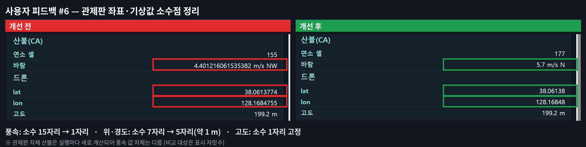

# ADAIR 사용자 테스트 및 피드백

## 1. 개요

- 프로젝트명: ADAIR
- 테스트 참여자: 서로 다른 사용자 10명
- 수집 방식: 팀원 5명이 각자 서로 다른 사용자 2명에게 피드백 수집
- 수집일: **[2026/10/6]**
- 테스트 방식: **[현장 시연]**
- 개인정보: 본 문서에는 참여자의 이름·연락처 등 식별정보를 기록하지 않음

> 본 문서는 실제 사용자 피드백 원문과, 해당 의견에서 도출한 개선 과제를 구분하여 기록한다.
> 사용자 의견은 제품 성능이나 사업성을 입증하는 자료가 아니라 사용성 개선을 위한 정성적 평가 자료로 사용한다.

---

## 2. 사용자 피드백 원문

### 사용자 01

> 설명을 들었지만 관제판만 보고 알기 어려움. 아이디어는 좋지만 관제판이 제대로 표현하고 있는지 일반인 입장이라 그런지 어렵다고 느낌.

**핵심 의견**
- 관제판만으로 현재 상황을 이해하기 어려움
- 일반 사용자를 위한 정보 구조 개선 필요

---

### 사용자 02

> 시작을 누르자마자 드론이 화재현장에 나타나서 이상하다고 느낌. 관제판에 나온 지도가 실제를 구현했다는 것이 매우 신기했음. 지금은 한 달 프로젝트라고 들어서 그런지 부족한 점이 보였지만 나중에 더 빌드업되면 좋은 사업 아이템이 될 것으로 보임.

**핵심 의견**
- UAV 출동 과정이 자연스럽게 보이지 않음
- 실제 지형 기반 지도 표현은 긍정적
- 향후 확장 가능성에 대한 의견

---

### 사용자 03

> 드론이 화면에서 자꾸 이리저리 돌아다니는데, 불필요하게 너무 많이 움직이는 것처럼 보이는 것 같음. 지금 드론이 '화재'에만 포커싱을 하고 있는데, 솔직히 '화재'를 탐지하는 데에만 저 정도의 솔루션을 도입하는 것이 비용 대비 이득이 의구심이 들긴 함. 차라리 실종자를 파악하는 등 화재 말고도 다른 정보들을 획득하는 데에 드론이 활용될 수 있으면 더 좋을 것 같다는 생각이 듬.

**핵심 의견**
- UAV 이동 목적이 화면에서 충분히 설명되지 않음
- 경로 효율성 검토 필요
- 실종자 탐색 등 활용 범위 확대 제안

---

### 사용자 04

> 무엇을 하려고 하는지 직관적으로 알 수 없어서, UI에서 사용자에게 주고 싶은 정보가 뭔지 개선을 했으면 좋겠음. 즉, 사용자가 이 화면을 보고 얻어야 하는 결론이 명확하지 않음. 사용자가 직접 여러 요소를 조합해서 추론해야 함. A/B/B 등 개발자 중심 표현이 너무 많아, 일반인에게도 친숙한 표현/어휘들로 해석을 하면 좋겠음. 3D가 화면의 거의 대부분을 차지하고 있지만 실제로 유의미하게 얻을 수 있는 정보는 적은 것 같음.

**핵심 의견**
- 화면에서 전달해야 할 결론이 명확하지 않음
- 개발자 중심 용어를 일반 사용자용 표현으로 개선 필요
- 3D 화면의 정보 밀도 개선 필요

---

### 사용자 05

> 지형 등이 현실적이고 데이터적으로 정교하면 의미가 있을 것 같다. 실제 영상과 결합하고 드론을 움직일 수 있으면 사업도 가능할 것 같다. 개체가 좀 더 많이 구현될 수 있었으면 좋겠다. 물리적인 효과가 더 많았으면 좋겠다.

**핵심 의견**
- 지형·데이터 정교화에 대한 긍정적 기대
- 실제 영상 연계 제안
- 객체 수와 물리 효과 확대 제안

---

### 사용자 06

> 시뮬레이션의 내용 교체를 즉각적으로 할 수 있고 헬기나 드론의 실사화를 좀 더 했으면 좋겠다.

**핵심 의견**
- 시나리오를 유연하게 변경할 수 있으면 좋겠음
- 헬기·드론 등 자원 표현의 현실성 향상 필요

---

### 사용자 07

> 드론과 지상자원의 출동 상태 및 도착 예정 시간을 한 화면에서 볼 수 있어 편리했음. col, row 값으로 출동 위치를 지정하는 방식보다, 가능하다면 마우스로 지도에서 직접 위치를 선택하고 해당 위치의 col, row 값이 마우스 커서 위치에 표시되면 더 편리할 것 같음. 바람과 lat, lon 값의 소수점 이하 자릿수를 제한하면 더 보기 좋을 것 같음.

**핵심 의견**
- 출동 상태와 ETA 통합 표시는 긍정적
- 지도 클릭 기반 위치 선택 제안
- 좌표·기상정보 표시 형식 개선 필요

---

### 사용자 08

> 산불 발생 위치와 확산되는 모습을 지도에서 바로 확인할 수 있어서 좋았음. 바람 정보가 표시되어 있지만, 풍향을 지도 위에 화살표 등으로 시각화하면 산불 확산 방향을 이해하기 더 쉬울 것 같음. 전체적으로 산불 상황과 대응 자원의 상태를 한 화면에서 확인할 수 있어 관제 화면으로 사용하기 편리했음.

**핵심 의견**
- 화재 확산 및 자원 상태 통합 표시는 긍정적
- 풍향을 지도 위에 시각화할 필요

---

### 사용자 09

> 화재 수와 출동 현황이 상단에 바로 보여 상황 파악이 빨랐음. 다만 위치가 13_101 같은 칸 번호로만 나와 무전·보고에 쓰기 어려웠음. '남전1리 마을회관'처럼 지명으로 보이면 좋겠음.

**핵심 의견**
- 핵심 현황 표시의 가독성은 긍정적
- 격자 번호와 실제 지명 병기 필요

---

### 사용자 10

> 신고부터 출동, 도착까지 시간순으로 볼 수 있는 상황 일지나 타임라인이 있으면 보고서 쓸 때 편할 것 같음.

**핵심 의견**
- 신고·출동·도착·복귀 과정을 시간순으로 기록하는 기능 필요
- 상황 보고 및 사후 기록 지원 필요

---

## 3. 종합 분석

사용자 10명의 의견은 크게 다음 다섯 영역으로 정리된다.

| 영역 | 주요 의견 | 개선 방향 |
|---|---|---|
| 정보 전달 | 현재 상황과 시스템 목적을 한눈에 이해하기 어려움 | 상황·임무·판단 결과 요약 |
| 위치·조작 | `col/row`와 격자 번호가 일반 사용자에게 직관적이지 않음 | 지명 병기, 지도 클릭 위치 선택 |
| 시각화 | 풍향, UAV 이동 목적, 3D 정보 밀도가 부족함 | 풍향 화살표, 이동 목적 표시, 화면 재배치 |
| 기록 | 신고부터 출동·도착까지 시간 흐름을 보기 어려움 | 상황 일지·타임라인 |
| 현실성·확장 | 실제 영상, 더 많은 객체, 물리 효과, 다른 임무 활용 요구 | 시뮬레이션 고도화 및 후속 시나리오 검토 |

### 긍정적으로 평가된 요소

- 실제 지형을 기반으로 한 지도와 산불 확산 표현
- 화재 현황과 UAV·UGV 대응 상태를 한 화면에서 확인하는 구조
- 자원 출동 상태와 ETA 표시
- 관제 화면을 통한 전체 상황 파악

### 반복적으로 나타난 개선 요구

1. 현재 상황과 임무 목적을 더 직관적으로 설명
2. 개발자 중심의 좌표·용어를 사용자 친화적으로 변환
3. 지도 기반 직접 조작 기능 제공
4. 풍향과 이동 목적을 시각적으로 표현
5. 상황 변화와 자원 대응을 시간순으로 기록

---

## 4. 개선 우선순위

| 우선순위 | 개선 과제 | 상태 |
|---:|---|---|
| 1 | 현재 상황·임무 목적·주요 판단 결과 요약 | 계획 |
| 2 | 격자 좌표와 실제 지명 병기 | 계획 |
| 3 | 신고·출동·도착·복귀 타임라인 | 계획 |
| 4 | 지도 클릭 기반 위치 선택 | 계획 |
| 5 | 풍향 화살표 시각화 | 계획 |
| 6 | 좌표·기상값 소수점 표시 정리 | 완료 (관제판 풍속 소수 1자리, 위·경도 소수 5자리) |
| 7 | UAV 이동 목적 표시 및 경로 효율성 검토 | 계획 |
| 8 | 실제 영상·객체·물리 효과 확대 | 후속 과제 |
| 9 | 실종자 탐색 등 추가 재난 대응 시나리오 | 후속 과제 |

> 실제 구현이 완료된 항목은 구현 후 상태를 `완료`로 변경하고, 관련 커밋 또는 화면 캡처를 함께 기록한다.

### 개선 반영: 좌표·기상값 소수점 표시 정리 (사용자 07)

관제판(8080) 오른쪽 패널의 풍속을 소수 1자리, 드론 위·경도를 소수 5자리(약 1 m), 고도를 소수 1자리로 표시하도록 바꿨다.

---

## 5. 제출용 요약

ADAIR는 팀원 5명이 각각 서로 다른 사용자 2명에게 테스트 및 피드백을 수집하여 **총 10명의 사용자로부터 10건의 의견**을 확보하였다.

사용자들은 실제 지형 기반 산불 확산 표현과 UAV·UGV 출동 상태를 한 화면에서 확인할 수 있다는 점을 긍정적으로 평가하였다. 반면 관제 화면의 정보 전달 방식, 개발자 중심 용어, 격자 좌표 표현, 풍향 시각화 및 상황 타임라인에 대한 개선 요구가 반복적으로 나타났다.

수집된 의견을 바탕으로 관제판의 정보 전달력과 조작성을 우선 개선 대상으로 선정하였다. 실제 개선 완료 여부와 재검증 결과는 구현 후 별도로 기록한다.

---

## 6. 증빙 관리

- 피드백 참여자: 총 10명, 서로 다른 사용자
- 참여자 식별정보: 기록하지 않음
- 원문 보관: 본 문서
- 수집일: 2026/10/06
- 테스트 방식: 대면시 직접시연
- 개선 반영 커밋: 4849ce3
- 개선 전·후 화면: /intergration/media/fb-6_compare.png
- 개선 반영 커밋: `web/app.py` 좌표·기상값 소수점 표시 정리
- 개선 전·후 화면: `docs/intergration/media/fb-6_compare.png`
