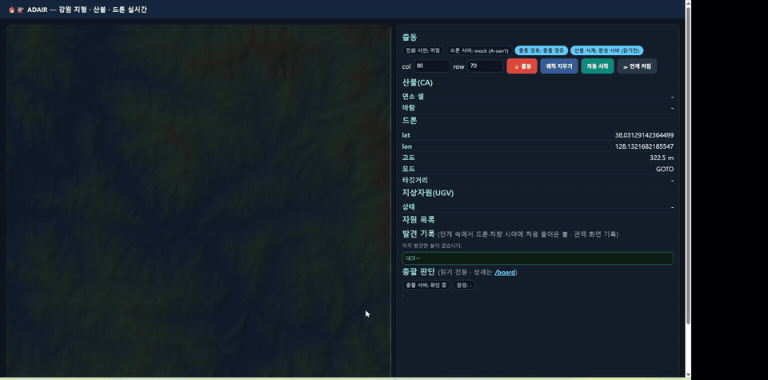
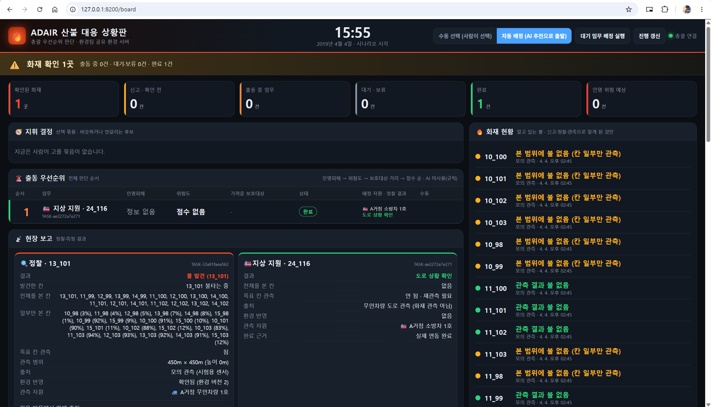
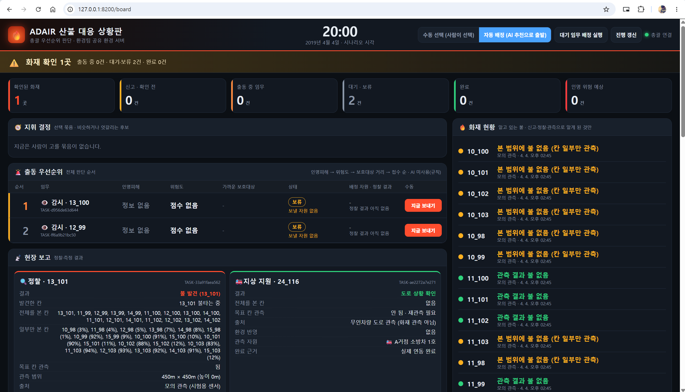

# 통합·관제·로그 파트 정리 — 발표용

> **한눈에 보기 (발표자용)**
> - 이 파트는 **"각자 만든 서버를 하나로 묶어 같이 돌아가게 하고, 그 결과를 화면과 기록으로 보여 주는 일"**을 맡았습니다. 판단(총괄)·화재(환경)·주행(UAV·UGV)은 하지 않습니다.
> - 명령 한 줄(`python run_servers.py start --twin`)로 **2019 인제 트윈 전체 9개 서버**가 같은 시계로 켜집니다.
> - 관제판(8080)의 **미관측 지역 표시**는 발표 핵심인 **"총괄의 인지 지도가 관측으로 채워지는 과정"**을 눈으로 보여 줍니다. 드론·차량이 본 곳만 밝아지고, 총괄이 아는 불은 ⚠ 신고 / 🔥 확인으로 표시됩니다.
> - 팀원 PR은 통합 브랜치 `fix/integration-restore`에서 시험한 뒤 main에 올렸고, 마지막 통합(PR #42, 10/12)에서 **총괄 시험 341개 통과, 트윈에서 드론 정찰 → 불 확인 → 지상 자원 출동까지 정상**을 확인했습니다.
> - 진화(불 끄기)는 발표 범위에서 빠졌고, 관제판의 진화 시연 스위치도 **기본 꺼짐**입니다.

| 항목 | 내용 |
|---|---|
| 담당 | 이원규 — 시스템 통합 · 관제(웹 화면) · 로그 |
| 기준 코드 | 팀 저장소 `main` (`ca19f2c`, PR #42 병합 시점, 2026-10-12) |
| 시험 환경 | Windows 11 · Python 3.11 · 모든 서버 로컬 실행 · UAV mock 2대 · UGV sim |
| 발표 범위 | UAV·UGV가 환경 모델의 화재를 관측하고, 총괄이 모아 인지 지도를 만드는 과정 (진화·살수 제외) |
| 주요 파일 | `run_servers.py`, `web/app.py`, `tools/twin_ground_dispatch.py`, `orchestrator/board.py`(화면 디자인만), `tests/` |
| 자료 | 화면·영상 [`docs/intergration/media/`](../intergration/media/) · 시험 근거 [`docs/intergration/evidence/2026-10-12/`](../intergration/evidence/2026-10-12/) · 통합 작업 기록 [`03. 통합 작업 기록`](../intergration/) |

---

## 1. 전체 시연에서 맡는 역할

```
환경 서버(8300) ─ 불·바람·시계 ─┐
UAV 서버(8000·8001) ─ 드론 위치 ─┤
UGV 서버(8100) ─ 차량 위치·경로 ─┼──▶ [관제판 8080]  미관측 지역 · 발견 기록 · 총괄 판단 요약
총괄(8200) ─ 아는 불·임무 ───────┘     [3D 트윈 8080/inje3d]  (실행 구성만 통합)
                                        [상황판 8200/board]   (총괄 데이터, 화면 디자인만 통합 담당)

run_servers.py ── 9개 서버를 같은 설정·같은 시계로 켜고 끈다
twin_ground_dispatch.py ── 불 확인 뒤 지상 지원 임무를 총괄에 '요청'만 한다 (운용자 역할)
logs/ ── 실행마다 기록을 남긴다
```

| 이 파트가 하는 것 | 하지 않는 것 (담당) |
|---|---|
| 9개 서버 일괄 실행·종료·상태 확인, 트윈 구성 | 어느 자원을 어디로 보낼지 판단 → **총괄** |
| 관제판: 화재·자원·총괄 판단을 한 화면에 표시 | 화재 확산 계산 → **환경** |
| 미관측 지역 표시, 화재 발견 기록 | 드론 비행·관측 → **UAV** / 도로 주행 → **UGV** |
| 상황판(`/board`) 발표용 디자인 | 상황판 데이터·판단 로직 → **총괄** |
| 팀원 PR 통합 시험, main 반영 | |
| 실행 기록(로그) 남기기 | |

> **발표 표현:** "관제판이 불을 찾았다" ✗ → "드론·차량이 관측한 범위가 관제판에 밝게 드러나고, 총괄이 관측으로 확인한 불이 표시된다" ✓

---

## 2. 구현된 기능과 아직 통합되지 않은 기능

`✅ 실제로 실행해 확인` / `🕒 구현 예정·미통합` 으로 구분합니다.

### 2-1. 실제로 실행해 확인한 기능

| 기능 | 내용 | 확인 |
|---|---|---|
| ✅ 서버 일괄 실행 | `run_servers.py start --twin` 하나로 9개 서버 기동, `status`로 상태 확인, `stop`으로 종료 | 10/12 트윈 |
| ✅ 같은 시계 | 관제판은 환경 서버 시계를 읽기만 함(INT-04·05). UGV 배속도 트윈 시계 배속(100)에 자동으로 맞춤 | 자동 시험 + 트윈 |
| ✅ 거점 좌표 단일 출처 | A=인제119, B=기린119 좌표를 `environment/config/fire_stations.json` 한 곳에서 읽음 | 자동 시험 |
| ✅ 관제판 출동은 총괄 경유 | 관제판 "출동" 버튼이 드론을 직접 부르지 않고 총괄 `/tasks`로 요청 (INT-01) | 자동 시험 |
| ✅ 총괄 판단 요약 패널 | 관제판 아래쪽에 총괄 연결 상태·환경 종류·임무와 보류 사유 표시, 읽기 전용 (INT-03) | 자동 시험 + 트윈 |
| ✅ 미관측 지역 표시 | 지도를 어둡게 덮고 드론(반경 약 1.6 km)·차량(약 0.8 km) 시야만 밝힘. 벗어나면 서서히 회색. 차량이 지나간 도로도 밝힘 | 트윈 (10/7, 10/12) |
| ✅ 화재 발견 기록 | 시야에 불이 처음 들어오면 지도에 ◆, 오른쪽에 "발견 #n · 시각 · 칸 · 발견자" | 트윈: 발견 #1 13_101 드론 |
| ✅ 총괄이 아는 불 표시 | ⚠ 신고(확인 전), 🔥 총괄 확인 — 총괄 `/priority/board`의 값 그대로 | 트윈 |
| ✅ 지상 지원 자동 요청 | 드론 정찰로 총괄이 불을 확인하면 스크립트가 "남전1리 마을회관 지상 지원" 임무를 총괄에 요청 → 총괄이 소방차 배정 → UGV가 도로로 이동 | 트윈: A-fire1 마을회관 도착 (시뮬 약 10분) |
| ✅ 상황판 디자인 | `/board`를 상황실 형태로 (경보 띠·숫자판·풍향 화살표 등). 데이터·버튼·출처 문구는 그대로 | 트윈 + 총괄 시험 |
| ✅ 통합 브랜치 운영 | PR → `fix/integration-restore`에서 시험 → main. GitHub Actions 자동 시험 | PR #29~#42 |
| ✅ 실행 기록 | 관제 출동·도착·완료 기록에 `decision_id`·자원 이름 포함 (폐루프 추적) | 자동 시험 |

### 2-2. 아직 구현·통합되지 않은 것

| 항목 | 상태 |
|---|---|
| 🕒 화면의 위치 표시를 지명으로 | 지금은 `13_101` 같은 칸 번호. "남전약수터 부근"처럼 지명 표시는 미구현 (사용자 피드백) |
| 🕒 상황 일지(시간순 기록) 화면 | 신고→확인→출동→도착을 시간순으로 보는 화면 미구현 (사용자 피드백) |
| 🕒 발견 기록 파일 저장 | 지금은 브라우저 안에만 있어서 **새로고침하면 사라짐** |
| 🕒 관제판 자원 목록의 실제 위치 | 트윈에서도 자원 목록 글자("주행 62%")는 col/row까지의 **경로 미리보기** 기준. 지도 위 `(실제)`·`(대기)` 표시만 실제 위치 |
| 🕒 원격(클라우드) UAV 연결 시험 | `--uav-url` 옵션은 있음. UAV 담당이 서버 주소를 주면 시험 예정 |
| 🕒 PX4·Gazebo 버전 UGV·총괄 통합 | 총괄 담당 개인 저장소에서 진행 중. 팀 저장소 반영 방식 미정 |
| ✖ 진화(불 끄기) | 발표 범위 제외. 관제판 진화 시연 스위치(`--demo-extinguish`) 기본 꺼짐 |

---

## 3. 입력·출력 데이터와 기준

### 3-1. 관제판이 읽는 것 (모두 읽기 전용, 1~3초마다)

| 어디서 | 무엇 | 쓰는 곳 |
|---|---|---|
| 환경 서버 `/snapshot` | 타는 칸, 위험 칸, 바람, 시뮬레이션 시각, 실행 ID | 지도 불·위험 칸, 바람, 시각 |
| UAV 서버 `/state` | 드론 위치·고도·모드 | 드론 표시·궤적·시야 |
| UGV 서버 `/ugv` | 차량 위치·상태 | 미관측 지역의 차량 시야, `(실제)`·`(대기)` 표시 |
| 총괄 `/priority/board`, `/state` | 아는 불, 임무, 보류 사유, 환경 종류 | ⚠/🔥 표시, 총괄 판단 패널 |

### 3-2. 관제판·스크립트가 보내는 것

| 누가 | 어디로 | 언제 |
|---|---|---|
| 관제판 "출동" 버튼 | 총괄 `POST /tasks` (정찰 임무 요청) | 사람이 눌렀을 때 |
| `twin_ground_dispatch.py` | 총괄 `POST /tasks` (지상 지원, 소방차, 마을회관) | 총괄이 불을 확인(CONFIRMED)한 뒤, 실행마다 1번 |

관제판은 **불을 진행시키지 않고(`/advance` 호출 없음), 총괄 판단에도 정답 정보를 넘기지 않습니다.** 미관측 지역의 "발견"은 화면 표시 전용입니다.

### 3-3. 좌표·시간·단위·ID 기준

| 구분 | 기준 |
|---|---|
| 위치 | 서버 간에는 위도·경도(WGS84). 관제판은 지도 좌표(EPSG:5186)로 바꿔 칸으로 그림 |
| 칸 | 90 m × 90 m, 308 × 236칸. 이름은 `열_줄` (예: `13_101`). 열은 서→동, 줄은 북→남으로 커짐. 환경·총괄과 같은 번호 |
| 시각 | 시나리오 시각 = 2019-04-04 14:45(KST) + 환경 서버 `simulation_time_s` |
| 시간 단위 | 환경 한 스텝 2,100초(35분), 트윈 시계 100배속 → 실제 21초마다 한 스텝 |
| 단위 | 거리·고도 m, 풍속 m/s, 풍향 °(**불어오는 쪽**, 북=0° 시계방향) |
| 실행 ID | `RUN-INJE-YYYYMMDDTHHMMSSZ-xxxxxx` (환경 서버가 발급). 바뀌면 관제판 미관측 지역도 처음부터 |
| 자원 ID | 드론 `A-uav1`·`A-uav2`, 차량 `A-ugv1`·`A-fire1`·`B-ugv1`·`B-fire1` |
| 지상 지원 요청 ID | `OPERATOR-DEFEND:{실행 ID}:{시설 ID}` (같은 실행에서 중복 요청 방지) |
| 보호 시설 ID | `NAMJEON1_HALL`(남전1리 마을회관), `INJE_REST_AREA`(인제휴게소) |

---

## 4. 실행 방법

### 4-1. 포트

| 이름 | 포트 | 내용 |
|---|---|---|
| env | 8300 | 환경 계약 서버 (2019 인제) |
| uav1 · uav2 | 8000 · 8001 | 드론 서버 (mock) |
| ugv | 8100 | UGV 서버 (sim) · 도로 상황판 `8100/view` |
| orch | 8200 | 총괄 · 상황판 `8200/board` |
| web | 8080 | 관제판 `8080` · 3D 트윈 `8080/inje3d` |
| clock | - | 트윈 시계 (환경을 진행시키는 유일한 곳) |
| operator | - | 야간 순찰 요청 (19:06 일몰 이후) |
| dispatch | - | 지상 지원 요청 (불 확인 뒤 마을회관) |

### 4-2. 실행 순서

```powershell
cd C:\codyssey\project\Codyssey_M2-1
python run_servers.py stop                 # 이전 실행 정리
python run_servers.py start --twin         # 9개 서버 (순서는 스크립트가 맞춤: env → uav → ugv → orch → web → clock → operator → dispatch)
python run_servers.py status               # 모두 ✅ 확인
```

브라우저: 관제판 `http://127.0.0.1:8080` · 3D `http://127.0.0.1:8080/inje3d` → **실시간 연결 LIVE** · 상황판 `http://127.0.0.1:8200/board` · 도로 상황판 `http://127.0.0.1:8100/view`

> **주의:** 이전에 켠 서버가 남아 있으면 "이미 실행 중 — 건너뜀"이 되어 새 설정이 반영되지 않습니다. 항상 `stop` 후 `start`. 실험용으로 터미널에 넣은 환경변수(`$env:...`)는 창을 닫아야 사라집니다.

### 4-3. 자주 쓰는 설정

| 설정 | 의미 |
|---|---|
| `--twin-speed 50` | 트윈 배속 변경 (시계·불·차량이 함께 느려짐) |
| `--uav-url http://주소` | 원격(클라우드) UAV 서버 사용, 로컬 UAV를 띄우지 않음 |
| `python run_servers.py stop dispatch` | 지상 지원 자동 요청만 끄기 |
| `$env:TWIN_DISPATCH_ARGS="--trigger sunset"` | 지상 지원을 일몰(19:06) 이후에 요청 (2019 실제 기록과 같은 시점) |
| `ORCH_UGV_THERMAL`, `ORCH_AUTO_RECON_GROUND` | UGV 열화상·지상 정찰 후보 (10/9 합의로 기본 켜짐, `0`이면 끔) |

---

## 5. 다른 파트와 연결되는 지점

| 파트 | 주고받는 것 | 통합에서 맞춘 것 |
|---|---|---|
| 환경 | 관제판·3D가 `/snapshot` 읽기, 시계는 `clock`만 `/advance` | 관제판 자체 시계 제거(시계 하나), 거점 좌표 파일 하나 |
| 총괄 | 관제판 출동 → `/tasks`, 판단 패널·⚠/🔥 ← `/priority/board` | 출동은 반드시 총괄 경유, 상황판 디자인 |
| UAV | 관제판이 `/state` 읽기 | 원격 서버 주소 옵션(`--uav-url`) |
| UGV | 관제판이 `/ugv` 읽기, 총괄이 `evaluate`/`execute` | UGV 배속 = 트윈 배속 자동 설정, 실행 드라이버 선택(`UGV_DRIVER`) |

---

## 6. 발표에서 보여줄 동작

모든 장면은 `python run_servers.py start --twin`(트윈 100배속, 실행 기준 main `ca19f2c`)에서 2026-10-12에 찍었습니다. 파일은 [`docs/intergration/media/`](../intergration/media/)에 있습니다.

### 6-1. 정상 동작



| 순서 | 장면 | 보여 주는 방법 |
|---|---|---|
| 1 | **시작** — 지도 전체가 어둡고 거점(인제119·기린119)과 드론 주변만 밝음 = 총괄이 아직 아무것도 모르는 상태 | 영상 `6-2.mp4` 앞부분 |
| 2 | **발견** — 발화점 근처에 배치된 드론의 관측 범위에 불이 들어오는 순간 빨간 링이 퍼지며 ◆ **발견 #1**, 오른쪽 발견 기록에 "시각 · 칸 13_101 · 드론" | 영상 `6-2.mp4` (위 GIF), 캡처 `6-3A.png` |
| 3 | **총괄 확인** — 상황판 현장 보고 "정찰 · 13_101 → 불 발견", 화재 현황 "13_101 불 확인" | 캡처 `6-3B.png` |
| 4 | **지상 지원** — 총괄 판단 "지상 지원 24_116 · 출동 중 · A-fire1", 관제판에서 소방차가 지나간 도로가 띠 모양으로 밝아지고, 3D에서 A-fire1이 인제휴게소·남전약수터 옆을 지나 마을회관 도착 | 영상 `6-2.mp4` 뒷부분, `6-4.mp4`(관제판 + 3D 나란히) |
| 5 | 🕒 **야간 순찰** — 19:06 이후 드론 순찰로 미관측 지역이 넓게 채워짐 | 환경 불 번짐 해결 후 촬영 예정 |
| 6 | 🕒 **표시 끄기 비교** — 🌫 버튼으로 끄면 진짜 불 전체가 드러나, 관측된 부분과 비교 | 환경 불 번짐 해결 후 촬영 예정 |

> **발표 포인트:** 같은 지도에서 **진짜 불(환경)** 은 어둠 속에 숨어 있고, **관측된 곳만** 드러나며, 총괄은 그중 **관측으로 확인한 것만** 안다 — 이것이 "인지 지도를 만들어 가는 과정"입니다.

> **화면 설명 주의:** 트윈에서 드론은 발화점 근처에서 시작하므로 "드론이 날아가 찾는다"가 아니라 **"배치된 드론의 관측 범위에 불이 들어오는 순간 발견으로 기록된다"** 로 설명합니다.

> **범위 주의:** 4번의 소방차 출동은 **이동(배치)만** 하고 살수·진화는 하지 않습니다. "보호 대상(마을회관) 주변으로 지상 자원을 배치해 도로·현장 상황을 확인"으로 설명하거나, `stop dispatch`로 끄고 시연할 수 있습니다.

### 6-2. 실패·거절·보류 동작

| 상황 | 동작 | 화면 | 자동 시험 |
|---|---|---|---|
| **총괄이 꺼진 채 관제판 출동** | 칩이 "총괄 서버: 연결 안 됨" → 출동 클릭 시 **"총괄 출동 요청 실패: ORCH_UNREACHABLE"**, 드론 위치·모드(HOLD) 그대로 = **드론을 직접 부르지 않음** | 영상 `6-7.mp4` | INT-01 |
| **드론이 없을 때 정찰** | 총괄이 정찰을 **A거점 무인차량 1호(UGV)** 에 배정 → UGV가 13_101 불 발견 (10/9 합의로 UGV 열화상 기본 켜짐) | 캡처 `6-8B.png` | `test_ugv_thermal` |
| **맡을 자원이 없는 감시** | 야간 감시 임무 2건이 **보류 · 보낼 자원 없음**, 운용자용 "지금 보내기" 버튼 표시 | 캡처 `6-8C.png` | — |
| **구역 전체 관측 근거 부족** | 드론이 감시를 다녀와도 `MONITOR 12_97 HOLD (AREA_EVIDENCE_UNSUPPORTED)` — 바로 위 감시 3건은 COMPLETED. 근거가 부족하면 완료로 치지 않음 | 캡처 `6-9D.png` (3D LIVE 총괄 임무 목록) | — |
| **차량 도착 시 진화** | 기록 칸 "**A-fire1 화재 지점 도착 (진화 효과 미반영 — 환경 모델 진화 기능 대기)**", 칩 "진화 시연: 꺼짐", 연소 셀 그대로 | 캡처 `6-10.png` | INT-02 |

| 드론이 없을 때 UGV가 대신 정찰 (6-8B) | 맡을 자원이 없는 감시는 보류 (6-8C) |
|---|---|
|  |  |

> **발표 표현:** "드론이 없을 때 정찰은 UGV가 대신 맡았지만, 공중 감시는 맡을 수 있는 자원이 없어 총괄이 억지로 보내지 않고 보류했습니다." UGV 정찰 카드의 관측 범위(450 m × 450 m)는 **총괄 모의 센서 값**이므로 "UGV가 450 m를 본다"고 말하지 않습니다.

UAV·UGV 자체의 거절(강풍·도달 불가 등)은 각 파트 문서에 있습니다. 통합 시험 IT-02에서 **UAV 강풍 거절 → 총괄 재평가** 흐름은 확인했습니다.

---

## 7. 테스트 결과와 로그·영상 위치

### 7-1. 자동 시험 (GitHub Actions와 같은 목록, 10/12 PR #42 기준 — `pytest orchestrator` 는 2026-10-16 `feat/orchestrator-final` 기준으로 갱신)

| 시험 | 내용 | 결과 |
|---|---|---|
| `tests.it_cases` | IT-01 정상 임무, IT-02 UAV 강풍 거절 후 재평가 | 통과 |
| `tests.int01_orch_dispatch_check` | 관제판 출동 총괄 경유, 총괄 없을 때 우회 안 함 | 9/9 통과 |
| `tests.int02_extinguish_check` | 도착 즉시 진화 제거, 시연 스위치 | 4/4 통과 |
| `tests.int03_orch_panel_check` | 총괄 판단 패널, 읽기 전용 | 7/7 통과 |
| `tests.log_coverage_check` | 폐루프 기록(decision_id·자원) | 7/7 통과 |
| `tests.int04_05_check` | 거점 좌표 단일 출처, 시계 하나, 트윈 구성 | 13/13 통과 |
| `pytest orchestrator` | 총괄 (+ UGV 열화상 기본 켜짐 반영) | 443 passed, 8 skipped (2026-10-16. 10/12 PR #42 당시 341 passed, 8 skipped) |

### 7-2. 트윈 통합 확인 (10/12, PR #39·#41 반영 후)

| 확인 | 결과 |
|---|---|
| 9개 서버 기동 | 모두 정상 |
| 드론 정찰 → 불 확인 | `RECON 13_101` 완료 (A거점 드론 1호) |
| 지상 지원 | A-fire1 마을회관 도착, 도로 상황판 기록 "경과 10분" |
| 도로 통제 시나리오 | 기본 꺼짐 확인 (도로 통제 0) |
| 차량 | 4대 (B-fire1 추가) |
| 미관측 지역·발견 기록 | 발견 #1 (13_101, 드론) |
| 야간 순찰 | 드론 1·2호 감시 임무 다수 완료 |

### 7-3. 근거 자료와 기록 위치

**저장소에 올린 근거** — [`docs/intergration/evidence/2026-10-12/`](../intergration/evidence/2026-10-12/) (설명은 폴더의 `README.md`)

| 파일 | 내용 | 이 문서에서 |
|---|---|---|
| `pytest_orchestrator.txt` | 총괄 시험 전체 결과 | 7-1 |
| `integration_checks.txt` | IT-01·02, INT-01~05, 로그 기록 검사 결과 | 7-1, 6-2 |
| `servers_status.txt` | 트윈 9개 서버 상태 | 4, 7-2 |
| `board_snapshot.json` | 그 시점 총괄이 아는 불·임무·보류 사유 (`/priority/board` 응답) | 6, 7-2 |
| `dispatch.log` | 지상 지원 자동 요청 기록 | 2-1, 6-1 |

**화면·영상** — [`docs/intergration/media/`](../intergration/media/)

| 파일 | 장면 |
|---|---|
| `6-2.mp4` / `6-2.gif` | 시작 → 발견 #1 → 지상 지원 출동·완료 (관제판) |
| `6-3A.png` | 관제판 발견 기록, 총괄 연결 |
| `6-3B.png` | 상황판 정찰 13_101 불 발견, 지상 지원 완료 |
| `6-4.mp4` | 지상 지원 — 관제판 + 3D LIVE 나란히 |
| `6-7.mp4` | 총괄 없음 → 출동 실패, 우회 안 함 |
| `6-8B.png` | 드론 없을 때 UGV가 대신 정찰 |
| `6-8C.png` | 맡을 자원 없는 감시 보류 |
| `6-9D.png` | 구역 관측 근거 부족 보류 (3D LIVE) |
| `6-10.png` | 도착해도 진화 미반영 |

**실행할 때마다 새로 생기는 기록** (저장소에 올리지 않음)

| 무엇 | 위치 |
|---|---|
| 서버별 실행 로그 | `logs/servers/<이름>.log` (예: `clock.log`는 스텝마다 시각·타는 칸·바람) |
| 트윈 실행별 기록 | `logs/twin/<날짜_시각>/` (총괄 DB `orchestrator.sqlite3`, UGV 상태) |
| 관제 이벤트 | `logs/web_auto.jsonl` — 관제판 출동·도착 처리 시 기록, 관제판 서버를 새로 켜면 새로 시작 |
| 통합 시험 기록 | `logs/it_01.jsonl`, `logs/it_02.jsonl` |

---

## 8. 가정과 한계

### 8-1. 가정 (모의값)

- 드론은 **mock 2대**, UGV는 **sim**(서버가 도로 위 위치를 계산). 관측값은 모의 센서(`SIMULATED`)
- 관제판 시야 반경(드론 18칸 ≈ 1.6 km, 차량 9칸 ≈ 0.8 km)은 **화면 표현용 값**이며 센서 성능이 아님
- 미관측 지역의 "발견"은 진짜 불 위치와 시야가 겹치는지로 그린 **화면 표시**. 총괄의 공식 확인은 드론 관측으로만 이루어짐
- 지상 지원 자동 요청은 **운용자 대신 요청하는 스크립트**이며 AI 판단이 아님 (배정·안전검사는 총괄, 경로는 UGV)

### 8-2. 한계

| 한계 | 영향 | 담당 |
|---|---|---|
| **트윈에서 불이 발화점 1칸에서 번지지 않음** (22:50에도 0.8 ha, 보정 기준은 19시 약 10 ha) | 미관측 지역·발견 기록이 1건에 그침. 시연 전 해결 필요 | 환경 확인 요청 중 |
| 관제판 자원 목록이 트윈에서도 미리보기 기준 | 3D·상황판과 진행도가 다르게 보일 수 있음 | 통합 |
| 발견 기록이 새로고침하면 사라짐 | 발표 중 새로고침 금지 | 통합 |
| B 거점 차량 2대 이름 겹침 | 관제판 표시만 | 통합 |
| UGV 열화상 정찰은 켜져 있으나 드론이 더 가까우면 드론이 선택됨 | UGV 정찰 장면은 따로 조건을 만들어야 보임 | 총괄·UGV |
| PX4·Gazebo는 Linux(WSL)에서만, 트윈 배속 100을 못 따라감 | LIVE 시연은 sim, Gazebo는 녹화 영상 | UGV·총괄 |

### 8-3. 남은 작업

1. 환경 불 번짐 해결 후 트윈 전체 재확인
2. 총괄 담당 PX4·Gazebo 버전 반영 방식 결정 → 통합 시험
3. 원격(클라우드) UAV 주소로 트윈 호출 시험
4. (선택) 지명 표시, 상황 일지, 발견 기록 파일 저장
