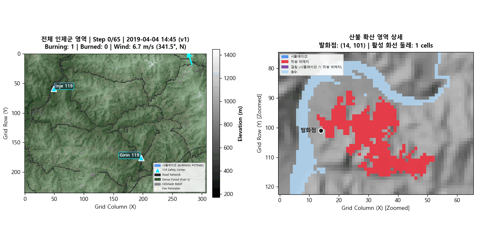

# ADAIR 환경 모델링 파트 정리 및 발표 범위

* **날짜**: 2026-10-12  
* **담당자**: 김은주
* **참고 자료**: [environment/README.md](../../environment/README.md)

---

## 1. 전체 시연에서 맡은 역할

**환경 및 산불 모델링 시뮬레이터 제공:** 2019년 4월 4일 강원도 인제군 남전리에서 발생한 산불을 재현하기 위해 실제 수치표고모델(DEM, 90m 해상도), 임상도, 도로망, 수역, 건물 정보 및 기상청 종관기상관측(ASOS 211) 데이터를 활용하여 Cellular Automata(CA) 기반 산불 확산 시뮬레이션 환경을 구축하고 격자별 산불 위험도를 산출/제공함.

---

## 2. 현재 구현된 기능과 구현되지 않은 기능

### 2.1 구현 완료된 기능

| 구분 | 구현 모듈 | 기능 설명 |
|---|---|---|
| **GIS 2D 격자** | `environment/src/cell.py`<br/>`environment/src/grid.py` | • 72,688개 셀 (236행 × 308열, 90m 해상도, EPSG:5186)<br/>• DEM, 경사도, 사면향, 임상도(연료량), 도로망, 건물 래스터 정렬<br/>• 소양호/하천 수역 마스크 방화벽 및 임상도 nodata 최근접(nearest) 보간 |
| **CA 산불 확산** | `environment/src/fire_model.py` | • Alexandridis (2008) 및 Rothermel 표면 확산 기반 이웃 셀 발화 확률 수식 계산<br/>• 지형 경사($f_{slope}$), 바람($f_{wind}$), 연료($f_{fuel}$), 수분($f_{moisture}$) 반영<br/>• `UNBURNED` $\to$ `BURNING` $\to$ `BURNED` 3단계 상태 전이<br/>• 도로망 방화벽(`roads_block_spread: true`) 및 시드 기반 재현성 |
| **위험도 산출** | `environment/src/risk.py`<br/>`environment/src/ahp.py` | • 다기준 가중선형결합(WLC) 복합 위험도 산출<br/>• AHP 가중치: 인명(0.63) > 인프라(0.18) > 재산(0.09) > 확산(0.04) > 2차(0.06)<br/>• 연소 중 셀(`BURNING`) 차등 위험도: $B=0.70 + 0.30 \times E$<br/>• N-step CA 앙상블 전방 몬테카를로 확률 모드 지원 (`benchmark.py`) | AHP 일관성 검증 완료<br/>Grid 단위 연산 검증 |
| **기상 시계열 연동** | `environment/src/weather.py` | • 2019-04-04 인제 관측소(211) 분 단위 ASOS 데이터 구동<br/>• 시간 경과에 따른 풍향·풍속·습도 동적 공급 |

### 2.2 구현되지 않은 범위 밖 기능 (Out of Scope)

| 기능 항목 | 현재 상태 | 상세 내용 |
|---|---|---|
| **진화 및 살수 효과** | 발표 범위 제외 | • 차량/드론의 소화 약제 투하 및 살수에 의한 연소 셀 진화 계산 미반영 |
| **국지 3D 미기상 바람장** | 미구현 (향후 과제) | • 현재는 관측소 시계열 데이터를 지도 전체에 단일 벡터로 적용하는 `GLOBAL_FIELD` 방식<br/>• 복잡 산악 지형에 따른 계곡풍, 능선 가속 등 국지 바람장은 미적용 |

---

## 3. 좌표·시간·단위·ID 기준 및 입력·출력 데이터

### 3.1 좌표계 및 지형 규격

- **좌표 참조계 (CRS)**:
  - 내부 지형 래스터: `EPSG:5186` (Korea 2000 / Central Belt 2010)
  - 외부 API 통신: `EPSG:4326` (WGS84 Lat/Lon, 소수점 6~7자리 실수)
- **격자 구조**:
  - 격자 크기: 236행 × 308열 (총 72,688개 셀).
  - 인덱스 체계: `col` ($x$, $0 \le x < 308$, 동쪽으로 갈수록 증가), `row` ($y$, $0 \le y < 236$, 남쪽으로 갈수록 증가).
  - 셀 공간 해상도: 가로 90m × 세로 90m ($8,100\text{ m}^2 = 0.81\text{ ha}$).

### 3.2 시간 기준

- **시나리오 시작 시각**: `2019-04-04T14:45:00+09:00`
- **CA 시뮬레이션 타임스텝**:
  - **디지털 트윈 모드**: 35분 (2019 인제 산불 19:00 10 ha 소실 실측치를 재현하도록 보정된 주기)
  - **환경모델 기본/단독 모드**: 10분 (그리고 기상청의 분당 데이터를 가지고 10분마다 평균낸 값을 씀)

### 3.3 식별자(ID) 명명 규칙

- `cell_id`: `"{col}_{row}"` 형식 문자열 (예: 발화점 `"14_101"`).

### 3.4 주요 입출력 데이터

**(1) 입력 데이터 (Input)**

| 구분 | 주요 데이터 | 용도 |
|---|---|---|
| 지형 | 수치표고모델(DEM), 경사도(Slope), 사면방향(Aspect) | 지형 특성 및 산불 확산 방향 분석 |
| 산림 | 임상도 기반 연료 유형(Fuel Type) | 침엽수림·활엽수림·혼효림 등 연료 특성 반영 |
| 공간정보 | 도로망, 수역, 건물 위치 및 유형 | 확산 제한 요소 및 인명·시설 위험도 평가 |
| 기상 | 기상청 ASOS 211 관측자료(풍속, 풍향 등) | 시간에 따른 기상 조건 및 산불 확산 확률 계산 |
| 시뮬레이션 설정 | 발화 위치·시각, CA timestep, 확산 확률 및 위험도 가중치 | 시뮬레이션 초기 조건 및 모델 파라미터 설정 |

- 공간 데이터는 EPSG:5186 좌표계와 90m × 90m 격자로 정렬하여 활용함.
- 기상자료는 환경 모델에서 10분 단위로 집계하며, Twin에서는 시간별 관측자료를 별도로 활용함.

**(2) 출력 데이터 (Output)**

| 구분 | 주요 데이터 | 활용 |
|---|---|---|
| 산불 상태 | 격자별 미연소(UNBURNED)·연소 중(BURNING)·연소 완료(BURNED) 상태 | 산불 확산 시뮬레이션 및 지도 시각화 |
| 산불 위험도 | 격자별 산불 위험도 점수(Risk Score) | 위험 지역 파악 및 대응 의사결정 지원 |
| 확산 결과 | 시간 단계별 산불 확산 상태 및 누적 연소 셀 | 산불 확산 경과 분석 |
| 기상 상태 | 시뮬레이션 시각에 적용된 풍속·풍향 등 | 산불 확산 조건 확인 |
| 공간정보 | 격자 좌표, 지형 고도 및 지도 데이터 | UAV·UGV 및 웹 관제 시스템과 공간정보 연계 |

**(3) 타 시스템 연계**

환경 계약 서버(Port 8300)를 통해 산불 상태, 위험도 및 공간정보를 제공하며, 총괄 오케스트레이터의 상황 판단과 자원 배정, 웹 관제판의 산불 확산 시각화 등에 활용함.

---

## 4. 실행 방법 및 필요한 설정

아래 실행 방법은 2019년 인제 산불 재현의 경우이다.

환경 모델 폴더 내에서 기본 실행:
```bash
pip install -r environment/requirements.txt
cd environment
python visualize_fire_inje.py --steps 65
```
* `--steps`: 스텝 수 (default: 30)
* `--seed`: 랜덤 시드 설정 (default: 42, 시드 값에 따라 산불이 확산되지 않을 수 있음)

---

## 5. 다른 파트와 연결되는 지점

```text
       [ twin_clock.py ]
              │ (POST /advance)
              ▼
   ┌─────────────────────────────────────────────────────────────┐
                  환경 계약 서버 (Port 8300)                    
     - CA 기반 산불 확산 시뮬레이션, 격자별 산불 상태 및 위험도 제공         
     - 기상청 ASOS 관측자료 연동                   
     - 관측 기록 저장 및 관리                       
   └───────▲─────────────────────────────┬─────────────────▲─────┘
           │ (POST /apply)               │                 │
           │ (POST /analyze)      (GET /snapshot)   (GET /snapshot)
           │ (GET /reports)       (GET /map_cells)         │
           │                             │                 │
   ┌───────┴───────────────┐             │          ┌──────┴──────────────┐
      총괄 오케스트레이터                   │               웹 관제판       
         (Port 8200)                     │              (Port 8080)      
     - 인지 지도(Belief)              지형·지도 정보        - 2D 관제
     - 자원 출동 및 배정 결정               │               - 3D LIVE 
   └───────▲───────────────┘             │          └─────────────────────┘
           │ (임무 명령 및 관측 수신)       │
           ▼                             ▼
   ┌──────────────────────────────────────────────┐
           UAV (8000/8001) / UGV (8100)
     - 지형 고도 및 지도 좌표 체계 활용
     - 현장 정찰 및 관측 결과 전달
   └──────────────────────────────────────────────┘
```

---

## 6. 발표에서 보여줄 정상 동작

**자연 확산 및 기상 반응**:
  - 14:45 인제 남전리(14_101) 발화 후, 기상청 실측 바람(남남동풍 5.7~6.6 m/s)을 받아 화선이 산림으로 전파.
  - 도로망(`roads_raster`) 및 소양호 수역(`water_mask`)에 불꽃이 닿으면 확산이 물리적으로 차단됨. 단, 도로가 격자에서 대각선으로 연결되어 있고 설정 파일에서 `4-neighbor`이 아닌 `8-neighbor`모드를 쓰도록 한 경우는 CA의 규칙에 따라서 불꽃이 확산될 가능성이 있음 (현재 `8-neighbor`모드 사용 중).

---

## 7. 시각화 산출물 위치

- `environment/images/fire_spread_2.gif`: 2019 인제 산불 실측 조건(ASOS 풍향/풍속) 65 Step 확산 애니메이션



---

## 8. 모의값·가정·알려진 한계와 남은 작업

### 8.1 주요 모의값 및 가정

1. **CA 확률 설정값**: 기본 점화 확률, 경사 및 바람 요인 가중치 등은 2019년 인제 산불 재현을 위해 설정된 값으로, 아직 일반화 및 검증이 이루어지지 않아 다른 산불 사례의 예측에는 한계가 있을 수 있음.

2. **타임스텝 가정**: 2019년 4월 4일 14:45 발화 후 19:00(약 4.25시간 경과) 시점의 소실 면적이 언론 및 백서 추정치인 약 10 ha에 도달하도록 보정된 시간 간격 (1 CA Step = 35 simulated minutes).

3. **연료 nodata 보간 (`nodata_strategy: "nearest"`)**:
   - 산림청 2019 임상도에서 발화 지점 주변 약 7,463개의 nodata(`-9999`) 셀이 존재하여 초기 발화가 단절되는 현상이 발생함.
   - 실제 비연료(class 0: 도로/수역)는 방화벽으로 유지하되, nodata 셀만 최근접 유효 연료 등급으로 채워 연속성을 확보함.

4. **바람의 공간 균일성 (`weather.scope = "GLOBAL_FIELD"`)**: 기상청 인제 관측소(211) 시계열 데이터를 지도 전체에 균일한 풍속/풍향 벡터로 적용함.

5. **발화점 스냅 (`snap_to_fuel: true`)**:
   - 최초 발화 신고 좌표(남전리 503-2)가 도로 또는 nodata 경계에 위치할 경우, 반경 12셀 이내의 가장 가까운 연료 셀로 자동 보정하여 발화 개시.

6. **위험도 평가 변수 및 가중치**: 인명·인프라 위험도 점수(`S_human`, `S_infra` 등)와 각 항목의 가중치(`w_human`, `w_infra` 등).

### 8.2 알려진 한계

1. **2019년 4월 4일 실제 인제 산불지역**: Sentinel-2 위성자료를 가공하여 산불 피해 면적 약 233 ha를 추출한 후, 경계 평활화를 통해 약 345 ha로 보정함. 해당 보정 영역과 시뮬레이션 결과의 IoU를 기준으로 CA 엔진의 가중치를 결정하였으므로, 보정된 참조 데이터에 의존한다는 한계가 있음.
2. **진화 효과 미반영**: UGV/소방차 살수에 의한 화재 감쇠 기능이 없으므로, 시뮬레이션 상 화재는 지정된 연소 지속 시간(`burn_duration_steps = 3`)이 지나 `BURNED`로 바뀔 때까지 계속 연소.
3. **국지 지형 미기상(양간지풍) 미구현**: 강원도 특유의 국지성 돌풍이나 협곡 가속 효과는 반영되지 않음.

### 8.3 필요시 향후 검토 (팀 프로젝트 종료 후)

1. **산불 진화(Suppression) 모델 고도화**: 헬기, 소방차, 진화대원 등 자원별 소화약제 투하량, 살수 범위 및 진화 효과를 반영한 CA 셀의 연소 억제·소멸 모델 검토.

2. **풍속·풍향 모델 고도화**:
    - 현재는 모든 격자 셀에 동일한 풍속·풍향을 적용하고 있으나, 실제 산악지형에서는 고도, 경사, 능선 및 계곡 등에 따라 국지적인 차이가 발생할 수 있음.
    - 향후 공간적 상관성과 지형 효과를 반영한 풍속·풍향 모델을 검토하고, 기존 균일 풍속·풍향 모델과 산불 확산 결과 비교.

3. **비화(Fire Spotting) 효과 구현**: 특히 침엽수림에서 발생할 수 있는 불티의 비산과 원거리 점화를 고려한 비화 확산 모델 검토.

4. **기온 및 연료 수분 함량(Fuel Moisture Content) 반영**: 기온과 연료 수분 함량이 점화 확률 및 산불 확산에 미치는 영향을 고려한 CA 모델 고도화 검토.

5. **CA 모델의 이론적 확장**: 현재 적용한 Alexandridis et al.(2008) 기반 모델을 확장하여, Alexandridis et al.(2011)의 접근법을 참고한 비화 및 진화 효과 반영 가능성 검토.

6. **확산 파라미터 보정 및 모델 일반화**:
    - 현재 CA 모델의 확산 가중치 및 설정값은 2019년 4월 4일 인제 산불 사례를 기반으로 보정된 상태임.
    - 향후 국내 여러 과거 대형 산불 사례에 적용하여 다양한 지형·기상·연료 조건에서 모델의 예측 성능과 일반화 가능성을 검증.
    - 필요시 추가 사례를 활용한 파라미터 재보정 및 새로운 산불 시나리오에 적용 가능한 일반화 모델 구축 검토.