# UGV_README

**주의** (2026-10-11 기준)
이 문서는 자체 시뮬레이션(아래 "sim", 시속 60 km, 도로 최저 50 km/h)을 기준으로 설명합니다. 발표 시연도 sim으로 합니다.
Gazebo에서는 PX4 차량 모델 [differential rover(r1_rover)](https://docs.px4.io/main/en/sim_gazebo_gz/vehicles#differential-rover)를 쓰며 상한 속도가 2.0 m/s(시속 7.2 km)라, Gazebo 주행은 단독 시험으로만 확인했습니다 (2-1의 Gazebo·Gazebo world). 통합할 때 Gazebo도 시연 배속에 맞추는 것은 공통 문서 8-3에 남긴 과제입니다.
실행은 4장, 시험 결과는 7장에 있습니다. 시험 환경과 팀 저장소에서 다시 얻는 방법은 공통 문서 [`ADAIR_UGV_파트정리_발표범위.md`](../docs/common/ADAIR_UGV_파트정리_발표범위.md)에 있습니다.

**이 문서에서 쓰는 말**

|용어|뜻|
|---|---|
|오케스트레이터|산불 상황을 보고 드론·UGV에 임무를 나눠 주는 총괄 AI 에이전트 (`orchestrator/`, 포트 8200)|
|환경 모듈|산불 확산·지형·날씨를 계산하고 시뮬레이션 시각을 정하는 서버 (`environment/`, 포트 8300)|
|sim|PX4·Gazebo 없이 UGV 서버가 직접 위치를 계산해 움직이는 방식. 기본값|
|노드 / 도로|도로망의 교차로·끝점(노드)과 두 노드를 잇는 도로 구간. 각각 고유 ID가 있다|
|시뮬레이션 초|시뮬레이션 시작부터 흐른 시간(초). 실제 시간과 다르게 빨리 흐를 수 있다|
|2019 인제 재현 시뮬레이션|2019년 4월 인제 산불을 재현한 팀 통합 시뮬레이션. 환경·드론·UGV·오케스트레이터·관제판을 함께 띄운다 (`run_servers.py start --twin`)|
|통합 시연 환경|오케스트레이터 담당의 별도 저장소 코드(관측 계획 포함, 10/8 기준)로 꾸린 로컬 시험 환경. 팀 저장소 main과 다르다. 어떤 시험을 어느 환경에서 했는지는 공통 문서 [`ADAIR_UGV_파트정리_발표범위.md`](../docs/common/ADAIR_UGV_파트정리_발표범위.md) 5-1·8-4장에 있다|
|웹 관제판|팀 공통 화면 "ADAIR 강원 관제판" (`web/`, 포트 8080)|
|도로 상황판|UGV 서버가 직접 내주는 화면 "UGV 도로 상황판" (`/view`)|

---

## 1. 역할
```
ugv/
├── __init__.py
├── README.md                 기존 문서
├── API_DEFINE.md             API 명세
├── SIMULATOR.md              PX4·Gazebo 실행 안내
│
├── config.py                 포트·차량·속도·시나리오 설정
├── server.py                 FastAPI :8100, 모든 엔드포인트·판단 흐름
├── api_models.py             오케스트레이터와 주고받는 JSON 모양
│
├── fleet.py                  차량 여러 대 생성·드라이버 연결
├── agent.py                  차량 1대 상태기계 (계획·실행·도착·정지)
├── road_graph.py             도로 그래프 + Dijkstra
├── route_plan.py             구간별 거리·시간·ETA
├── road_point.py             목표 → 도로 위 지점으로 붙이기
├── geo.py                    거리 계산, 위경도 ↔ 미터 변환
├── models.py                 노드·도로 자료형
├── resource.py               차량 자원 정의
├── equipment.py              장비(물탱크·펌프·적재·경광등)
│
├── drivers/
│   ├── __init__.py
│   ├── base.py               MotionDriver 인터페이스
│   ├── sim.py                자체 시뮬레이션 주행
│   └── px4.py                PX4/Gazebo 로버
├── gz_fx.py                  Gazebo 시각 효과
│
├── road_status.py            도로 통제·혼잡 상태
├── scenario.py               도로 시나리오 CSV 재생
├── graph_gpkg.py             road_network.json 로드
├── graph_data_demo.py        데모용 작은 그래프
│
├── sim_clock.py              환경 모듈 시계 따라가기
├── history.py                실행별 사건 기록 (jsonl, 다시 보기용)
├── drive_log.py              0.5초 간격 주행 CSV
├── reporter.py               오케스트레이터 보고 (/reports)
│
├── scenarios/                도로 시나리오 CSV
│
├── static/
│   └── road_view.html        UGV 도로 상황판
│
├── data/
│   └── road_network.json     도로망 (노드 664개, 도로 820개)
├── gazebo/                   Gazebo 월드·모델
└── tools/                    도로망·월드 생성, PX4 실행, 기록 분석 도구
```

산불 대응 오케스트레이터가 시뮬레이션이나 훈련 상황에서 산불 현황을 파악할 수 있도록, 도로망을 따라 요청된 지점까지 이동하고 위치를 보고하는 UGV(Unmanned Ground Vehicle) 모듈입니다.
**단, 현 단계에서 UGV는 직접 측정하지 않습니다.** 측정 지점에 도착해 위치와 시각을 보고하면, 오케스트레이터가 그 시점·그 지점의 정보(열화상 등)를 환경 모듈에서 가져오는 방식으로 구현되어 있습니다.

오케스트레이터로부터 임무 평가를 요청받으면 Dijkstra 알고리즘으로 갈 수 있는지, 어느 길로 갈지, 얼마나 걸릴지를 계산해 수락(ACCEPT) 또는 거절(REJECT)과 예상 도착 시간(ETA)을 돌려줍니다. 오케스트레이터가 배정을 고를 수 있도록 현재 상태(위치, 수행 중 임무)도 항상 조회할 수 있게 합니다. 어떤 임무를 맡을 수 있는지(능력)는 UGV가 보고하지 않고 오케스트레이터 설정이 정합니다.
임무 수행을 지시받으면 도로를 따라 이동하고, 이동 중 위치·진행률·남은 시간을 제공합니다. 도착하면 임무를 완료로 닫습니다.
시뮬레이션 동안 시간에 따른 위치, 도로, 지점(노드), 상태를 파일에 기록해 나중에 다시 보거나 분석할 수 있게 합니다.
별도 웹페이지(UGV 도로 상황판, `서버주소:8100/view`)에서 주행 상태와 기록을 보여 주고, 화면에서 직접 지시를 받을 수도 있습니다.

정리
1. 강원도 인제 지역 실제 도로 자료로 만든 도로망 그래프에서 도달 가능 여부와 시뮬레이션 안의 위치를 정합니다.
2. 오케스트레이터의 요청에 따라 임무 수락 여부와 예상 도착 시간을 보내고, 임무 수행 중에는 진행 상황을 제공합니다.
3. 이동은 두 방식 중 하나로 합니다. 기본은 UGV 서버가 직접 위치를 계산하는 자체 시뮬레이션(sim)이고, 선택적으로 로봇 제어에 널리 쓰이는 PX4에 파이썬 인터페이스(MAVSDK)로 명령해 미리 만든 Gazebo 도로 월드 위에서 움직이게 할 수 있습니다.
4. 도로 시나리오(통제·혼잡)를 시각에 맞춰 적용하고, 주행 중 앞길이 막히면 경로를 다시 찾습니다.
5. 도로 상황판에 차량·도로·임무 상황을 표시하고 수동 지시를 받으며, 웹 관제판 등 다른 화면에 필요한 차량 정보를 제공합니다.
6. 위치·속도·도로·노드·상태를 시뮬레이션 시각과 함께 기록하고, 도로 상황판에서 지난 실행을 다시 재생하거나 분석에 쓸 수 있게 남깁니다.

---

## 2. 기능

### UGV 모델

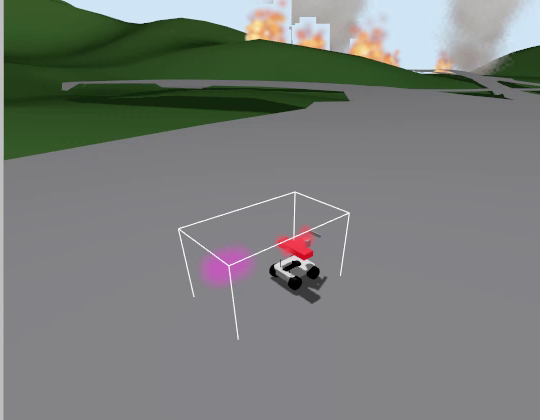

Gazebo 화면의 소방차(A-fire1, 2026-10-05 주행 영상에서 캡처). UGV(A-ugv1·B-ugv1)는 같은 r1_rover에 장비를 붙이지 않은 모델이고, 뒤쪽의 불·연기는 Gazebo 화면 효과입니다.

좌우 바퀴를 따로 제어하는 [differential drive](https://docs.px4.io/main/en/frames_rover/#differential) 방식의 [PX4 시뮬레이션 모델(r1_rover)](https://docs.px4.io/main/en/sim_gazebo_gz/vehicles#differential-rover)을 사용했습니다.

참고: [Differential rover 하드웨어 예시 — Hiwonder Tracked](https://docs.px4.io/main/en/complete_vehicles_rover/hiwonder_tracked)

---

### 2-1. 구현 기능

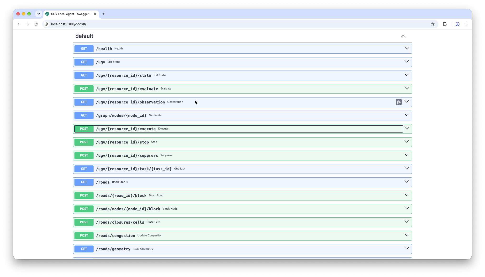
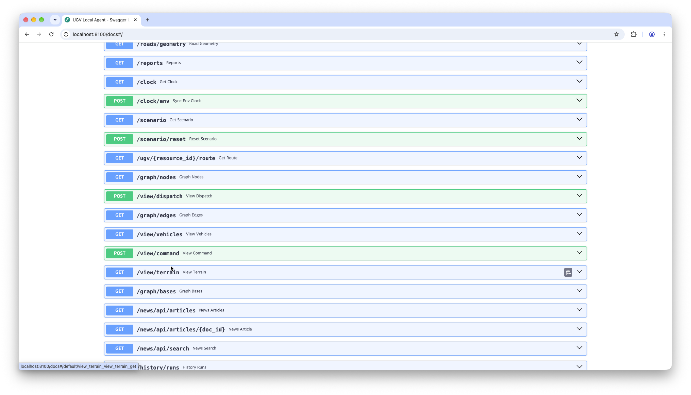

독립적인 기능 중심으로 설명합니다. 다른 모듈과의 요청·응답은 [5. 다른 파트와 연결되는 지점](#5-다른-파트와-연결되는-지점)을 참고해 주세요.

|기능|설명|위치|
|---|---|---|
|주행 전 임무 평가|목표 좌표를 반경 2 km 안의 도로 위 지점(기본) 또는 도로 노드로 붙이고, 막힌 도로를 빼고 혼잡을 반영해 가장 빨리 가는 경로와 ETA를 Dijkstra로 구합니다. 결과는 수락(ACCEPT) 또는 거절(REJECT). **이 단계에서 차는 움직이지 않습니다**|[server.py](server.py)<br>├ [`_decide`](server.py#L304)<br>└ [`_decide_point`](server.py#L399)<br>[agent.py](agent.py)<br>├ [`evaluate`](agent.py#L80)<br>└ [`evaluate_point`](agent.py#L114)<br>[road_graph.py](road_graph.py)<br>├ [`find_route`](road_graph.py#L124)<br>└ [`DijkstraAlgorithm`](road_graph.py#L20)<br>[road_point.py](road_point.py)<br>└ [`nearest`](road_point.py#L52)|
|주행|출발 명령을 받으면 경로를 구간으로 나눠 드라이버에 넘깁니다. sim은 시간이 흐른 만큼 경로를 따라 위치를 옮기고, PX4는 웨이포인트 미션으로 보냅니다|[server.py](server.py)<br>├ [`execute`](server.py#L800)<br>├ [`_run_task`](server.py#L638)<br>└ [`_drive_leg`](server.py#L558)<br>[agent.py](agent.py)<br>└ [`execute`](agent.py#L174)<br>[route_plan.py](route_plan.py)<br>└ [`build`](route_plan.py#L51)<br>[drivers/sim.py](drivers/sim.py) · [drivers/px4.py](drivers/px4.py)|
|현재 상태 보고|1초마다 드라이버의 위치·배터리를 차량 상태에 옮기고 도착을 확정합니다. 위치, 상태, 현재 도로, 수행 중 임무, 시뮬레이션 시각을 조회할 수 있습니다|[server.py](server.py)<br>├ [`_refresh_loop`](server.py#L149)<br>└ [`_state`](server.py#L270)<br>[fleet.py](fleet.py)<br>└ [`refresh_all`](fleet.py#L73)<br>[agent.py](agent.py)<br>├ [`refresh`](agent.py#L43)<br>└ [`check_arrival`](agent.py#L304)|
|주행 중 이상 감지|멈춤(60 시뮬레이션 초 동안 10 m도 못 감), 경로 이탈(100 m 초과), 드라이버 고장을 감시합니다. 확정되면 차는 사용 불가(UNAVAILABLE), 임무는 실패(FAILED)가 되고, 정지 명령으로 해제합니다|[server.py](server.py)<br>├ [`_check_run`](server.py#L492)<br>└ [`_fail_task`](server.py#L550)<br>[agent.py](agent.py)<br>└ [`fail`](agent.py#L288)|
|도로 상황 반영·우회|도로 통제와 혼잡을 출처별(시나리오 / 수동 / 구역)로 관리하고, 시나리오 CSV를 시각에 맞춰 적용합니다. 주행 중 앞길이 막히면 경로를 다시 찾습니다. 화재는 도로를 막지 않습니다 (팀 결정)|[road_status.py](road_status.py)<br>└ [`RoadStatus`](road_status.py#L18)<br>[scenario.py](scenario.py)<br>└ [`tick`](scenario.py#L121)<br>[server.py](server.py)<br>└ [`_drive_leg` 안 재탐색](server.py#L593)<br>[agent.py](agent.py)<br>├ [`blocked_ahead`](agent.py#L240)<br>└ [`reroute`](agent.py#L248)|
|시뮬레이션 시계|환경 모듈의 `/health` 시각을 따라갑니다. 환경 모듈이 10초 넘게 응답하지 않으면 혼자 흐릅니다|[server.py](server.py)<br>└ [`_env_clock_loop`](server.py#L112)<br>[sim_clock.py](sim_clock.py)<br>├ [`SimClock`](sim_clock.py#L26)<br>└ [`follow_env`](sim_clock.py#L128)|
|기록|네 갈래로 남깁니다.<br>① 실행별 사건 기록: 판단·주행·고장을 시뮬레이션 시각과 함께. 최근 30회 보관, 다시 보기의 근거<br>② 임무별 주행 CSV: 0.5초 간격 위치·속도·경로 이탈 거리<br>③ 오케스트레이터 보고 목록 (`/reports`)<br>④ 임무 저장: 서버를 다시 켜도 임무 상태 복구|[history.py](history.py)<br>└ [`record`](history.py#L57)<br>[drive_log.py](drive_log.py)<br>└ [`DriveLog`](drive_log.py#L29)<br>[reporter.py](reporter.py)<br>└ [`report`](reporter.py#L56)<br>[server.py](server.py)<br>├ [`_report`](server.py#L222)<br>└ [`STORE`](server.py#L69) (`ugv_tasks.json`)|
|도로 상황판|지도 위에 차량·경로·막힌 도로를 표시하고, 지난 실행을 다시 재생하고, 차를 골라 직접 지시합니다 (직접 지시는 오케스트레이터의 안전 검토를 거치지 않음). 화면 머리와 지도 위에 "AI 생성 화면"을 늘 표시합니다 (화면·지도 그림을 AI 코딩 도구로 만든 코드가 그림)|[static/road_view.html](static/road_view.html)<br>[server.py](server.py)<br>├ [`view_vehicles`](server.py#L1213)<br>├ [`view_command`](server.py#L1273)<br>└ [`view_dispatch`](server.py#L1105)|

#### 1. 주행 전 임무 평가
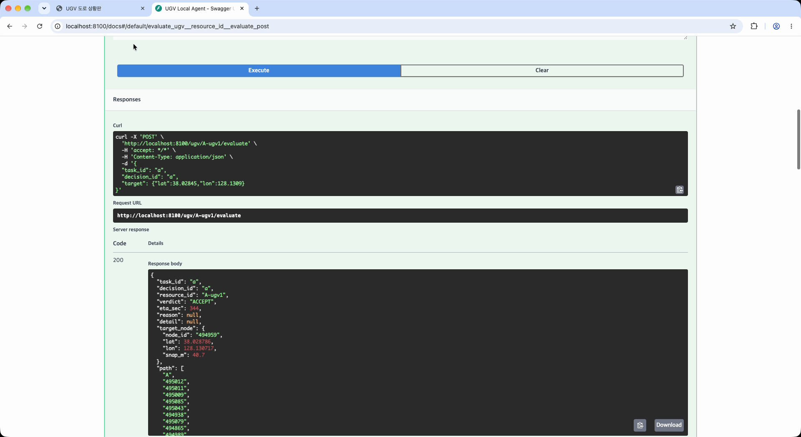

오케스트레이터는 임무를 맡기기 전에 "이 차가 그곳에 갈 수 있는지, 얼마나 걸리는지"를 묻습니다. 이 단계에서 차는 움직이지 않습니다.

차량 상태 확인: 다른 임무를 수행 중이면 BUSY, 주행 중 이상으로 사용 불가 상태면 거절합니다.
목표를 도로에 붙이기: 목표 좌표에서 도로 위 가장 가까운 점(기본, 10/11부터) 또는 가장 가까운 교차로를 도착 지점으로 정합니다. 도로가 2 km보다 멀면 갈 수 없다고 봅니다(TARGET_UNREACHABLE).
가장 빠른 길 찾기: 도로망을 교차로(노드)와 도로(간선)로 이루어진 그래프로 보고, Dijkstra 알고리즘으로 비용(여기서는 통과 시간)의 합이 가장 작은 경로를 찾습니다. 도로 하나의 비용은 길이 ÷ 속도이고, 속도는 도로 제한속도(최저 50 km/h)와 차량 최고속도(60 km/h) 중 작은 값을 혼잡 배율로 나눈 값입니다. 통제된 도로는 비용을 무한대로 두어 피해 갑니다.
결과: 길이 있으면 수락하고, 예상 도착 시간(시뮬레이션 초)과 지나갈 교차로 목록을 돌려줍니다. 통제 때문에 갈 수 없으면 ROAD_BLOCKED, 도로가 이어져 있지 않으면 TARGET_UNREACHABLE로 거절합니다.

예상 도착 시간은 판단한 순간의 도로 상황 기준입니다. 출발 뒤에 통제가 생기면 주행 중에 경로를 다시 찾습니다(3. 도로 상황 반영).

##### 가장 빠른 길 찾기 — Dijkstra 알고리즘

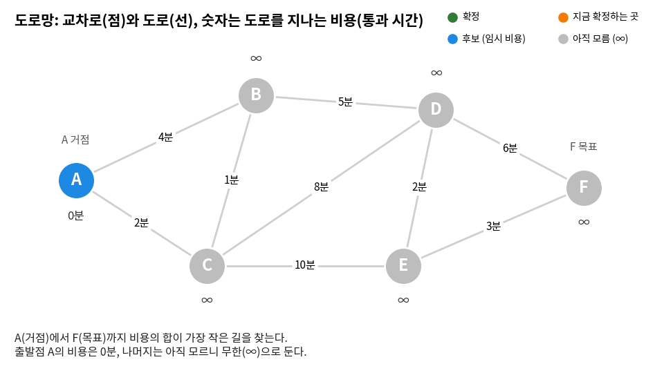

**그림 읽는 법.** 선 위 숫자는 그 도로를 지나는 비용(분)이고, 점 아래 숫자는 출발점 A에서 그 지점까지 지금까지 알게 된 가장 적은 비용입니다. 초록은 최저 비용이 확정된 지점, 주황은 지금 확정하는 지점, 파랑은 비용을 알게 됐지만 아직 확정하지 않은 지점, 회색은 아직 모르는(무한, ∞) 지점입니다.

A에서 B로 바로 가는 길(4분)보다 C를 거치는 길(3분)이 적게 들었던 것처럼, 가까워 보이는 길이 꼭 비용이 적은 길은 아닙니다. 통제된 도로는 비용이 무한대라 이웃을 다시 계산할 때 건너뛰므로, 막힌 길을 따로 처리하지 않아도 경로에서 빠집니다.

수학에서 점들과 그 사이의 연결을 선으로 나타낸 것을 그래프라고 합니다. 구체적인 모양은 고려하지 않고 어떤 점이 어떤 점과 이어져 있는지만 생각하면, 어디를 지나서 어디로 가는 방법을 구할 수 있습니다. 도로망에서는 교차로가 점(노드), 도로가 선(간선)입니다.

**비용이란.** 한 곳에서 다른 곳으로 이동하는 데 드는 것을 비용이라고 합니다. 거리(m), 요금(원), 시간(초) 등이 비용이 될 수 있습니다. 경로의 비용은 지나는 도로 비용의 합이고, 길 찾기는 이 합이 가장 작은 경로를 찾는 일입니다. UGV는 **도로를 지나는 데 걸리는 시간**을 비용으로 씁니다. 같은 거리라도 느린 도로, 혼잡한 도로는 비용이 커지고, 통제된 도로는 비용이 무한대가 됩니다. 코드에서도 도로 비용을 `cost_s`·`travel_s`(초)라는 이름으로 씁니다.

Dijkstra 알고리즘은 출발점에서 **비용이 작은 지점부터 하나씩 "가장 적은 비용"을 확정**해 나가는 방법입니다. 이때 지점마다 두 가지 값을 구분합니다.

- **임시 비용**: 여태까지 알고 있는 가장 적은 비용과 그 경로입니다. 다른 곳을 거쳐 더 적게 가는 길을 찾으면 줄어들 수 있습니다.
- **확정 비용**: 더는 줄어들 수 없는 최저 비용입니다. 한 번 확정하면 바뀌지 않습니다.

1. 출발점의 비용은 0, 나머지 모든 지점은 아직 모르니까 무한으로 생각합니다.
2. 출발점을 확정하고, 이어지는 이웃 지점들의 임시 비용을 무한에서 바로 가는 비용으로 바꿉니다. 이 중 가장 적은 비용이 드는 지점은 **바로 가는 비용이 곧 최저 비용**입니다. 다른 지점을 거쳐서 가려면 거기까지 가는 데 이미 더 많은 비용이 들기 때문입니다. 위 그림에서 A에서 C로는 바로 가는 2분이 가장 적습니다. B를 거쳐 가려면 B까지만 이미 4분이 들기 때문입니다. **이렇게 출발점에서 한 지점으로 가장 적게 가는 경로를 하나 확정했습니다.**<br>
   나머지 이웃(B)의 임시 비용은 무한보다는 줄었지만, 아직 다른 곳을 거쳐 더 적게 갈 여지가 있습니다. 그림에서도 A에서 B로 바로 가면 4분이지만, C를 거치면 3분이 걸립니다. 그래서 임시 비용과 함께 어디를 거쳐 왔는지(경로)를 기억해 둡니다.
3. 방금 확정한 지점에서 이어지는 이웃 지점들의 비용(확정한 지점의 비용 + 이웃으로 가는 도로 비용)을 계산하고, 이전에 알고 있던 임시 비용보다 적으면 그 값과 경로로 바꿔 기억해 둡니다.<br>
   그다음 **방금 확정한 지점의 이웃만이 아니라, 지금까지 알게 된 모든 후보 중에서** 임시 비용이 가장 적은 지점을 하나 골라 확정합니다. 그림에서 E의 12분은 C를 확정할 때 알게 된 값인데, 두 단계 뒤까지 후보로 남아 있습니다. 가장 적은 지점을 확정해도 되는 이유는 2번과 같습니다. 다른 후보를 거쳐 오려면 그 후보까지만 이미 더 많은 비용이 드니까요.
4. 목표 지점이 확정될 때까지 3을 되풀이합니다. 목표가 확정되면 그 비용이 최저 비용이고, 기억해 둔 "어디를 거쳐 왔는지"를 목표에서 거꾸로 따라가면 가장 적은 비용의 경로가 나옵니다.

위 그림을 표로 정리하면 다음과 같습니다. 칸의 숫자는 그 단계에서 **여태까지 알고 있는 가장 적은 비용**(임시 비용, 분), 괄호는 **어디를 거쳐 왔는지**, 굵은 글씨는 **확정**입니다.

| 단계 | 확정 | A | B | C | D | E | F |
|---|---|---|---|---|---|---|---|
| 시작 | — | 0 | ∞ | ∞ | ∞ | ∞ | ∞ |
| 1 | A | **0** | 4 (A) | 2 (A) | ∞ | ∞ | ∞ |
| 2 | C | **0** | 3 (C) | **2** | 10 (C) | 12 (C) | ∞ |
| 3 | B | **0** | **3** | **2** | 8 (B) | 12 (C) | ∞ |
| 4 | D | **0** | **3** | **2** | **8** | 10 (D) | 14 (D) |
| 5 | E | **0** | **3** | **2** | **8** | **10** | 13 (E) |
| 6 | F | **0** | **3** | **2** | **8** | **10** | **13** |

1. **A 확정 (0분).** A의 이웃 B는 4분, C는 2분으로 무한에서 바뀝니다.
2. **C 확정 (2분).** 아는 지점 중 가장 적은 비용입니다. B를 거쳐 C로 오려면 이미 4분 이상 쓴 뒤라 2분보다 적을 수 없습니다. C에서 이웃을 다시 계산하면 B는 2 + 1 = 3분으로 A에서 바로 가는 4분보다 적어서 3분으로 바꾸고 "C를 거쳐 온다"고 기억해 둡니다. D는 10분, E는 12분이 됩니다.
3. **B 확정 (3분).** D는 3 + 5 = 8분으로 10분보다 적어 바꿉니다.
4. **D 확정 (8분).** E는 8 + 2 = 10분으로 12분보다 적어 바꾸고, F는 8 + 6 = 14분이 됩니다.
5. **E 확정 (10분).** F는 10 + 3 = 13분으로 14분보다 적어 바꿉니다.
6. **F 확정 (13분).** 목표가 확정되면 멈춥니다. 기억해 둔 "어디를 거쳐 왔는지"를 F에서 거꾸로 따라가면 경로 A → C → B → D → E → F가 나옵니다.

값은 줄어들다가(B 4→3, D 10→8, E 12→10, F 14→13) 확정되면 더 바뀌지 않습니다. 괄호가 바뀌는 순간이 더 적은 비용의 경로를 찾은 순간이고, 마지막 줄의 괄호를 F부터 거꾸로 따라가면 F ← E ← D ← B ← C ← A, 곧 경로 A → C → B → D → E → F가 나옵니다.

**왜 한 번 확정한 비용은 바뀌지 않나.** 그림 3단계에서 후보는 B 3분, D 10분, E 12분이고 비용이 가장 적은 B를 확정합니다. B로 오는 다른 길이 있다면 그 길은 D나 E 같은 다른 후보를 거쳐야 하는데, 거기까지 오는 데 이미 10분, 12분의 비용을 썼습니다. 도로 비용은 음수가 될 수 없으니, 그 뒤로 어떤 길을 더 가도 B까지의 비용이 3분보다 작아질 수 없습니다. **어떤 새 경로도 그 앞까지 이미 더 많은 비용을 썼다면, 더 적은 비용으로 데려다 줄 수 없습니다.** 그래서 비용이 가장 적은 후보부터 확정해도 틀리지 않습니다.

실제 계산에서 도로 비용은 도로 길이 ÷ 속도(초)입니다. 후보 중 임시 비용이 가장 적은 지점을 빨리 꺼내기 위해 우선순위 큐(힙)를 씁니다. 큐는 줄 서기처럼 먼저 넣은 자료부터 꺼내는 자료 구조이고, **꺼낸 자료는 큐에서 빠집니다(잊어버립니다).** 그래야 다음 자료를 꺼낼 수 있습니다. 우선순위 큐는 넣은 순서와 상관없이 정해진 기준에 따라 **늘 가장 작은 값부터** 꺼내 줍니다. 여태까지 알고 있는 임시 비용 중 가장 적은 지점을 고르는 데 안성맞춤입니다. 꺼낸 지점은 확정되므로 큐에서 잊어버려도 되고, 다시 넣을 필요도 없습니다. 큐에 새로 넣는 것은 임시 비용이 줄어든 지점뿐이고, 이것도 줄었을 때만 하는 일이지 매번 해야 하는 일은 아닙니다. 줄어든 값을 넣을 때 예전 값을 찾아 지우지는 않으므로 큐에 같은 지점의 낡은 값이 남을 수 있는데, 나중에 그 값을 꺼내면 이미 더 적은 값을 알고 있으니 버립니다 ([`road_graph.py` `DijkstraAlgorithm`](road_graph.py#L20)).

**성립 조건.** 위 설명은 이해를 돕기 위해 쉽게 풀어 쓴 것입니다. 엄밀하게는 **모든 도로 비용이 0 이상(음수가 아님)**일 때만 "가장 적은 후보부터 확정해도 틀리지 않는다"가 성립합니다. 비용이 음수인 도로가 있으면 이미 확정한 지점보다 비싼 후보를 거쳐 돌아오는 길이 오히려 더 적은 비용이 될 수 있어서, 확정이 뒤집힐 수 있습니다. 이런 경우에는 Bellman-Ford 같은 다른 알고리즘을 씁니다. 또 지점 수가 유한해야 확정이 언젠가 끝납니다. UGV의 도로 비용은 통과 시간이라 항상 양수이고, 통제된 도로만 무한대로 두어 계산에서 건너뛰므로 이 조건을 만족합니다. 목표까지 이어진 도로가 없으면 후보가 바닥나 경로 없음으로 끝납니다.

#### 2. 주행과 현재 상태
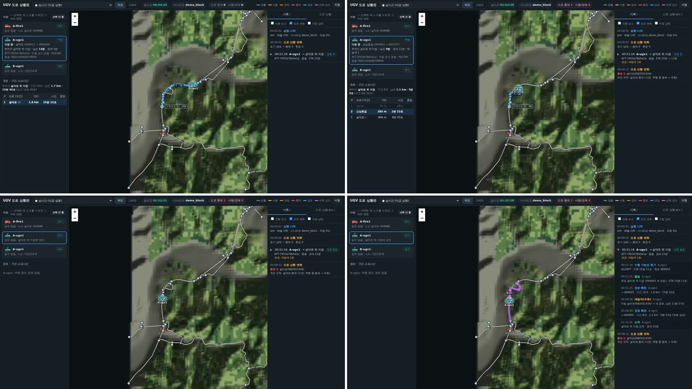

영상: `ugv_reroute_sim.mp4` (원본 보관, 저장소·드라이브에 없음) (25초)

명령은 웹(HTTP 요청)으로 전달됩니다. 오케스트레이터가 주행 시작을 요청하면 UGV는 평가와 같은 규칙으로 한 번 더 판단하고, 갈 수 있으면 임무를 만들어 바로 "출발함(STARTED)"이라고 답합니다. 실제 주행은 그 뒤 서버 안에서 따로 진행되고, 오케스트레이터는 임무 진행 조회로 상황을 확인합니다.

**경로를 주행 명령으로 바꾸기.** 평가에서 찾은 경로(지나갈 교차로 목록)를 도로 선형의 점들로 펼쳐 웨이포인트 목록을 만들고, 웨이포인트마다 그 도로에서 낼 속도를 붙여 드라이버에 넘깁니다. 드라이버는 "이 점들을 따라가라, 멈춰라, 지금 위치와 진행률을 알려 달라"는 같은 약속을 지키는 두 가지가 있습니다.
- **sim:** UGV 서버가 직접 위치를 계산합니다. 0.1초마다 시뮬레이션 시계가 흐른 만큼 "구간 속도 × 흐른 시간"을 앞으로 옮기고, 웨이포인트에 닿으면 다음 웨이포인트로 넘어갑니다. 시계가 멈추면 차도 섭니다.
- **PX4:** 웨이포인트를 PX4에 미션으로 올리고 시작시킵니다. 실제 조향과 속도 제어는 PX4가 합니다 (아래 2. Gazebo).

**현재 상태 갱신.** 1초마다 드라이버가 알려 주는 위치와 배터리를 차량 상태에 옮깁니다. 주행 중에는 상태가 RUNNING이고, 서 있는 노드는 비어 있으며(null) 지금 달리는 도로가 채워집니다. 마지막 웨이포인트를 지나면 도착으로 확정해 READY로 돌아오고, 도착한 노드가 채워집니다.

##### 1. 주행 중 상호작용
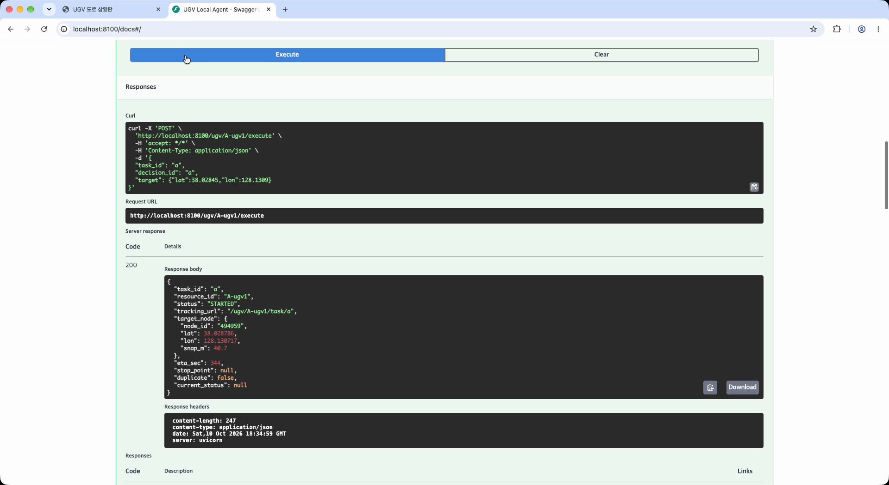

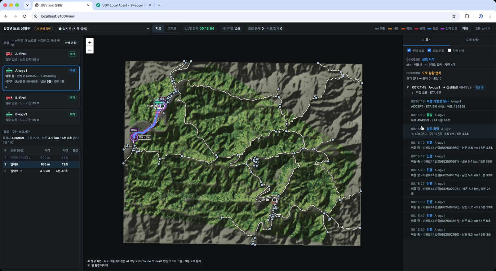

Swagger 단독 호출 (2026-10-11, sim, 배속 5): 평가 ACCEPT·ETA 344초 → 주행 시작 → 시뮬레이션 348.9초 뒤 도착(ETA 대비 1.01배). 영상 [영상 02](https://drive.google.com/file/d/1bw5k8rbyBo672su-RLFyA5ibGpZNnINr/view), 근거 [`2026-10-11_swagger`](../docs/ugv/evidence/2026-10-11_swagger/).

주행 중에는 0.5초마다 아래를 확인합니다.
1. **진행 상황 기록:** 지난 웨이포인트 수, 남은 거리, 남은 시간, 지금 도로를 임무 상태에 적습니다. 오케스트레이터는 임무 진행 조회로 이 값을 읽습니다. 달리는 도로가 바뀔 때마다 진행 보고를 한 번씩 남깁니다.
2. **앞길 확인:** 남은 경로(지금 달리는 도로 다음부터)에 통제된 도로가 생겼는지 봅니다. 생겼으면 지금 위치에서 경로를 다시 찾아 계속 가고 우회 기록을 남깁니다. 다른 길이 없으면 가까운 노드에 서고 임무를 실패(ROAD_BLOCKED)로 닫습니다. 고장이 아니므로 차는 READY입니다.
3. **이상 확인:** 멈춤(60 시뮬레이션 초 동안 10 m도 못 감), 경로 이탈(100 m 초과), 드라이버 고장을 봅니다. 확정되면 차를 세우고 사용 불가(UNAVAILABLE)로 두며, 임무는 실패로 닫습니다.
4. **도착 확인:** 목표 노드에 READY로 서면 임무를 완료(COMPLETED)로 닫고 도착 관측(위치·도로 상태)을 남깁니다.

밖에서 주행에 끼어드는 경우:
- **정지 요청:** 차를 세우고 임무를 취소(CANCELLED)합니다.
- **도로 통제·혼잡 변경:** 시나리오 시각이 되거나 API로 바뀌면 다음 확인에서 우회합니다.
- **도로 상황판의 직접 지시(교체):** 기존 임무를 실패(OPERATOR_OVERRIDE)로 닫고 새 목적지로 출발합니다. 오케스트레이터는 실패를 보고 다른 차에 다시 맡깁니다.
- **같은 주행 요청 재전송:** 새로 출발하지 않고 지금 임무 상태를 돌려줍니다.

주행 중 위치는 도로 상황판(`/view`)과 웹 관제판(`GET /ugv`)이 읽어 화면에 그립니다.

##### 2. Gazebo
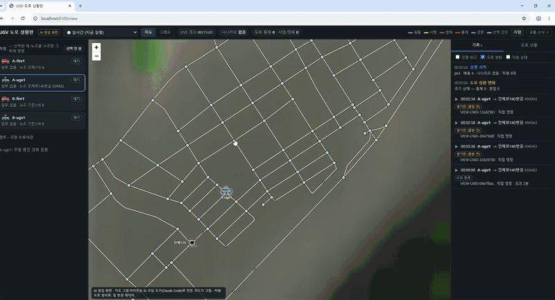

2026-10-11, Windows WSL. 도로 상황판(`/view`)에서 A-ugv1에 직접 지시하면 Gazebo의 PX4 차량이 움직이고, 같은 위치가 3D 트윈 LIVE(웹 관제판)와 QGroundControl에 함께 표시됩니다. 나머지 3대는 sim으로 거점에 대기. GIF는 2배속, 영상: [영상 07](https://drive.google.com/file/d/1FDUeMzhDdScPLViCn4qkAXgzBJ7bsy9N/view) (59초, 실시간). 트윈·총괄과의 통합 주행은 하지 않았습니다 (시연 배속 100을 Gazebo가 따라갈 수 없음).

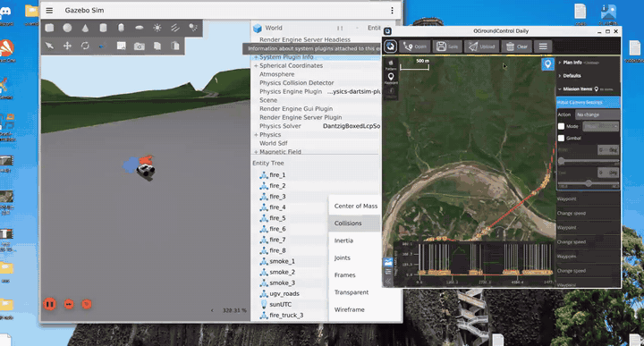

2026-10-05 22:34~22:48 촬영 (임무 FIRE9, 진압 기능 봉인 전). 왼쪽 Gazebo, 오른쪽 QGroundControl(PX4 미션 경로). 실제 862초 동안 시뮬레이션 2,801초를 달려 배속 3.25, 예상 도착(ETA 2,784초) 대비 실제 도착 1.01배로 ETA와 거의 같았습니다 (임무 기록 `timing`). GIF는 원본을 40배 빠르게 줄였습니다. 영상: `ugv_gazebo_drive.mp4` (원본 보관, 저장소·드라이브에 없음) (20배속, 43초). 불·연기는 Gazebo 화면 효과이며 환경 모듈의 화재와 연결되어 있지 않습니다.

2026-10-11 재시험 (Windows WSL, A-ugv1 1대 PX4 + 나머지 3대 sim, 도로 상황판 직접 지시 2회): 두 번 모두 도착, 배속 3.26·3.23, 예상 도착 대비 실제 1.05배. 경로 이탈은 대부분 0.3 m 안(95%가 0.76 m 이하, 최대 3.0 m는 출발 직후 방향 전환), 평균 속도 1.9 m/s. 근거: [`docs/ugv/evidence/2026-10-11_gazebo/`](../docs/ugv/evidence/2026-10-11_gazebo/). 같은 날 PX4 시간이 멈춘 동안(px4_elapsed 0초) 위치가 끊겨 `TELEMETRY_LOST`로 임무가 실패한 경우도 기록에 남아 있습니다 — 이상 감지가 의도대로 동작한 사례입니다.

PX4 드라이버를 쓰면 같은 경로가 PX4 미션으로 바뀝니다 (연결 구조와 포트는 4장).
- 웨이포인트를 미션으로 올리고, 미션 번호를 처음으로 되돌린 뒤 시동을 걸고 미션을 시작합니다. PX4가 이전 미션의 진행 번호를 기억해 새 미션을 중간부터 시작하는 일이 있어서입니다.
- 중간 웨이포인트는 서지 않고 지나가며 꺾는 통과형, 마지막 웨이포인트만 서는 형으로 둡니다. 점마다 서면 경사진 곳에서 제자리 회전을 끝내지 못하고 멈추는 일이 있었습니다.
- 웨이포인트 도착 반경은 4 m입니다. 10 m면 코너를 질러 도로를 벗어나고, 2 m면 지나쳐 버렸습니다.
- 위치·속도·방향·시동·모드·PX4 시각을 1초마다 받아 상태를 갱신하고, 미션 진행률로 진행 상황을 압니다.
- 위치가 10초 넘게 오지 않거나, 미션 중 시동이 꺼지거나 모드가 바뀌면 차량 이상으로 봅니다.
- 정지는 미션 일시정지 → 제자리 정지 → 시동 끔 순서로 보냅니다.
- Gazebo 단독으로 돌릴 때는 PX4 쪽 `SPEED`와 UGV 서버 `UGV_TIME_SCALE`을 같게 해야 ETA와 실제 주행이 맞습니다 (5. Gazebo world의 2. 시간과 속도). 주행 CSV에 서버 시각과 PX4 시각을 함께 남겨 실제 배속을 확인합니다.
- 한계: 차량 모델(r1_rover)은 2.0 m/s가 상한이라 sim의 60 km/h와 시간이 맞지 않습니다. 지형 월드는 처음에 도로면이 겹친 교차로마다 턱이 생겨 차가 멈췄는데, 도로면 높이를 연속 높이장 하나로 맞춰 10 cm 넘는 턱을 12,316칸에서 145칸으로 줄였고 그 뒤 2 m/s 주행에서는 턱으로 멈추지 않았습니다. 다만 남은 턱이 0은 아니어서, 다른 차량 모델로 약 60 km/h 진입한 팀 시험(2026-10-09)에서 교차로 한 곳(높이차 0.65~1.15 m)에서 전복이 확인됐습니다 (5. Gazebo world).

#### 3. 도로 상황 반영

도로가 막혔는지·얼마나 막히는지는 UGV 쪽이 정합니다. 환경 모듈의 화재와는 별개이고, 화재는 도로를 막지 않습니다 (팀 결정).

**바꾸는 길은 세 가지이고, 출처별로 따로 기록합니다** ([road_status.py](road_status.py)). 한 도로에 출처가 하나라도 남아 있으면 막힌 것으로 봅니다. 그래서 시나리오가 푼 도로를 수동 통제가 계속 막고 있을 수 있습니다.

|출처|어떻게|
|---|---|
|시나리오|파일에 적은 시간대대로 자동 적용 ([scenario.py](scenario.py))|
|수동|API로 도로·노드 하나씩 (`POST /roads/{road_id}/block`, `/roads/nodes/{node_id}/block`, `/roads/congestion`)|
|구역|격자 칸 묶음을 넘기면 그 칸을 지나는 도로를 한꺼번에 막음 (`POST /roads/closures/cells`)|

- 노드를 막으면 그 노드에 닿은 도로가 전부 막힙니다 (교차로 통제).
- 혼잡은 도로별 통과시간 배율입니다 (1.0 = 정상, 2.0 = 두 배 걸림). 같은 도로에 겹치면 큰 값을 씁니다.

**시나리오 파일** — 한 줄이 "이 대상은 언제부터 언제까지 이렇다" 규칙 하나입니다. 시각은 시뮬레이션 시:분(00:10 = 600초)입니다.

```
kind,target,start,end,value,note
road,682501557,00:10,00:24,,설악로 통제 (14분)
node,494915,00:05,00:15,,교차로 사고 — 닿은 도로 전부 통제
congestion,682501921|682501922,00:00,01:00,2.0,시가지 정체 (통과시간 2배)
```

규칙은 시계가 갈 때마다 "지금 켜져 있어야 할 것"을 처음부터 다시 계산합니다. 그래서 환경 모듈이 새 실행을 시작해 시계가 0으로 돌아가도 상태가 맞습니다.

- **기본은 시나리오 없음** — 모든 도로가 뚫려 있습니다 (10/7 결정). 예전 기본 시나리오는 [`scenarios/inje_girin.csv`](scenarios/inje_girin.csv)이며 `UGV_SCENARIO=<파일>`로 켭니다.
- 평가 때는 막힌 도로의 비용을 무한대로 두어 피하고(1. 주행 전 임무 평가), 주행 중에는 0.5초마다 앞길을 확인해 다시 찾습니다(2. 주행과 현재 상태).

#### 4. 기록

서버를 한 번 켜면 실행(run) 하나가 시작되고, `<기록 폴더>/<run_id>.jsonl`에 사건을 한 줄씩 덧붙입니다 ([history.py](history.py)). 기록 폴더는 `UGV_HISTORY_DIR`(기본 `ugv/.state/history`)이고, 최근 30개만 남깁니다(`UGV_HISTORY_KEEP`).

|사건|언제|
|---|---|
|`RUN_START`|서버 시작: 차량·거점·시나리오·배속 (다시 보기의 시작 상태)|
|`CLOCK`|환경 시계에 연결·끊김|
|`ROAD_STATE`|막힌 도로·혼잡이 바뀔 때만|
|`ROUTE`|출발·재탐색 때 고른 경로와 구간별 소요시간|
|`UGV_EVALUATED` · `UGV_TASK_STARTED` · `UGV_PROGRESS` · `UGV_REROUTED` · `UGV_ARRIVED` · …|총괄에 보고하는 것과 같은 사건 (평가 결과·거절 사유 포함)|
|`VIEW_COMMAND` · `VIEW_DISPATCH`|도로 상황판에서 직접 지시·출동 요청|

한 줄은 `{"seq", "wall", "sim_time_s", "type", "resource_id", "task_id", "data"}`입니다. 기록은 화면과 분석용이라 총괄로 보내지 않고, 기록에 실패해도 주행에는 영향이 없습니다 (끄기: `UGV_HISTORY=0`).

**다시 보기.** 도로 상황판 위쪽 실행 선택 칸에서 지난 실행을 고르면 이 기록을 그대로 재생합니다. 지금 진행 중인 실행은 목록에 없으므로, 끝낸 뒤(서버를 다시 켠 뒤) 봅니다.

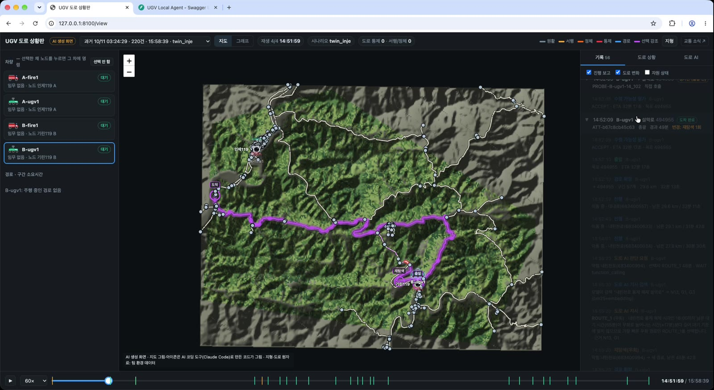

저장소에 넣어 둔 기록을 다른 기계에서 볼 때는 기록 폴더를 따로 지정합니다:

```bash
mkdir -p /tmp/ugv_replay
cp docs/ugv/evidence/2026-10-11_final/history_final_main_20261011T125624.jsonl /tmp/ugv_replay/20261011T125624.jsonl
UGV_HISTORY_DIR=/tmp/ugv_replay UGV_DRIVER=sim python -m uvicorn ugv.server:app --port 8100
```

이 밖의 기록(주행 CSV, 임무 저장, 서버 출력)은 7장 2. 로그 위치에 있습니다.

#### 5. Gazebo world

##### 1. world 제작

**왜 따로 만들었나.** 처음에는 드론 팀의 강원 월드를 썼는데, 그 지형은 90 m 격자 DEM을 56 m 간격으로 보간한 것이라 도로를 모릅니다. 마을이 산자락과 만나는 곳에서 원래는 평평한 칸인데도 보간 때문에 62 m 사이 8 m 오르는 가짜 오르막이 생겨, r1_rover가 같은 지점에서 두 번 멈췄습니다(10/2, `STALLED`). 지형에 도로를 맞출 수 없으니 반대로 **도로 데이터로 주행 면을 만들었습니다** ([tools/build_road_world.py](tools/build_road_world.py)).

**만드는 것** (`ugv/gazebo/` 아래, 드론 파일은 건드리지 않음)
- `models/kangwon_ugv2/roads.obj` — 도로 면. 보이는 면과 부딪히는 면을 같은 메시 하나로 씁니다.
- `models/kangwon_ugv2/heightmap.png` — 도로 밑을 도로보다 낮게 깎은 지형 (지형이 도로를 뚫고 올라오지 않게)
- `kangwon_ugv2.sdf` — 월드. 그리고 `ugv/data/road_network.json`의 월드·스폰 위치를 갱신합니다.

**도로 높이 정하기**
1. 노드(교차로) 높이 = 원본 DEM(90 m)에서 보간
2. 도로를 잘게 나눠 DEM을 찍고 이동평균으로 90 m 격자의 계단을 없앰
3. 양 끝을 노드 높이에 맞춤 → 교차로에서 도로끼리 높이가 이어짐
4. 경사 상한을 둠
5. 도로 양옆에 비스듬히 내려가는 갓길(0.6 m)을 둠 — 코너를 질러도 낭떠러지로 떨어지지 않음 (10/3 주행 뒤 추가)

그 결과 10 cm 넘는 턱이 12,316칸에서 145칸으로 줄었고, 2 m/s 주행에서는 턱으로 멈추지 않았습니다. 남은 턱이 0은 아니어서, 다른 차량 모델로 시속 약 60 km 진입한 팀 시험(10/9)에서는 교차로 한 곳(높이차 0.65~1.15 m)에서 전복이 확인됐습니다.

실행 (`build_road_network.py` 다음, 한 번만): `python3 -m ugv.tools.build_road_world`. 개발용이라 numpy·scipy·pillow·rasterio·pyproj가 필요하고 서버 실행에는 필요 없습니다. 소방차 모델(경광등·방수포)은 [tools/make_fire_truck.py](tools/make_fire_truck.py)로 만듭니다.

##### 2. 시간과 속도

시계가 둘입니다. UGV 서버의 시뮬레이션 시계와 Gazebo의 물리 시간입니다.
- **트윈(통합)** — UGV 시계는 환경 모듈 시각을 따릅니다. `UGV_TIME_SCALE`은 환경이 10초 넘게 응답하지 않을 때 혼자 흘리는 배속일 뿐입니다.
- **Gazebo 단독** — PX4 드라이버를 쓰면 UGV 시계가 Gazebo 시간을 따릅니다(`UGV_CLOCK_SOURCE=px4`, 기본). 이때 PX4 쪽 `SPEED`(`PX4_SIM_SPEED_FACTOR`, Gazebo를 실시간의 몇 배로 돌릴지)와 `UGV_TIME_SCALE`을 같게 줘야 ETA 계산과 실제 주행이 같은 시계로 맞습니다.

**배속 측정** ([`2026-10-11_gazebo_speed`](../docs/ugv/evidence/2026-10-11_gazebo_speed/)) — 요청한 배속을 Gazebo가 실제로 얼마나 내는지 쟀습니다.

|기계|조건|요청 → 실제|
|---|---|---|
|Windows WSL (기준 환경)|화면 끔, 빈 월드|10 → 3.5~4.2|
|Windows WSL|화면 켬, 도로 월드 주행|4 → 약 3.2 (도착, ETA 대비 1.05)|
|macOS|화면 끔, 도로 월드 주행|10 → 9.99 (도착, ETA 대비 1.01)|
|macOS|화면 끔|30 → PX4 시동 전 점검 실패 / 정지 상태 상한 약 39|

어느 환경에서도 시연 배속 100에 못 미치고, r1_rover는 2 m/s(시속 7.2 km)가 상한이라 시속 60 km를 가정한 트윈과 시간이 맞지 않습니다. 그래서 시연은 sim으로 하고, Gazebo는 4배 단독 주행으로 동작만 확인했습니다. 통합할 때는 시속 60 km를 내는 차량 모델로 바꾸거나 PX4 속도 상한을 올려 Gazebo도 시연 배속에 맞춰야 합니다 (공통 문서 8-3).

### 2-2. 구현·통합되지 않은 기능

코드는 있지만 설정으로 꺼 두었거나, 아직 다른 모듈과 이어지지 않은 기능입니다. 도로 판단 AI(막힌 도로 앞에서 우회·대기를 생성형 AI가 결정)는 이 브랜치에 없고 별도 PR(`feat/ugv-road-ai`)에서 다룹니다.

|기능|설명|위치|
|---|---|---|
|직접 측정·전송|UGV는 위치만 보고합니다. 열화상 등 측정값은 오케스트레이터가 그 위치·시각으로 환경 모듈에서 가져옵니다|[server.py](server.py)<br>└ [`observation`](server.py#L449)|
|진압 (소방차)|도착 뒤 물을 쓰며 진압 상태가 됩니다. 환경 모듈의 불에는 반영되지 않습니다. `UGV_SUPPRESSION=1`일 때만 켜집니다|[equipment.py](equipment.py)<br>[server.py](server.py)<br>├ [`_work`](server.py#L733)<br>└ [`suppress`](server.py#L891)|
|배터리 기반 판단·복귀|배터리는 계산해 보고만 하고, 어디에서도 판단에 쓰지 않습니다. 오케스트레이터도 UGV의 배터리 값을 읽지 않습니다. sim에서는 1 km당 1 %씩 줄지만 0 %가 되어도 멈추지 않습니다. 복귀 기준값(`FUEL_RETURN_MARGIN_PCT`)은 정의만 있습니다|[config.py](config.py#L95)<br>[drivers/sim.py](drivers/sim.py#L95)|
|고장 자동 해제|사용 불가(UNAVAILABLE) 해제는 정지 명령(`/stop`)으로 하는데, 오케스트레이터는 이를 호출하지 않습니다. 지금은 운영자가 해제합니다|—|
|짐 싣기·운반|짐(`cargo`)과 싣는 곳(`via_node`)을 주면 적재 한도(UGV 100 kg)를 보고 지금 위치 → 싣는 곳 → 목적지로 갑니다. 이번 범위에서는 짐을 옮기지 않기로 해 쓰지 않으며, 오케스트레이터도 보내지 않습니다. 짐을 보내면 적재 한도를 가장 먼저 보고 넘으면 `REQUIRED_CAPABILITY_UNAVAILABLE`로 거절합니다|[server.py](server.py)<br>├ [`_decide`](server.py#L304) (적재 한도·경유지)<br>└ [`_stages`](server.py#L536)<br>[equipment.py](equipment.py)|
|Gazebo 실제 속도 주행|r1_rover는 2.0 m/s 상한이라 시속 60 km 주행은 sim에서만 합니다|[config.py](config.py)|


---

## 3. 입력·출력 데이터, 좌표·시간·단위·ID 기준

### 3-1. 좌표·시간·단위·ID 기준

|구분|항목|기준|예시|
|---|---|---|---|
|좌표|위치|위도·경도 (WGS84, 십진 도)|`{"lat": 38.02845, "lon": 128.1309}`|
|좌표|주행 기록의 평면 좌표|기준점에서 북쪽·동쪽 미터 (`north_m`, `east_m`). 수 km 안에서만 쓰는 근사|`north_m: -9.55, east_m: 10.11`|
|좌표|환경 격자 칸|환경 모듈 격자 `x`(열)·`y`(행), 한 칸 90 m|`{"x": 171, "y": 235}`|
|좌표|도로 위 지점|도로 ID + 도로 시작 노드에서 도로를 따라 잰 거리 `along_m` + 원래 목표에서 도로까지 거리 `snap_m`|`{"road_id": "683300182", "along_m": 120.4, "snap_m": 35.0}`|
|시간|시뮬레이션 시각|시뮬레이션 초 (`sim_time_s`). 환경 모듈 `/health`의 `simulation_time_s`를 따름|`sim_time_s: 604.2`|
|시간|실제 시각 대응|`scenario_start_kst` + 시뮬레이션 초. 2019 인제 재현은 00:00 = 2019-04-04 14:45 KST|`00:10` → 14:55|
|시간|시나리오 시각|시뮬레이션 시계 기준 `시:분`, 초, 또는 환경 스텝(`step:10`)|`00:10`, `600`, `step:10`|
|시간|예상 도착 시간|`eta_sec`, `eta_remaining_sec`: 시뮬레이션 초|`eta_sec: 309`|
|시간|배속|`UGV_TIME_SCALE`: 시뮬레이션 초 ÷ 실제 초 (기본 1)|`10` → 실제 1초에 10초|
|시간|환경 스텝|환경 1스텝 = 60 시뮬레이션 초 (`UGV_SECONDS_PER_ENV_STEP`)|—|
|시간|갱신 시각|`updated_at`: 실제 시각 (epoch 초). 0이면 아직 수신 없음|`1791531777.2`|
|단위|거리|m (`distance_m`, `remaining_m`, `snap_m`)|—|
|단위|속도|코드 내부 m/s, 설정·도로 자료 km/h. 차량 sim 60 km/h, 도로 최저 50 km/h|`16.67 m/s` = 60 km/h|
|단위|배터리|% (`fuel_pct`)|`fuel_pct: 82.5`|
|단위|혼잡|통과 시간 배율 (1.0 = 평소, 2.0 = 두 배 걸림)|`2.0`|
|ID|차량|`resource_id`: `거점-종류번호`|`A-ugv1`, `B-ugv1`, `A-fire1`, `B-fire1`|
|ID|차량 종류|`resource_type`|`UGV`, `FIRE_ENGINE`|
|ID|거점|`base`: A = 인제119, B = 기린119|`A`|
|ID|노드|`node_id`: 도로망 원자료 노드 번호 (문자열)|`495007`|
|ID|도로|`road_id`: 도로망 원자료 링크 번호 (문자열)|`682501557`|
|ID|임무·판단|`task_id`, `decision_id`: 오케스트레이터가 정함|`ATT-…`|
|ID|실행 기록|`run_id`: 서버를 켠 시각 `YYYYMMDDTHHMMSS`|`20261009T200528`|

### 3-2. UGV 서버 API (:8100)

Swagger: <http://localhost:8100/docs> · 모델 정의: [ugv/api_models.py](api_models.py)

#### 1) 오케스트레이터와 주고받는 호출 (핵심)

|기능|요청|설명|입력값|출력값|호출 위치|
|---|---|---|---|---|---|
|전체 차량 상태|[GET /ugv](http://localhost:8100/docs#/default/list_state_ugv_get)|모든 차량의 지금 상태. 오케스트레이터가 배정 후보를 고를 때 읽습니다(위치·대기 여부). 배터리(`fuel_pct`)도 응답에 있지만 오케스트레이터는 읽지 않습니다|**쿼리**<hr><pre>base: A  # 거점 A / B로 거르기. 선택</pre>|**차량 상태 목록 ([[`UgvState`](api_models.py#L15)])**<hr><pre>{                                   # 목록의 항목 하나 (차량마다 하나씩)<br>&nbsp;&nbsp;"resource_id": "A-ugv1",          # 차량 ID<br>&nbsp;&nbsp;"resource_type": "UGV",           # UGV / FIRE_ENGINE<br>&nbsp;&nbsp;"base": "A",                      # 소속 거점 A / B<br>&nbsp;&nbsp;"state": "READY",                 # READY 대기 / RUNNING 주행 중 / UNAVAILABLE 이상<br>&nbsp;&nbsp;"position": {                     # 현재 위치 (LatLon)<br>&nbsp;&nbsp;&nbsp;&nbsp;"lat": 38.061984,               # 위도<br>&nbsp;&nbsp;&nbsp;&nbsp;"lon": 128.168513               # 경도<br>&nbsp;&nbsp;},<br>&nbsp;&nbsp;"fuel_pct": 100.0,                # 배터리 %, 표시용 · 실수<br>&nbsp;&nbsp;"current_node": "A",              # 서 있는 노드. 주행 중이면 null · 문자열<br>&nbsp;&nbsp;"current_task_id": null,          # 수행 중 임무 ID<br>&nbsp;&nbsp;"driver": "sim",                  # sim / px4<br>&nbsp;&nbsp;"driver_status": "IDLE",          # 드라이버 상태. sim: IDLE / MISSION / ARRIVED<br>&nbsp;&nbsp;"updated_at": 1791626792.599613,  # 마지막 갱신 실제 시각, epoch 초 · 실수<br>&nbsp;&nbsp;"fault": null,                    # 이상 내용. UNAVAILABLE일 때만<br>&nbsp;&nbsp;"current_road_id": null,          # 주행 중인 도로 ID · 문자열<br>&nbsp;&nbsp;"sim_time_s": 0.0,                # 응답 시점 시뮬레이션 초 · 실수<br>&nbsp;&nbsp;"activity": "IDLE",               # 도착 뒤 작업 IDLE / LOADING / SUPPRESSING / UNLOADING<br>&nbsp;&nbsp;"equipment": {…}                  # 장비 상태 (물·펌프·적재·경광등)<br>}</pre>|[orchestrator/resources.py](../orchestrator/resources.py)<br>└ [`UgvClient.states`](../orchestrator/resources.py#L142)<br>[connectors/ugv_connector.py](../connectors/ugv_connector.py#L139)<br>[web/app.py](../web/app.py#L461) (웹 관제판)|
|주행 전 평가|[POST /ugv/{resource_id}/evaluate](http://localhost:8100/docs#/default/evaluate_ugv__resource_id__evaluate_post)|**차를 움직이지 않고** 갈 수 있는지와 걸리는 시간을 판단합니다. 목표 좌표를 반경 2 km 안 도로 위 지점(기본) 또는 도로 노드로 붙이고 Dijkstra로 경로·ETA를 구합니다|**경로**<hr><pre>resource_id: A-ugv1  # 차량 ID. A-ugv1 / B-ugv1 / A-fire1 / B-fire1</pre><br>**body ([`EvaluateRequest`](api_models.py#L39))**<hr><pre>{<br>&nbsp;&nbsp;"task_id": "T1",       # 임무 ID. 필수<br>&nbsp;&nbsp;"decision_id": "D1",   # 오케스트레이터 판단 ID. 필수<br>&nbsp;&nbsp;"target": {            # 목표 좌표. target_node와 둘 중 하나. 선택 (LatLon)<br>&nbsp;&nbsp;&nbsp;&nbsp;"lat": 38.02845,     # 위도<br>&nbsp;&nbsp;&nbsp;&nbsp;"lon": 128.1309      # 경도<br>&nbsp;&nbsp;},<br>&nbsp;&nbsp;"target_node": null,   # 도로 노드 ID를 직접 지정할 때. 선택 · 문자열<br>&nbsp;&nbsp;"cargo": null,         # 짐 싣기. 쓰지 않음 (2-2)<br>&nbsp;&nbsp;"via_node": null,      # 짐 싣는 노드. 쓰지 않음 (2-2)<br>&nbsp;&nbsp;"target_mode": "node"  # node 교차로에 서기(기본) / road_point 도로 중간에 서기. 선택<br>}</pre>|**평가 결과 ([`EvaluateResponse`](api_models.py#L64))**<hr><pre>{                              # 수락 예 (node 방식). 거절이면 verdict: REJECT, reason 채워짐, eta_sec·path: null<br>&nbsp;&nbsp;"task_id": "T1",             # 요청의 임무 ID<br>&nbsp;&nbsp;"decision_id": "D1",         # 요청의 판단 ID<br>&nbsp;&nbsp;"resource_id": "A-ugv1",     # 차량 ID<br>&nbsp;&nbsp;"verdict": "ACCEPT",         # ACCEPT 수락 / REJECT 거절<br>&nbsp;&nbsp;"eta_sec": 344,              # 예상 도착 시뮬레이션 초. ACCEPT일 때만 · 정수<br>&nbsp;&nbsp;"reason": null,              # 거절 이유 BUSY / ROAD_BLOCKED / TARGET_UNREACHABLE 등<br>&nbsp;&nbsp;"detail": null,              # 부가 설명<br>&nbsp;&nbsp;"target_node": {             # 실제로 향할 노드 (TargetNode)<br>&nbsp;&nbsp;&nbsp;&nbsp;"node_id": "494959",       # 향할 도로 노드 ID · 문자열<br>&nbsp;&nbsp;&nbsp;&nbsp;"lat": 38.028786,          # 위도<br>&nbsp;&nbsp;&nbsp;&nbsp;"lon": 128.130717,         # 경도<br>&nbsp;&nbsp;&nbsp;&nbsp;"snap_m": 40.7             # node 방식: 목표 좌표에서 이 노드까지 직선 m / road_point 방식: stop_point.snap_m과 같은 값<br>&nbsp;&nbsp;},<br>&nbsp;&nbsp;"path": ["A", "495012", …],  # 경로 노드 ID 목록, 출발 포함 · 문자열<br>&nbsp;&nbsp;"stop_point": {              # road_point 방식일 때만 채워짐. 실제로 설 도로 위 점 (StopPoint). 없으면 null<br>&nbsp;&nbsp;&nbsp;&nbsp;"road_id": "682501427",    # 지점이 있는 도로 ID · 문자열<br>&nbsp;&nbsp;&nbsp;&nbsp;"lat": 38.028593,          # 위도<br>&nbsp;&nbsp;&nbsp;&nbsp;"lon": 128.130579,         # 경도<br>&nbsp;&nbsp;&nbsp;&nbsp;"snap_m": 32.3,            # 목표 좌표에서 지점까지 m<br>&nbsp;&nbsp;&nbsp;&nbsp;"along_m": 44.4            # 도로 시작 노드에서 도로를 따라 지점까지 m<br>&nbsp;&nbsp;}<br>}</pre>|[orchestrator/resources.py](../orchestrator/resources.py)<br>└ [`UgvClient.evaluate`](../orchestrator/resources.py#L168)<br>[connectors/ugv_connector.py](../connectors/ugv_connector.py#L173)|
|주행 시작|[POST /ugv/{resource_id}/execute](http://localhost:8100/docs#/default/execute_ugv__resource_id__execute_post)|같은 규칙으로 다시 판단한 뒤 출발합니다. 같은 요청이 다시 오면 새로 출발하지 않고 `duplicate=true`를 돌려줍니다|**경로**<hr><pre>resource_id: A-ugv1  # 차량 ID. A-ugv1 / B-ugv1 / A-fire1 / B-fire1</pre><br>**body ([`ExecuteRequest`](api_models.py#L77))**<hr><pre>{                        # 주행 전 평가와 같음<br>&nbsp;&nbsp;"task_id": "T1",       # 임무 ID. 필수<br>&nbsp;&nbsp;"decision_id": "D1",   # 오케스트레이터 판단 ID. 필수<br>&nbsp;&nbsp;"target": {            # 목표 좌표. target_node와 둘 중 하나. 선택 (LatLon)<br>&nbsp;&nbsp;&nbsp;&nbsp;"lat": 38.02845,     # 위도<br>&nbsp;&nbsp;&nbsp;&nbsp;"lon": 128.1309      # 경도<br>&nbsp;&nbsp;},<br>&nbsp;&nbsp;"target_node": null,   # 도로 노드 ID를 직접 지정할 때. 선택 · 문자열<br>&nbsp;&nbsp;"cargo": null,         # 짐 싣기. 쓰지 않음 (2-2)<br>&nbsp;&nbsp;"via_node": null,      # 짐 싣는 노드. 쓰지 않음 (2-2)<br>&nbsp;&nbsp;"target_mode": "node"  # node 교차로에 서기(기본) / road_point 도로 중간에 서기. 선택<br>}</pre>|**출발 결과 ([`ExecuteResponse`](api_models.py#L87))**<hr><pre>{<br>&nbsp;&nbsp;"task_id": "T1",                        # 임무 ID<br>&nbsp;&nbsp;"resource_id": "A-ugv1",                # 차량 ID<br>&nbsp;&nbsp;"status": "STARTED",                    # 항상 STARTED<br>&nbsp;&nbsp;"tracking_url": "/ugv/A-ugv1/task/T1",  # 진행 조회 주소<br>&nbsp;&nbsp;"target_node": {                        # 향하는 노드 (TargetNode)<br>&nbsp;&nbsp;&nbsp;&nbsp;"node_id": "494959",                  # 향할 도로 노드 ID · 문자열<br>&nbsp;&nbsp;&nbsp;&nbsp;"lat": 38.028786,                     # 위도<br>&nbsp;&nbsp;&nbsp;&nbsp;"lon": 128.130717,                    # 경도<br>&nbsp;&nbsp;&nbsp;&nbsp;"snap_m": 40.7                        # node 방식: 목표 좌표에서 이 노드까지 직선 m / road_point 방식: stop_point.snap_m과 같은 값<br>&nbsp;&nbsp;},<br>&nbsp;&nbsp;"eta_sec": 344,                         # 출발 시점 예상 도착 시뮬레이션 초 · 정수<br>&nbsp;&nbsp;"stop_point": {                         # road_point 방식일 때만 채워짐 (StopPoint). 없으면 null<br>&nbsp;&nbsp;&nbsp;&nbsp;"road_id": "682501427",               # 지점이 있는 도로 ID · 문자열<br>&nbsp;&nbsp;&nbsp;&nbsp;"lat": 38.028593,                     # 위도<br>&nbsp;&nbsp;&nbsp;&nbsp;"lon": 128.130579,                    # 경도<br>&nbsp;&nbsp;&nbsp;&nbsp;"snap_m": 32.3,                       # 목표 좌표에서 지점까지 m<br>&nbsp;&nbsp;&nbsp;&nbsp;"along_m": 44.4                       # 도로 시작 노드에서 도로를 따라 지점까지 m<br>&nbsp;&nbsp;},<br>&nbsp;&nbsp;"duplicate": false,                     # 같은 요청 재전송이면 true (새로 출발하지 않음)<br>&nbsp;&nbsp;"current_status": null                  # duplicate일 때 그 임무의 지금 상태<br>}</pre>|[orchestrator/resources.py](../orchestrator/resources.py)<br>└ [`UgvClient.execute`](../orchestrator/resources.py#L181)<br>[connectors/ugv_connector.py](../connectors/ugv_connector.py#L225)|
|임무 진행 조회|[GET /ugv/{resource_id}/task/{task_id}](http://localhost:8100/docs#/default/get_task_ugv__resource_id__task__task_id__get)|오케스트레이터가 주기적으로 물어 도착·실패를 압니다|**경로**<hr><pre>resource_id: A-ugv1  # 차량 ID<br>task_id: T1          # 주행 시작에 쓴 임무 ID</pre>|**임무 진행 상태 ([`TaskStatus`](api_models.py#L99))**<hr><pre>{                                              # 주행 중 예<br>&nbsp;&nbsp;"task_id": "T1",                             # 임무 ID<br>&nbsp;&nbsp;"resource_id": "A-ugv1",                     # 차량 ID<br>&nbsp;&nbsp;"status": "IN_PROGRESS",                     # STARTED / IN_PROGRESS / COMPLETED / FAILED / CANCELLED<br>&nbsp;&nbsp;"target_node": "494959",                     # 목적지 노드 ID · 문자열<br>&nbsp;&nbsp;"progress": {                                # 진행 상황 (아래 객체)<br>&nbsp;&nbsp;&nbsp;&nbsp;"phase": "ENROUTE",                        # ENROUTE 주행 중 등<br>&nbsp;&nbsp;&nbsp;&nbsp;"stage": "1/1",                            # 구간 번호 / 전체<br>&nbsp;&nbsp;&nbsp;&nbsp;"leg_target": "494959",                    # 이 구간의 목적 노드 · 문자열<br>&nbsp;&nbsp;&nbsp;&nbsp;"waypoint": 8,                             # 지난 경로점 수<br>&nbsp;&nbsp;&nbsp;&nbsp;"total": 44,                               # 전체 경로점 수<br>&nbsp;&nbsp;&nbsp;&nbsp;"remaining_m": 4818,                       # 남은 거리 m<br>&nbsp;&nbsp;&nbsp;&nbsp;"eta_remaining_sec": 293,                  # 남은 시뮬레이션 초 · 정수<br>&nbsp;&nbsp;&nbsp;&nbsp;"current_road_id": "682500523",            # 지금 도로 ID · 문자열<br>&nbsp;&nbsp;&nbsp;&nbsp;"sim_time_s": 50.3                         # 기록 시점 시뮬레이션 초 · 실수<br>&nbsp;&nbsp;},<br>&nbsp;&nbsp;"observation": null,                         # 도착 시 도로 상태 관측<br>&nbsp;&nbsp;"error": null,                               # 실패·취소 이유<br>&nbsp;&nbsp;"reroutes": null,                            # 주행 중 우회 기록<br>&nbsp;&nbsp;"agent_restart": null,                       # 서버 재시작으로 끊긴 경우 근거<br>&nbsp;&nbsp;"cargo": null,                               # 짐 기록. 쓰지 않음<br>&nbsp;&nbsp;"work": null,                                # 도착 뒤 작업 기록<br>&nbsp;&nbsp;"timing": null,                              # 시작·끝 시각, 실제/ETA 비율<br>&nbsp;&nbsp;"drive_log": "/tmp/ugvcap/drive_logs/T1.…",  # 주행 CSV 경로<br>&nbsp;&nbsp;"stop_point": null                           # 도로 위 지점<br>}</pre>|[orchestrator/resources.py](../orchestrator/resources.py)<br>└ [`UgvClient.task_status`](../orchestrator/resources.py#L192)<br>[connectors/ugv_connector.py](../connectors/ugv_connector.py#L233)|
|현재 위치 관측|[GET /ugv/{resource_id}/observation](http://localhost:8100/docs#/default/observation_ugv__resource_id__observation_get)|**화재 관측이 아닙니다.** 위치와 도로 상태만 줍니다|**경로**<hr><pre>resource_id: A-ugv1  # 차량 ID. A-ugv1 / B-ugv1 / A-fire1 / B-fire1</pre>|**위치 관측**<hr><pre>{<br>&nbsp;&nbsp;"resource_id": "A-ugv1",            # 차량 ID<br>&nbsp;&nbsp;"location_lat": 38.056315,          # 현재 위도<br>&nbsp;&nbsp;"location_lon": 128.16266,          # 현재 경도<br>&nbsp;&nbsp;"observation_type": "ROAD_STATUS",  # 항상 ROAD_STATUS<br>&nbsp;&nbsp;"value": {                          # 도로 상태 (아래 객체)<br>&nbsp;&nbsp;&nbsp;&nbsp;"state": "RUNNING",               # 차량 상태<br>&nbsp;&nbsp;&nbsp;&nbsp;"current_node": null,             # 서 있는 노드 · 문자열<br>&nbsp;&nbsp;&nbsp;&nbsp;"current_task_id": "T1",          # 수행 중 임무 ID<br>&nbsp;&nbsp;&nbsp;&nbsp;"blocked_roads": 0,               # 막힌 도로 수<br>&nbsp;&nbsp;&nbsp;&nbsp;"blocked_nodes": 0                # 막힌 노드 수<br>&nbsp;&nbsp;}<br>}</pre>|[connectors/ugv_connector.py](../connectors/ugv_connector.py#L213)|
|차량 하나 상태|[GET /ugv/{resource_id}/state](http://localhost:8100/docs#/default/get_state_ugv__resource_id__state_get)|위와 같은 내용, 한 대만|**경로**<hr><pre>resource_id: A-ugv1  # 차량 ID. A-ugv1 / B-ugv1 / A-fire1 / B-fire1</pre>|**차량 상태 ([`UgvState`](api_models.py#L15))**<hr><pre>{                                   # 전체 차량 상태의 항목 하나와 같음<br>&nbsp;&nbsp;"resource_id": "A-ugv1",          # 차량 ID<br>&nbsp;&nbsp;"resource_type": "UGV",           # UGV / FIRE_ENGINE<br>&nbsp;&nbsp;"base": "A",                      # 소속 거점 A / B<br>&nbsp;&nbsp;"state": "READY",                 # READY 대기 / RUNNING 주행 중 / UNAVAILABLE 이상<br>&nbsp;&nbsp;"position": {                     # 현재 위치 (LatLon)<br>&nbsp;&nbsp;&nbsp;&nbsp;"lat": 38.061984,               # 위도<br>&nbsp;&nbsp;&nbsp;&nbsp;"lon": 128.168513               # 경도<br>&nbsp;&nbsp;},<br>&nbsp;&nbsp;"fuel_pct": 100.0,                # 배터리 %, 표시용 · 실수<br>&nbsp;&nbsp;"current_node": "A",              # 서 있는 노드. 주행 중이면 null · 문자열<br>&nbsp;&nbsp;"current_task_id": null,          # 수행 중 임무 ID<br>&nbsp;&nbsp;"driver": "sim",                  # sim / px4<br>&nbsp;&nbsp;"driver_status": "IDLE",          # 드라이버 상태. sim: IDLE / MISSION / ARRIVED<br>&nbsp;&nbsp;"updated_at": 1791626792.603343,  # 마지막 갱신 실제 시각, epoch 초 · 실수<br>&nbsp;&nbsp;"fault": null,                    # 이상 내용. UNAVAILABLE일 때만<br>&nbsp;&nbsp;"current_road_id": null,          # 주행 중인 도로 ID · 문자열<br>&nbsp;&nbsp;"sim_time_s": 0.0,                # 응답 시점 시뮬레이션 초 · 실수<br>&nbsp;&nbsp;"activity": "IDLE",               # 도착 뒤 작업 IDLE / LOADING / SUPPRESSING / UNLOADING<br>&nbsp;&nbsp;"equipment": {…}                  # 장비 상태 (물·펌프·적재·경광등)<br>}</pre>|없음 (확인용)|
|정지|[POST /ugv/{resource_id}/stop](http://localhost:8100/docs#/default/stop_ugv__resource_id__stop_post)|진행 중 임무는 취소(CANCELLED)됩니다. 사용 불가(UNAVAILABLE) 해제도 이것으로 합니다|**경로**<hr><pre>resource_id: A-ugv1  # 차량 ID. A-ugv1 / B-ugv1 / A-fire1 / B-fire1</pre>|**정지 결과**<hr><pre>{<br>&nbsp;&nbsp;"resource_id": "A-ugv1",   # 차량 ID<br>&nbsp;&nbsp;"cancelled_task": "T1",    # 취소된 임무 ID. 없으면 null<br>&nbsp;&nbsp;"stopped_work": false,     # 도착 뒤 작업도 멈췄는지<br>&nbsp;&nbsp;"state": "READY",          # 정지 후 상태<br>&nbsp;&nbsp;"current_node": "494990",  # 선 것으로 보는 가장 가까운 노드 · 문자열<br>&nbsp;&nbsp;"position": {              # 정지 위치<br>&nbsp;&nbsp;&nbsp;&nbsp;"lat": 38.056315,        # 위도<br>&nbsp;&nbsp;&nbsp;&nbsp;"lon": 128.16266         # 경도<br>&nbsp;&nbsp;}<br>}</pre>|없음 (운영자가 직접. 사용 불가 해제에도 씀)|
|진압 제어 (소방차)|[POST /ugv/{resource_id}/suppress](http://localhost:8100/docs#/default/suppress_ugv__resource_id__suppress_post)|미통합 기능. `UGV_SUPPRESSION=1`이 아니면 시작 요청은 409|**경로**<hr><pre>resource_id: A-ugv1  # 차량 ID. A-ugv1 / B-ugv1 / A-fire1 / B-fire1</pre><br>**body ([`SuppressRequest`](api_models.py#L116))**<hr><pre>{<br>&nbsp;&nbsp;"action": "stop",  # start 시작 / stop 멈춤. 필수<br>&nbsp;&nbsp;"task_id": null    # 기록용 임무 ID. 선택<br>}</pre>|**진압 상태**<hr><pre>{<br>&nbsp;&nbsp;"resource_id": "A-fire1",  # 차량 ID<br>&nbsp;&nbsp;"state": "READY",          # 차량 상태<br>&nbsp;&nbsp;"equipment": {…}           # 장비 상태<br>}</pre><br>진압 중이 아닌데 stop, 또는 꺼진 상태에서 start면 409|없음 (미통합 기능)|

#### 2) 상태·기록 조회

|기능|요청|설명|입력값|출력값|호출 위치|
|---|---|---|---|---|---|
|서버 상태|[GET /health](http://localhost:8100/docs#/default/health_health_get)|서버가 떠 있는지, 어떤 설정으로 떴는지|없음|**서버 상태**<hr><pre>{<br>&nbsp;&nbsp;"status": "ok",                         # ok<br>&nbsp;&nbsp;"driver": "sim",                        # sim / px4<br>&nbsp;&nbsp;"resources": {…},                       # 차량별 드라이버<br>&nbsp;&nbsp;"graph": {"nodes": 664, "roads": 820},  # 도로망 노드·도로 수<br>&nbsp;&nbsp;"approach": {…},                        # 목표 붙이기 설정<br>&nbsp;&nbsp;"clock": {…},                           # 시계 상태<br>&nbsp;&nbsp;"scenario": null,                       # 적용 중 시나리오 이름<br>&nbsp;&nbsp;"max_speed_mps": {…}                    # 차량별 최고속도 m/s<br>}</pre>|[run_servers.py](../run_servers.py#L99) (기동 확인)|
|주행 경로|[GET /ugv/{resource_id}/route](http://localhost:8100/docs#/default/get_route_ugv__resource_id__route_get)|지도에 그릴 경로 선형과 남은 거리·시간|**경로**<hr><pre>resource_id: A-ugv1  # 차량 ID. A-ugv1 / B-ugv1 / A-fire1 / B-fire1</pre>|**주행 경로**<hr><pre>{<br>&nbsp;&nbsp;"resource_id": "A-ugv1",         # 차량 ID<br>&nbsp;&nbsp;"target_node": "494959",         # 목적지 노드 · 문자열<br>&nbsp;&nbsp;"path": ["A", "495012", …],      # 경로 노드 ID · 문자열<br>&nbsp;&nbsp;"route": [[38.061984, "…"], …],  # 경로 선형 [위도, 경도] 목록<br>&nbsp;&nbsp;"waypoint": 9,                   # 지난 경로점 수<br>&nbsp;&nbsp;"total": 44,                     # 전체 경로점 수<br>&nbsp;&nbsp;"reroutes": 0,                   # 우회 횟수<br>&nbsp;&nbsp;"legs": [{                       # 도로별 구간 (아래 객체)<br>&nbsp;&nbsp;&nbsp;&nbsp;"road_id": "682501660",        # 도로 ID · 문자열<br>&nbsp;&nbsp;&nbsp;&nbsp;"name": "비봉로44번길",        # 도로 이름<br>&nbsp;&nbsp;&nbsp;&nbsp;"from": "A",                   # 출발 노드 · 문자열<br>&nbsp;&nbsp;&nbsp;&nbsp;"to": "495012",                # 도착 노드 · 문자열<br>&nbsp;&nbsp;&nbsp;&nbsp;"distance_m": 92,              # 길이 m<br>&nbsp;&nbsp;&nbsp;&nbsp;"congestion": 1.0,             # 혼잡 배율<br>&nbsp;&nbsp;&nbsp;&nbsp;"blocked": false,              # 막혔는지<br>&nbsp;&nbsp;&nbsp;&nbsp;"travel_s": 7,                 # 통과 시뮬레이션 초<br>&nbsp;&nbsp;&nbsp;&nbsp;"state": "DONE"                # DONE 지남 / 진행 중 / 남음<br>&nbsp;&nbsp;}, …],<br>&nbsp;&nbsp;"remaining_m": 4679,             # 남은 거리 m<br>&nbsp;&nbsp;"eta_remaining_sec": 283,        # 남은 시뮬레이션 초 · 정수<br>&nbsp;&nbsp;"current_road_id": "682501567",  # 지금 도로 ID · 문자열<br>&nbsp;&nbsp;"sim_time_s": 60.2               # 시뮬레이션 초 · 실수<br>}</pre>|[static/road_view.html](static/road_view.html) (도로 상황판)|
|시계|[GET /clock](http://localhost:8100/docs#/default/get_clock_clock_get)|UGV가 쓰는 시뮬레이션 시각과 실제 시각 대응|없음|**시계 상태**<hr><pre>{<br>&nbsp;&nbsp;"sim_time_s": 60.4,            # 시뮬레이션 초 · 실수<br>&nbsp;&nbsp;"env_step": 1.01,              # 환경 스텝 환산값<br>&nbsp;&nbsp;"time_scale": 20.0,            # 배속<br>&nbsp;&nbsp;"seconds_per_env_step": 60.0,  # 환경 1스텝의 시뮬레이션 초<br>&nbsp;&nbsp;"source": "local",             # local 혼자 / environment 환경 모듈 따라감<br>&nbsp;&nbsp;"environment": {…},            # 환경 모듈 연결 상태<br>&nbsp;&nbsp;"scenario_start_kst": null     # 시뮬레이션 0초의 실제 시각<br>}</pre>|[static/road_view.html](static/road_view.html) (도로 상황판)|
|실행 기록 목록|[GET /history/runs](http://localhost:8100/docs#/default/history_runs_history_runs_get)|서버를 켤 때마다 생기는 실행(run) 목록. 실행마다 사건 수와 마지막 시뮬레이션 시각|없음|**실행 목록**<hr><pre>{<br>&nbsp;&nbsp;"current": "20261010T100632",      # 지금 실행 ID<br>&nbsp;&nbsp;"runs": [{                         # 실행별 요약 (아래 객체)<br>&nbsp;&nbsp;&nbsp;&nbsp;"run_id": "20261010T100632",     # 실행 ID (서버 켠 시각)<br>&nbsp;&nbsp;&nbsp;&nbsp;"current": true,                 # 지금 실행인지<br>&nbsp;&nbsp;&nbsp;&nbsp;"events": 14,                    # 사건 수<br>&nbsp;&nbsp;&nbsp;&nbsp;"started_wall": 1791626792.491,  # 시작 실제 시각 · 실수, epoch 초<br>&nbsp;&nbsp;&nbsp;&nbsp;"last_wall": 1791626795.641,     # 마지막 사건 실제 시각 · 실수, epoch 초<br>&nbsp;&nbsp;&nbsp;&nbsp;"last_sim_time_s": 60.3,         # 마지막 시뮬레이션 초<br>&nbsp;&nbsp;&nbsp;&nbsp;"scenario": null,                # 시나리오<br>&nbsp;&nbsp;&nbsp;&nbsp;"driver": "sim"                  # sim / px4<br>&nbsp;&nbsp;}]<br>}</pre>|[static/road_view.html](static/road_view.html) (도로 상황판 기록 탭)|
|실행 기록 사건|[GET /history/runs/{run_id}](http://localhost:8100/docs#/default/history_events_history_runs__run_id__get)|한 실행의 사건(판단·주행·고장)을 시뮬레이션 시각과 함께 순서대로. 다시 보기의 근거|**경로**<hr><pre>run_id: 20261010T100632  # 실행 ID</pre><br>**쿼리**<hr><pre>after: 0  # 이 번호 다음 사건부터. 기본 0 · 정수<br>limit: 3  # 최대 개수 · 정수</pre>|**실행 사건 목록**<hr><pre>{<br>&nbsp;&nbsp;"run_id": "20261010T100632",  # 실행 ID<br>&nbsp;&nbsp;"current": true,              # 지금 실행인지<br>&nbsp;&nbsp;"events": [{                  # 사건 목록 (아래 객체)<br>&nbsp;&nbsp;&nbsp;&nbsp;"seq": 1,                   # 순번 · 정수<br>&nbsp;&nbsp;&nbsp;&nbsp;"wall": 1791626792.491,     # 실제 시각 epoch 초 · 실수<br>&nbsp;&nbsp;&nbsp;&nbsp;"sim_time_s": 0.1,          # 시뮬레이션 초 · 실수<br>&nbsp;&nbsp;&nbsp;&nbsp;"type": "RUN_START",        # 사건 종류 (RUN_START, UGV_EVALUATED 등)<br>&nbsp;&nbsp;&nbsp;&nbsp;"resource_id": null,        # 차량 ID<br>&nbsp;&nbsp;&nbsp;&nbsp;"task_id": null,            # 임무 ID<br>&nbsp;&nbsp;&nbsp;&nbsp;"data": {…}                 # 사건별 내용<br>&nbsp;&nbsp;}, …],<br>&nbsp;&nbsp;"next_after": 3,              # 다음에 이어 읽을 번호<br>&nbsp;&nbsp;"more": true                  # 더 있는지<br>}</pre>|[static/road_view.html](static/road_view.html) (도로 상황판 기록 탭)|
|보고 기록|[GET /reports](http://localhost:8100/docs#/default/reports_reports_get)|오케스트레이터에 보낸(보낼) 사건 목록. `UGV_REPORT_URL`이 비어 있으면 기록만 하고 보내지 않습니다|**쿼리**<hr><pre>limit: 2  # 최근 몇 개. 기본 30 · 정수</pre>|**보고 기록**<hr><pre>{<br>&nbsp;&nbsp;"enabled": false,   # 보고 전송 여부<br>&nbsp;&nbsp;"url": "",          # 보고 주소. 비면 기록만<br>&nbsp;&nbsp;"sent": 0,          # 보낸 수<br>&nbsp;&nbsp;"failed": 0,        # 실패 수<br>&nbsp;&nbsp;"dropped": 0,       # 버린 수<br>&nbsp;&nbsp;"queued": 0,        # 대기 수<br>&nbsp;&nbsp;"recent": [{…}, …]  # 최근 보고 (event_id · type · payload)<br>}</pre>|없음 (시험·확인용)|

#### 3) 도로 상황·시계 조작 (시험·시나리오 변경용)

|기능|요청|설명|입력값|출력값|호출 위치|
|---|---|---|---|---|---|
|시나리오 보기|[GET /scenario](http://localhost:8100/docs#/default/get_scenario_scenario_get)|적용 중인 도로 시나리오의 규칙과 지금 켜진 규칙. `UGV_SCENARIO`를 비우고 띄우면 "시나리오 없음"|없음|**시나리오 상태**<hr><pre>{<br>&nbsp;&nbsp;"name": "inje_girin",                                     # 시나리오 이름. 없으면 null<br>&nbsp;&nbsp;"description": "",                                        # 설명<br>&nbsp;&nbsp;"source": "ugv/scenarios/inje_girin.csv",                 # 파일 경로<br>&nbsp;&nbsp;"sim_time_s": 620.0,                                      # 지금 시뮬레이션 초 · 실수<br>&nbsp;&nbsp;"sim_time": "00:10:20",                                   # 지금 시각 시:분:초<br>&nbsp;&nbsp;"active": [{                                              # 지금 켜진 규칙<br>&nbsp;&nbsp;&nbsp;&nbsp;"no": 1,                                                # 규칙 번호<br>&nbsp;&nbsp;&nbsp;&nbsp;"kind": "road",                                         # road 도로 / node 노드 / congestion 혼잡<br>&nbsp;&nbsp;&nbsp;&nbsp;"targets": ["682501557"],                               # 대상 도로·노드 ID · 문자열<br>&nbsp;&nbsp;&nbsp;&nbsp;"start": "00:10",                                       # 시작 시:분<br>&nbsp;&nbsp;&nbsp;&nbsp;"end": "00:24",                                         # 끝 시:분<br>&nbsp;&nbsp;&nbsp;&nbsp;"value": null,                                          # 혼잡 배율. road·node는 null<br>&nbsp;&nbsp;&nbsp;&nbsp;"note": "설악로 남전리 아랫마을 낙석 잔해 정리 14분 …"  # 메모<br>&nbsp;&nbsp;}, …],<br>&nbsp;&nbsp;"upcoming": [],                                           # 앞으로 켜질 규칙 (in_s: 남은 초)<br>&nbsp;&nbsp;"rules": [{…}, …],                                        # 전체 규칙<br>&nbsp;&nbsp;"log": [{…}, …]                                           # 적용 기록 최근 50개<br>}</pre><br>시나리오 없이 띄웠으면 {name: null, detail: 안내 문구}만|[static/road_view.html](static/road_view.html) (도로 상황판)|
|도로 상태|[GET /roads](http://localhost:8100/docs#/default/road_status_roads_get)|지금 막혔거나 혼잡한 도로와 막은 출처|없음|**도로 상태**<hr><pre>{<br>&nbsp;&nbsp;"sim_time_s": 60.7,                        # 시뮬레이션 초 · 실수<br>&nbsp;&nbsp;"blocked": ["682501557", "683300182", …],  # 막힌 도로 ID · 문자열<br>&nbsp;&nbsp;"blocked_by": {…},                         # 도로별 막은 출처 scenario / manual / cells / manual-node:노드<br>&nbsp;&nbsp;"blocked_nodes": {"495721": ["manual"]},   # 막힌 노드<br>&nbsp;&nbsp;"congested": {"682501921": 2.0}            # 혼잡 도로별 배율<br>}</pre>|없음 (시험·확인용)|
|도로 막기/풀기|[POST /roads/{road_id}/block](http://localhost:8100/docs#/default/block_road_roads__road_id__block_post)|출처 "수동"으로 기록. 주행 중이면 경로를 다시 찾습니다|**경로**<hr><pre>road_id: 682501557  # 도로 ID · 문자열</pre><br>**body ([`BlockRequest`](api_models.py#L140))**<hr><pre>{<br>&nbsp;&nbsp;"blocked": true  # true 막기 / false 풀기. 선택<br>}</pre>|**차단 결과**<hr><pre>{<br>&nbsp;&nbsp;"road_id": "682501557",   # 도로 ID · 문자열<br>&nbsp;&nbsp;"blocked": true,          # 지금 막혔는지<br>&nbsp;&nbsp;"blocked_by": ["manual"]  # 막은 출처<br>}</pre>|없음 (시험·확인용)|
|노드 막기/풀기|[POST /roads/nodes/{node_id}/block](http://localhost:8100/docs#/default/block_node_roads_nodes__node_id__block_post)|교차로 하나를 지나갈 수 없게 합니다|**경로**<hr><pre>node_id: 495721  # 노드 ID · 문자열</pre><br>**body ([`BlockRequest`](api_models.py#L140))**<hr><pre>{                  # 도로 막기/풀기와 같음<br>&nbsp;&nbsp;"blocked": true  # true 막기 / false 풀기. 선택<br>}</pre>|**차단 결과**<hr><pre>{<br>&nbsp;&nbsp;"node_id": "495721",                  # 노드 ID · 문자열<br>&nbsp;&nbsp;"blocked": true,                      # 지금 막혔는지<br>&nbsp;&nbsp;"roads": ["683400136", "683400483"],  # 이 노드에 닿아 함께 막힌 도로 · 문자열<br>&nbsp;&nbsp;"blocked_nodes": ["manual"]           # 막은 출처<br>}</pre>|없음 (시험·확인용)|
|구역 통제|[POST /roads/closures/cells](http://localhost:8100/docs#/default/close_cells_roads_closures_cells_post)|환경 격자 칸을 지나는 도로를 한꺼번에 막습니다. 빈 목록이면 전부 해제|**body ([`CellsRequest`](api_models.py#L126))**<hr><pre>{<br>&nbsp;&nbsp;"cells": [{  # 통제할 칸 전체. 빈 목록이면 전부 해제 (GridCell)<br>&nbsp;&nbsp;&nbsp;&nbsp;"x": 171,  # 환경 격자 열 · 정수<br>&nbsp;&nbsp;&nbsp;&nbsp;"y": 235   # 환경 격자 행 · 정수<br>&nbsp;&nbsp;}],<br>&nbsp;&nbsp;"margin": 1  # 주변 몇 칸까지. 기본 1. 선택 · 정수<br>}</pre>|**구역 통제 결과**<hr><pre>{<br>&nbsp;&nbsp;"cells": 1,                      # 받은 칸 수<br>&nbsp;&nbsp;"blocked_roads": 1,              # 구역 통제로 막힌 도로 수<br>&nbsp;&nbsp;"newly_blocked": ["683300182"],  # 새로 막힌 도로 · 문자열<br>&nbsp;&nbsp;"cleared": []                    # 풀린 도로 · 문자열<br>}</pre>|없음 (시험·확인용)|
|혼잡|[POST /roads/congestion](http://localhost:8100/docs#/default/update_congestion_roads_congestion_post)|통과 시간 배율. ETA에 반영됩니다|**body ([`CongestionRequest`](api_models.py#L131))**<hr><pre>{<br>&nbsp;&nbsp;"preset": "none",            # none 없음 / random 무작위. 선택<br>&nbsp;&nbsp;"seed": 0,                   # random 씨앗. 선택<br>&nbsp;&nbsp;"ratio": 0.2,                # random: 혼잡 도로 비율. 선택<br>&nbsp;&nbsp;"min_factor": 1.5,           # random: 배율 최소. 선택<br>&nbsp;&nbsp;"max_factor": 3.0,           # random: 배율 최대. 선택<br>&nbsp;&nbsp;"roads": {"682501921": 2.0}  # 도로별 배율 직접 지정 {도로ID: 배율}. 선택<br>}</pre>|**혼잡 적용 결과**<hr><pre>{<br>&nbsp;&nbsp;"preset": "none",     # 적용한 preset<br>&nbsp;&nbsp;"congested_roads": 1  # 혼잡 도로 수<br>}</pre>|없음 (시험·확인용)|
|시나리오 처음부터|[POST /scenario/reset](http://localhost:8100/docs#/default/reset_scenario_scenario_reset_post)|시계를 되돌리고 시나리오의 통제·혼잡을 처음부터 다시 적용 (시연 반복용)|**쿼리**<hr><pre>sim_time_s: 0  # 되돌릴 시뮬레이션 초. 기본 0 · 실수</pre>|**초기화 결과**<hr><pre>{<br>&nbsp;&nbsp;"clock": {…},     # 시계 상태<br>&nbsp;&nbsp;"scenario": null  # 시나리오 상태. 없으면 null<br>}</pre>|없음 (시험·시연용)|
|환경 시계 동기화|[POST /clock/env](http://localhost:8100/docs#/default/sync_env_clock_clock_env_post)|환경 스텝으로 시계를 맞춥니다. 지금은 UGV가 환경 모듈 `/health`를 직접 읽어 맞추므로 쓰지 않습니다|**body ([`EnvClockRequest`](api_models.py#L144))**<hr><pre>{<br>&nbsp;&nbsp;"sim_step": 3  # 환경 스텝 번호. 필수 · 정수<br>}</pre>|**시계 맞춤 결과**<hr><pre>{<br>&nbsp;&nbsp;"sim_time_s": 180.0,  # 맞춘 시뮬레이션 초 · 실수<br>&nbsp;&nbsp;"drift_s": -119.2,    # 맞추기 전 차이 초<br>&nbsp;&nbsp;"reset": false,       # 새 실행으로 보고 처음부터 다시 했는지<br>&nbsp;&nbsp;"clock": {…}          # 시계 상태<br>}</pre>|없음 (시험·확인용)|

#### 4) 화면 전용 (설명 생략)

`/view` 도로 상황판 · `/view/vehicles` · `/view/dispatch` · `/view/command` (상황판에서 직접 지시, 오케스트레이터의 안전 검토를 거치지 않음) · `/view/terrain` · `/graph/nodes`, `/graph/edges`, `/graph/bases` · `/news`, `/news/api/*` (도로 판단 AI용 가상 교통 소식)

---

## 4. 실행 방법, 필요한 설정, 포트와 실행 순서

### 1. 실행 모드

**시연·통합 시험 — 2019 인제 재현 시뮬레이션, 세 구성** ([tools/run_twin_ugv.sh](tools/run_twin_ugv.sh))

```bash
bash ugv/tools/run_twin_ugv.sh final        # 시연 구성: UGV 출동 + 시뮬레이션 40분에 거절 요청 1건 자동
python run_servers.py stop                  # 끄기
```

|구성|무엇이 다른가|
|---|---|
|`main`|팀 main 총괄 동작 그대로. UGV 열화상·지상 자동 정찰을 꺼서(`ORCH_UGV_THERMAL=0 ORCH_AUTO_RECON_GROUND=0`) UGV는 출동하지 않음|
|`dispatch`|신고 때 총괄이 UGV도 출동시킴 (10/9 팀 합의 기본값). 통합 시험 대부분이 이 구성|
|`final`|`dispatch` + 운용자 거절 요청 1건 자동 ([tools/twin_reject_request.py](tools/twin_reject_request.py) `--auto`). **시연 구성**|

**거절 시연 요청** — 도로·노드에서 2.2 km 넘게 떨어진 산속 칸 하나(A 거점에서 가장 가까운 것)를 골라 총괄 공식 API(`POST /tasks`)로 UGV 정찰을 요청하고, 바로 배정을 요청(`POST /tasks/{id}/dispatch`)합니다. UGV는 `TARGET_UNREACHABLE`로 거절하고 총괄은 `NO_FEASIBLE_CANDIDATE`로 보류합니다. 거절 기록이 뜰 때까지 터미널에 찍어 줍니다.

```bash
python ugv/tools/twin_reject_request.py --dry-run     # 고를 칸만 확인 (요청 안 함)
python ugv/tools/twin_reject_request.py               # 지금 한 번 요청 — dispatch 구성으로 켠 뒤 원하는 때에
python ugv/tools/twin_reject_request.py --auto --at-min 60   # 시뮬레이션 60분에 한 번 (final 구성이 하는 일)
```

`final` 구성에서는 `logs/twin_reject_request.log`에 결과가 남습니다. 총괄이 관측 계획(AI)을 세우는 동안 트윈 시계가 멈추므로, 자동 요청 시각까지 실제 시간은 환경마다 다릅니다.

**그 밖의 실행**

|모드|언제|명령|
|---|---|---|
|UGV 단독 (sim)|API만 확인할 때. 다른 서버 없이 뜹니다|`UGV_DRIVER=sim python -m uvicorn ugv.server:app --port 8100`|
|팀 통합 실행 (트윈 없이)|오케스트레이터·드론·관제판과 함께|`python run_servers.py start --ugv`|
|PX4/Gazebo|실제 차량 모델로 주행할 때|[SIMULATOR.md](SIMULATOR.md) 순서대로 `ugv/tools/px4-start.sh` 실행 뒤 `UGV_DRIVER=px4 …` (스크립트가 마지막에 명령을 출력)|

### 2. 포트

|서버|포트|비고|
|---|---|---|
|UGV 서버|8100|Swagger `/docs`, 도로 상황판 `/view`|
|오케스트레이터|8200|UGV를 호출하는 쪽|
|환경 모듈|8300|UGV가 시계를 읽는 곳|
|웹 관제판|8080|UGV 상태를 읽어 표시|
|드론(UAV)|8000~8003|UGV와 직접 통신 없음|
|mavsdk_server (차량 i)|gRPC 50060+i (localhost)|UGV 서버가 PX4 드라이버를 쓸 때 자동으로 띄움|
|mavsdk_server ← PX4 (차량 i)|UDP 14540+i 수신|PX4 SITL이 이 포트로 MAVLink를 보냄. 14540은 드론 몫|
|PX4 SITL (차량 i)|UDP 14590+i (송신 쪽 자기 포트)|`px4-start.sh`가 UGV 서버 주소로 링크를 추가|

차량 번호 i: A-ugv1 = 1, B-ugv1 = 2, A-fire1 = 3, B-fire1 = 4 (Gazebo 스폰 위치가 없어 sim 전용)

### PX4/Gazebo 구성

```
UGV 서버 (파이썬, mavsdk_grpc)
   │ gRPC (localhost:50060+i)          ← 클라이언트: 파이썬 / 서버: mavsdk_server
mavsdk_server  (C++ 실행 파일, 차량마다 1개, connect() 때 자동 실행)
   │ MAVLink over UDP (UGV 서버 기계 :14540+i 에서 대기)
PX4 SITL  (`px4 -i i`, PX4 펌웨어의 PC용 빌드, 차량마다 1개)
   │ gz-transport (GZ_PARTITION=ugv)
Gazebo  (`gz sim`, 월드 1개에 차량 여러 대)
```

|구성 요소|종류|역할|누가 띄우나|
|---|---|---|---|
|MAVLink|통신 프로토콜 (이진 메시지)|PX4와 주고받는 메시지 형식. 위치·상태는 스트림, 미션 업로드·시동은 요청-응답 절차|—|
|gRPC|RPC 프레임워크 (HTTP/2 + Protocol Buffers)|파이썬에서 mavsdk_server의 기능을 함수처럼 호출|—|
|mavsdk_server|실행 파일 (gRPC 서버 + MAVLink 통신 상대)|"미션 업로드" 같은 고수준 요청을 MAVLink 절차로 바꿔 수행|UGV 서버 (`PX4Driver.connect`)|
|PX4 SITL|실행 파일 (자동조종 소프트웨어)|위치 추정, 바퀴 제어, 미션 수행, 비상 동작|`ugv/tools/px4-start.sh`|
|Gazebo|물리 시뮬레이터|차체·바퀴·지형·센서 흉내|`ugv/tools/px4-start.sh`|

실행 순서: ① `px4-start.sh`로 Gazebo와 PX4 SITL을 띄우고 (`UGV_HOST`= UGV 서버 기계 주소, `SPEED`= 배속) ② UGV 서버를 `UGV_DRIVER=px4 UGV_TIME_SCALE=<SPEED와 같은 값> UGV_PX4_RESOURCES=<PX4로 움직일 차량>`으로 띄웁니다 (Gazebo 단독이라 UGV 시계가 Gazebo 시간을 따르므로 두 값이 같아야 함). `UGV_PX4_RESOURCES`에 없는 차량은 sim으로 움직입니다. 우리 실험에서는 Gazebo·PX4를 Windows(WSL), UGV 서버를 Mac에서 돌렸고, 같은 기계에서 돌려도 됩니다.

### 3. 필요한 설정

설정은 환경변수로 하며, 지정하지 않으면 기본값으로 동작합니다. 전체 목록은 [API_DEFINE.md](API_DEFINE.md)에 있습니다.

|환경변수|기본값|뜻|
|---|---|---|
|`UGV_DRIVER`|`sim`|`sim` 또는 `px4`|
|`UGV_TIME_SCALE`|`1`|배속 (시뮬레이션 초 ÷ 실제 초)|
|`UGV_SCENARIO`|비어 있음|도로 시나리오 CSV. 비우면 시나리오 없음|
|`UGV_ENV_URL`|`http://127.0.0.1:8300`|시계를 따라갈 환경 모듈|
|`UGV_ORCH_URL`|`http://127.0.0.1:8200`|도로 상황판 출동 요청을 보낼 오케스트레이터|
|`UGV_REPORT_URL`|비어 있음|사건 보고를 보낼 주소. 비우면 기록만|
|`UGV_STATE_DIR`|`ugv/.state`|임무 저장·기록 폴더|
|`UGV_TARGET_SNAP_M`|`2000`|목표에서 도로까지 허용 거리(m)|
|`UGV_EXTRA`|비어 있음|추가 UGV (sim 전용). `자원:거점[:출발노드],…` 예: `C-ugv1:C:495165`. 총괄 테스트 저장소의 같은 옵션과 맞춘 것|
|`UGV_TARGET_MODE`|`road_point`|`road_point` = 도로 위 가장 가까운 점에 섬 (10/11부터 기본, 총괄 2 km 시야와 함께 쓰기로 함), `node` = 가장 가까운 교차로에 섬 (10/11 이전 기본, 그 전 시험은 모두 이 방식)|
|`UGV_HISTORY_DIR`|`ugv/.state/history`|실행 기록 폴더 (다시 보기). 최근 30개 보관|
|`UGV_CLOCK_SOURCE`|`px4`|PX4 드라이버일 때 UGV 시계가 Gazebo 시간을 따름. `wall`이면 벽시계 × `UGV_TIME_SCALE`|
|`UGV_SUPPRESSION`|`0`|진압 기능 (미통합)|

### 4. 실행 순서

UGV는 다른 서버 없이도 뜹니다. 함께 띄울 때는 환경 모듈 → UGV → 오케스트레이터 순서가 자연스럽습니다. 환경 모듈이 늦게 떠도 UGV는 10초 뒤 혼자 시계를 흘리다가, 환경 모듈이 응답하면 그 시각을 따라갑니다. `run_servers.py`를 쓰면 순서를 알아서 맞춥니다.

---

## 5. 다른 파트와 연결되는 지점

|상대|방향|무엇을|어디서|
|---|---|---|---|
|오케스트레이터|오케스트레이터 → UGV|상태 조회, 평가, 주행 시작, 진행 조회|[orchestrator/resources.py](../orchestrator/resources.py)<br>└ [`UgvClient`](../orchestrator/resources.py#L132)|
|오케스트레이터|오케스트레이터 설정|UGV가 맡을 수 있는 임무 종류(능력). UGV가 보고하지 않고 이 설정이 정합니다|[orchestrator/config.py](../orchestrator/config.py#L173)<br>└ `SIMULATED_CAPABILITIES` (WEATHER, THERMAL)|
|오케스트레이터|UGV → 오케스트레이터|도로 상황판 출동 요청 (`POST /tasks`), 임무 목적 조회 (`GET /attempts/{id}`)|[server.py](server.py)<br>├ [`view_dispatch`](server.py#L1105)<br>└ [`_orch_purposes`](server.py#L1167)|
|공통 커넥터|커넥터 → UGV|평가, 주행 시작, 진행 조회, 위치 관측|[connectors/ugv_connector.py](../connectors/ugv_connector.py)|
|환경 모듈|UGV → 환경 모듈|시뮬레이션 시각 읽기 (`GET /health`)|[server.py](server.py)<br>└ [`_env_clock_loop`](server.py#L112)|
|웹 관제판|관제판 → UGV|차량 위치·상태 표시 (`GET /ugv`)|[web/app.py](../web/app.py#L461)|
|실행 스크립트|run_servers → UGV|서버 기동, 기동 확인 (`GET /health`)|[run_servers.py](../run_servers.py#L99)|

UGV에 명령(평가·주행 시작)을 내리는 것은 오케스트레이터(와 공통 커넥터)뿐입니다. 예외로 도로 상황판의 직접 지시는 운영자 명령으로 오케스트레이터를 거치지 않고, 이때 오케스트레이터가 맡긴 임무는 실패(OPERATOR_OVERRIDE)로 닫혀 오케스트레이터가 다른 차량에 다시 맡깁니다.

---

## 6. 발표에서 보여줄 정상 동작과 실패·거절 동작

아래 "재현" 칸은 sim에서 실제 서버를 띄워 호출한 결과입니다 (배속 200, 목표 = 2019 인제 발화점 부근 38.02845, 128.1309, 출발 = A 거점 인제119). 번호는 근거 파일 [`ugv_cases_sim.json`](../docs/ugv/evidence/2026-10-10/ugv_cases_sim.json)의 `no`, 재현 스크립트는 [`ugv_cases.py`](../docs/ugv/evidence/2026-10-10/ugv_cases.py)입니다.

### 1. 평가 (수락·거절)

|경우|결과|재현|
|---|---|---|
|갈 수 있음 (교차로에 서기, 기본)|수락, ETA와 경로|ETA 344초(약 5.7분), 경로 교차로 28개 (1)|
|갈 수 있음 (도로 위 지점에 서기)|수락, 설 지점(`stop_point`) 포함|도로 682501427 위 지점, 목표에서 32 m, ETA 345초 (2)|
|목표 근처 2 km 안에 도로 노드가 없음|거절 `TARGET_UNREACHABLE`|가장 가까운 노드 6,750 m (기준 2,000 m) (3)|
|목표로 가는 길이 모두 통제됨|거절 `ROAD_BLOCKED`|목표 노드에 닿은 도로 3개 통제 → 차단 도로 682501428 (5, 6)|
|이미 다른 임무 수행 중|거절 `BUSY`|"수행 중 task RUN1" (9)|
|차량이 사용 불가(UNAVAILABLE)|거절, 고장 종류(예: `FAILSAFE_ACTIVE`)와 `/stop`으로 해제하라는 안내|— (sim에서 고장을 일으키는 재현은 하지 않음)|

판정 순서: 목표 근처 도로 노드 2 km(`TARGET_UNREACHABLE`) → 차량 이상(고장 종류) → 다른 임무 중(`BUSY`) → 경로 탐색: 통제 때문에 못 감(`ROAD_BLOCKED`) / 도로가 이어지지 않음(`TARGET_UNREACHABLE`) → 수락

**통합 환경에서의 거절 (최종 통합 시나리오, 2026-10-11).** 총괄 배정만으로 돌린 통합 시험(평가 900건 이상)에서는 거절이 나오지 않았습니다. 불이 늘 도로에서 2 km 안에 있었고, 도로 판단 AI 시험의 통제에도 다른 길이 남아 있었기 때문입니다. 그래서 운용자 거절 요청(4장 `final`)으로 도로에서 2.2 km 떨어진 산속 칸(20_57)을 요청했습니다.

|환경|UGV|총괄|
|---|---|---|
|통합 시연 환경 (총괄 테스트 저장소)|A-ugv1·B-ugv1 `TARGET_UNREACHABLE` — "가장 가까운 도로 노드가 2201 m 떨어짐 (허용 2000 m)"|`NO_FEASIBLE_CANDIDATE` 보류, 출동 없음|
|팀 main 총괄|같은 결과|같은 결과 (이 실행은 공통 문서 8-4 ① 없이 돌려 UGV 정찰 출동 0회)|

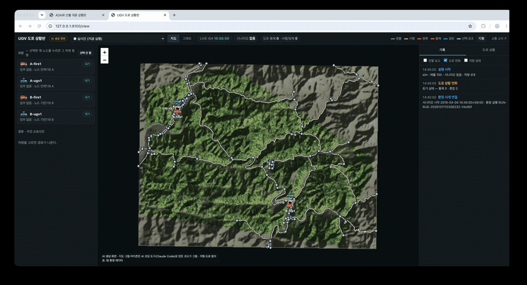

총괄은 보류한 요청을 환경 이벤트가 들어올 때마다 다시 평가합니다(138초에 27회). 거절 사유를 가리지 않는 총괄 쪽 동작이고, UGV는 매번 같은 답을 줍니다. 근거: [`2026-10-11_final`](../docs/ugv/evidence/2026-10-11_final/).

**설 자리 `road_point` (10/11부터 기본).** 같은 `final`을 도로 위 점 방식으로 다시 돌린 결과(통합 시연 환경, 1회): 선 자리↔목표 거리 중앙값 505 m → 392 m, 총괄 모의 열화상 불 탐지 54 % → 67 %, 목표가 지형에 가린 관측 23 % → 17 %. 거절·보류는 같았습니다. 이 브랜치 코드로 다시 돌린 결과는 선 자리↔목표 중앙값 301 m, 불 탐지 82 %, 도착 23회·실패 0입니다 ([`2026-10-11_road_view`](../docs/ugv/evidence/2026-10-11_road_view/)). 위 6장의 재현 숫자는 노드 방식(당시 기본)입니다.

### 2. 주행

|경우|결과|재현|
|---|---|---|
|정상 도착|임무 완료(COMPLETED), 차량 대기(READY), 도착 관측(위치·도로 상태)|COMPLETED. 주행 CSV [`drive_RUN1_normal.csv`](../docs/ugv/evidence/2026-10-10/drive_RUN1_normal.csv) (7, 11)|
|같은 주행 요청이 다시 옴|새로 출발하지 않고 `duplicate=true`, 지금 상태(IN_PROGRESS) 돌려줌|`duplicate: true` (8)|
|주행 중 앞길이 막힘|경로를 다시 찾아 계속 주행, `reroutes`에 기록|B 거점 출발, 도로 683401006 통제 → 우회, 남은 ETA 2,737초로 다시 계산 후 COMPLETED. [`drive_RUN2_reroute.csv`](../docs/ugv/evidence/2026-10-10/drive_RUN2_reroute.csv) (12~14)|
|주행 중 막혔는데 다른 길이 없음|가까운 노드에 서고 임무 실패(`ROAD_BLOCKED`). 고장이 아니므로 차는 READY|"주행 중 682501428 차단, 우회 경로 없음", 차량 READY (15, 16)|
|정지 요청|임무 취소(CANCELLED), 차는 그 자리 가까운 노드에 READY|CANCELLED "stopped by request" (17, 18)|
|멈춤·경로 이탈·드라이버 고장|임무 실패(FAILED), 차량 사용 불가(UNAVAILABLE). `/stop`으로 해제|— (sim에서는 재현하지 않음. PX4/Gazebo 주행에서 확인)|
|도로 상황판에서 직접 지시로 교체|기존 임무 실패(`OPERATOR_OVERRIDE`), 새 지시로 출발|—|

이 재현 한 번의 판단·주행·우회·실패·취소 사건 전체가 실행 기록 [`history_ugv_cases.jsonl`](../docs/ugv/evidence/2026-10-10/history_ugv_cases.jsonl)에 시뮬레이션 시각과 함께 남아 있습니다.

---

## 7. 실제 테스트 결과와 로그·영상 위치

이 장은 결과와 파일 위치만 적습니다. 시험 환경의 구성(단독 / 통합 시연 환경 / Gazebo)과 팀 저장소에서 다시 얻는 방법은 공통 문서 5-1·8-4장에 있습니다. 아래에서 "통합 시연 환경"이라고 적은 결과는 팀 저장소 main이 아니라 그 환경에서 나온 것입니다.

### 1. 테스트

|파일|확인 내용|
|---|---|
|[tests/test_ugv_speed.py](../tests/test_ugv_speed.py)|차량 속도 설정 (sim 60 km/h, PX4 상한)|
|[tests/test_ugv_road_point.py](../tests/test_ugv_road_point.py)|도로 위 지점으로 붙이기·도착|
|[tests/test_ugv_env_clock.py](../tests/test_ugv_env_clock.py)|환경 모듈 시계 따라가기|
|[tests/test_ugv_road_view.py](../tests/test_ugv_road_view.py)|도로 상황판 화면 요소|

실행: `python -m pytest tests/test_ugv_*.py`

결과 — 이 브랜치(2026-10-11, `road_point` 기본값): [`pytest_and_cases.txt`](../docs/ugv/evidence/2026-10-11_road_view/pytest_and_cases.txt). 10/10 도로 AI 브랜치 결과(도로 AI 시험 포함 29개, 오케스트레이터 쪽 시험): [`pytest_ugv.txt`](../docs/ugv/evidence/2026-10-10/pytest_ugv.txt)

|대상|결과|
|---|---|
|`tests/test_ugv_*.py`|5개 통과 (이 브랜치, 10/11). 도로 AI 시험은 별도 PR|
|경우별 재현 (`ugv_cases.py`)|18건 모두 기대대로 (이 브랜치, 10/11)|
|오케스트레이터의 UGV 관련 시험 (10/10, `orchestrator/tests/test_ugv_thermal.py`, `test_live_ugv.py`, `test_scenario_smoke_ugv_support.py`, `test_uav_unavailable_ugv_fallback.py`)|9개 통과, 4개 건너뜀 (실제 UGV 서버가 떠 있어야 하는 시험)|

### 2. 로그 위치

|기록|위치|내용|
|---|---|---|
|실행별 사건 기록|`ugv/.state/history/<run_id>.jsonl`|판단·주행·고장, 시뮬레이션 시각 포함. 최근 30회|
|주행 CSV|`ugv/.state/drive_logs/<task_id>.csv`|0.5초 간격 위치·속도·경로 이탈|
|임무 저장|`ugv/.state/ugv_tasks.json`|임무 상태 (서버 재시작 복구용)|
|서버 출력|`logs/servers/ugv.log`|`run_servers.py`로 띄웠을 때|

`ugv/.state/`와 `logs/`는 git에 올라가지 않습니다. 발표용 근거는 [`docs/ugv/evidence/2026-10-10/`](../docs/ugv/evidence/2026-10-10/)에 모았습니다.

|근거 파일|내용|
|---|---|
|`ugv_cases.py`|6장 경우들을 재현하는 스크립트 (저장소 루트에서 `python docs/ugv/evidence/2026-10-10/ugv_cases.py <출력.json>`)|
|`ugv_cases_sim.json`|위 스크립트의 결과 18건 (요청·응답·통과 여부)|
|`history_ugv_cases.jsonl`|같은 실행의 사건 기록 (평가 7, 출발 4, 진행 28, 우회 1, 도착 2, 실패 1, 취소 1 등)|
|`drive_RUN1_normal.csv`, `drive_RUN2_reroute.csv`|정상 도착·우회 주행의 0.5초 간격 기록|
|`pytest_ugv.txt`|자동 시험 결과|

10/11 추가 근거: Gazebo 재시험 [`2026-10-11_gazebo`](../docs/ugv/evidence/2026-10-11_gazebo/), Gazebo 배속 [`2026-10-11_gazebo_speed`](../docs/ugv/evidence/2026-10-11_gazebo_speed/), 4대 통합 [`2026-10-11_twin4`](../docs/ugv/evidence/2026-10-11_twin4/), Swagger [`2026-10-11_swagger`](../docs/ugv/evidence/2026-10-11_swagger/), 최종 통합 시나리오(거절) [`2026-10-11_final`](../docs/ugv/evidence/2026-10-11_final/)


### 3. 영상

영상은 [구글 드라이브 폴더](https://drive.google.com/drive/folders/1mKf7SWaMMfgTkvHFlNM9OuFESxECjyqy)에, GIF·4컷 장면은 [`docs/ugv/media/`](../docs/ugv/media/)에 있습니다. 원본 녹화는 용량이 커서 저장소에 올리지 않았습니다.

**편집 기준.** 모든 영상은 가로 1280 px로 줄이고 소리를 뺐습니다. 시험과 관계없는 화면(다른 웹페이지, 바탕화면, 편집기·터미널)이 나온 구간은 잘라냈고, 장면의 순서는 바꾸지 않았습니다. 배속을 바꾼 영상은 표의 내용 칸에 "N배속 재생"으로 적었습니다(녹화 자체의 시뮬레이션 배속과는 별개). 적혀 있지 않으면 녹화 속도 그대로입니다. GIF는 같은 영상을 더 줄인 것입니다.

|파일|내용|길이|
|---|---|---|
|[영상 01](https://drive.google.com/file/d/1Ic2o8N6mWVAHP95pXV_fdyWmRf5ojPiC/view)|통합 시연 환경(총괄·환경) + UGV 서버 4대, 도로 에이전트 끔, 도로 통제 없음, 100배속 (2026-10-11). 총괄 요청으로 A-ugv1 13회·B-ugv1 12회·A-fire1 1회 출동, 전부 도착. UGV 위치 기준 총괄 모의 열화상 관측 26회 중 14회 불 탐지(A-ugv1 5/13, B-ugv1 9/13), 목표가 지형에 가려 안 보인 관측 6회. 편집: 다른 웹페이지가 나온 약 10초를 잘라내고 2배속 재생 (같은 편집의 4배속 `_x4` 1분 15초, 첫 출동·소방차·불 따라가기 세 장면만 이은 요약 `_short` 33초·2배속, GIF는 요약본). 근거 [`2026-10-11_twin4`](../docs/ugv/evidence/2026-10-11_twin4/)|2분 30초|
|[영상 02](https://drive.google.com/file/d/1bw5k8rbyBo672su-RLFyA5ibGpZNnINr/view)|Swagger 단독 호출: 평가(ACCEPT, ETA 344초) → 주행 시작(처음엔 기본 예시 본문 그대로 보내 404 "경유 노드 string 없음", 본문을 고쳐 STARTED) → 도로 상황판에서 주행 확인 (sim, 배속 5, 2026-10-11). 편집: 2배속 재생|1분 22초|
|`ugv_twin_live.mp4` (원본 보관, 저장소·드라이브에 없음)|2019 인제 재현 시뮬레이션 3D 화면. 오케스트레이터가 배정한 UGV가 출동·주행 (2026-10-09)|1분 51초|
|[영상 07](https://drive.google.com/file/d/1FDUeMzhDdScPLViCn4qkAXgzBJ7bsy9N/view)|Gazebo + PX4 1대, 도로 상황판 직접 지시, 3D 트윈 LIVE·QGroundControl 동시 표시 (2026-10-11, 배속 약 3.2)|59초|
|[영상 09](https://drive.google.com/file/d/1gaAT6Zct-FrcqPuWq4ibnaslTJCdRTlK/view)|도로 상황판 실시간. 최종 통합 시나리오, 팀 main 총괄 (2026-10-11). 운용자 거절 요청 → A-ugv1·B-ugv1 `REJECT TARGET_UNREACHABLE`이 기록 탭에 반복해 쌓임. 녹화 속도 그대로|1분 30초|
|`ugv_gazebo_drive.mp4` (원본 보관, 저장소·드라이브에 없음)|Gazebo + PX4 단독 주행 (트윈·총괄 없이, 2026-10-05). 소방차가 PX4 미션으로 도로를 따라 목적지 도착 (배속 3.25, 실제/ETA 1.01). 20배속 재생|43초|
|`ugv_reroute_sim.mp4` (원본 보관, 저장소·드라이브에 없음)|도로 상황판. 주행 중 앞길 도로가 통제되자 경로를 다시 찾아 도착 (sim, 2026-10-08)|25초|

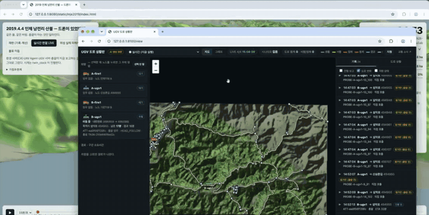


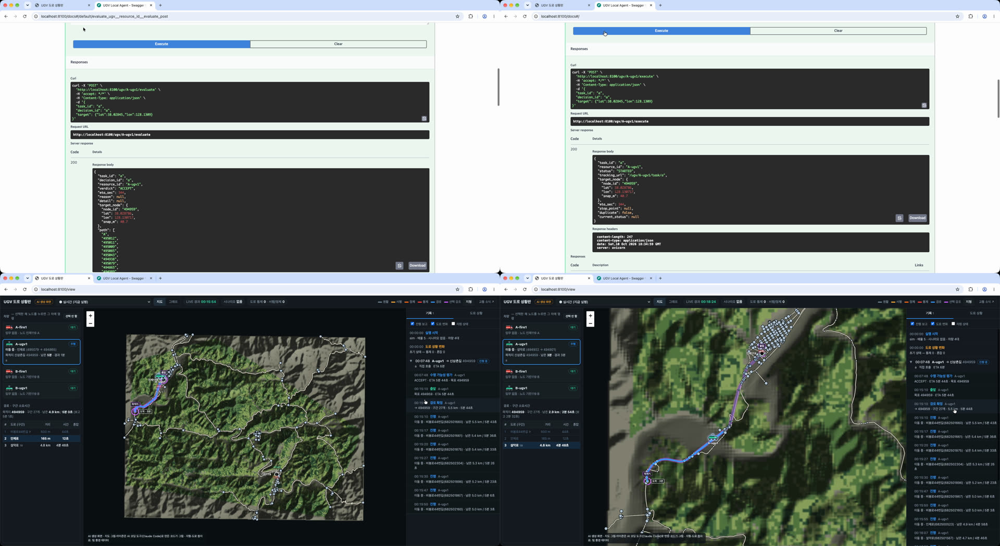

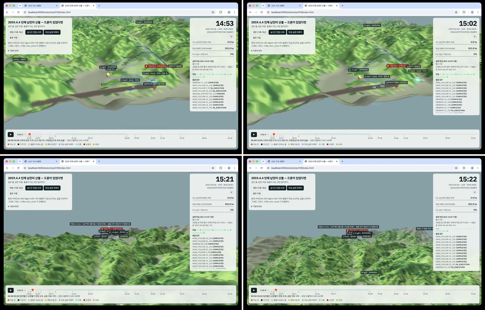


---

## 8. 모의값·가정·알려진 한계와 남은 작업

### 1. 모의값·가정

|항목|값|비고|
|---|---|---|
|차량 속도 (sim)|60 km/h|-|
|도로 최저 속도|50 km/h|-|
|차량 속도 (PX4)|2.0 m/s|r1_rover 상한|
|목표 → 도로 허용 거리|2 km|넘으면 TARGET_UNREACHABLE|
|멈춤 판정|60 시뮬레이션 초 동안 10 m 미만|—|
|경로 이탈 판정|100 m|—|
|배터리 감소 (sim)|1 km당 1 %|표시용 모의값. 0 %가 되어도 주행에 영향 없음|
|환경 1스텝|60 시뮬레이션 초|—|

### 2. 알려진 한계

1. 측정은 UGV가 하지 않고 오케스트레이터가 환경 모듈에서 가져옵니다.
2. 배터리가 판단에 쓰이지 않습니다. 배터리가 부족해도 임무를 거절하지 않고, 주행 중 0 %가 되어도 멈추지 않습니다.
3. 고장 해제를 오케스트레이터가 하지 않습니다.
4. Gazebo 차량(r1_rover)은 2.0 m/s(약 7 km/h)로만 달립니다. 처음 구상은 Gazebo만 가속하고 시나리오 시간은 그대로 흘려 실제 차에 가까운 속도 효과를 내는 것이었지만, 기준 환경인 Windows WSL(i5-12400)에서는 GUI 없이 PX4 기본 빈 월드에 10배를 요청해도 3.5–4.2배에 머물렀고(10/3), 도로를 배치한 월드는 4배 요청에 주행 중 평균 3.77배(10/3), 이후 10배를 요청한 측정에서는 중앙값 6.3배·평균 5.4배(순간적으로 0.5–2배까지 떨어짐, 10/5–10/6 무렵)였습니다. GUI를 켜고 4배로 주행하면 약 3.2배(10/5·10/11)입니다. 흔들림이 적고 ETA가 맞는 4배를 표준으로 정했습니다. 같은 조건으로 macOS에서 재 보니 GUI 없이 10배 주행이 됐고(실제 9.99배, 예상 대비 1.01), 30배는 PX4 시동 전 점검이 센서 시간 초과로 실패했습니다 ([`2026-10-11_gazebo_speed`](../docs/ugv/evidence/2026-10-11_gazebo_speed/)). 서버 시계는 ETA가 어긋나지 않도록 Gazebo 시간에 묶어 두었으므로(`UGV_CLOCK_SOURCE=px4`) 시나리오 시간 기준 속도는 약 7 km/h이고, 어느 환경에서도 시연 배속 100에 못 미쳐 시속 60 km를 가정한 트윈에는 넣지 않았습니다.
5. 화재와 도로상황의 연동은 구현하지 않았습니다.

### 3. 남은 작업

1. 주행 중 이상 처리 보강
2. 소화(진압) 기능의 환경 반영
3. Gazebo 차량 속도를 sim과 맞추기 (더 빠른 차량 모델 또는 서버 시계와 Gazebo 시간을 분리하는 방식 — 분리하면 ETA를 배속만큼 보정해야 함)
4. 배터리 용량 반영: 평가 때 남은 배터리로 왕복(목적지 + 거점 복귀)이 가능한지 확인해 부족하면 거절하고, 주행 중 기준값(`FUEL_RETURN_MARGIN_PCT`) 아래로 떨어지면 거점으로 복귀

### 4. 통합 시 확인할 점

UGV 구현이 바뀌거나 다른 구현과 합쳐져도 아래가 맞으면 다른 파트는 바꾸지 않아도 됩니다. 지금의 연결 관계는 5장에 있습니다.

1. **역할 경계** — UGV는 수락 판단·ETA, 도로 주행, 위치·상태 보고, 기록을 맡고, 오케스트레이터는 임무 배정과 관측값 계산을 맡습니다. 명령은 오케스트레이터만 내리고, 도로 상황판의 직접 지시는 운영자 예외로 둡니다.
2. **API 계약** — 상태 조회, 평가, 주행 시작, 임무 진행 조회의 경로·필드·상태값이 오케스트레이터와의 약속입니다 (3-2장). 거절 사유는 공통 목록(`interfaces/schema.py` `RejectReason`)에서 쓰고, 새 사유(예: 화재 안전거리)는 총괄과 합의합니다. 팀 main 총괄은 거절 사유를 가리지 않고 다음 후보로 넘어가므로 지금 사유로는 고칠 코드가 없습니다 (6장, 팀 main에서 확인).
3. **정차 지점과 관측 범위** — UGV는 도로 위 관측 위치를 제공하고, 관측 범위·지형은 오케스트레이터 관측 모델을 따릅니다. 수락 거리(지금 2 km)는 그 범위에 맞춥니다. 지금 팀 저장소의 UGV 열화상 모의는 차 주변 450 m 사각형이라 2 km와 맞지 않습니다. 제안은 통합 전에 총괄 테스트 저장소 방식으로 맞추는 것입니다: 총괄 시야를 2 km + 지형 시선으로(총괄 쪽), UGV는 도로 위 가장 가까운 점에 서기(`road_point`, 10/11부터 기본값).
4. **시간** — 모든 시각은 시뮬레이션 초이고 환경 모듈 시계를 따릅니다. Gazebo 단독일 때만 UGV 시계가 Gazebo 시간을 따르므로 PX4 `SPEED`와 `UGV_TIME_SCALE`을 같게 둡니다.
5. **속도** — ETA를 계산한 속도와 실제 주행 속도가 같아야 합니다 (sim 60 km/h, 도로 최저 50 km/h). 시뮬레이터 차량이 이 속도를 내지 못하면 ETA와 실제 도착이 어긋납니다.
6. **도로망·ID** — 같은 도로 원자료의 `road_id`·`node_id`를 쓰면 도로 시나리오 파일과 기록을 그대로 다시 쓸 수 있습니다. 도로망을 새로 만들면 ID 대응이 필요합니다.
7. **도로 상황의 출처** — 통제·혼잡은 UGV의 도로 시나리오가 정하고, 화재는 도로를 막지 않습니다 (팀 결정). 화재 근처를 피하는 규칙을 넣으려면 화재 범위를 받아 오는 연결이 필요합니다.
8. **기록** — 판단·주행·이상을 시뮬레이션 시각과 함께 남기는 실행 기록과 주행 CSV는 발표·분석의 근거입니다. 구현이 바뀌어도 같은 사건 종류와 시각 기준으로 남깁니다.
9. **다른 주행 구현 위에 얹을 수 있는 기능** — 도로 상황판, 실행 기록(그리고 별도 PR의 도로 판단 AI)은 주행 방식과 떨어져 있습니다. 필요한 연결점은 ① 앞길이 막힌 것을 알리는 지점 ② 경로를 다시 짜는 기능 ③ 사건을 기록하는 함수 세 가지입니다.
10. **거점 좌표** — UGV 거점 위치는 도로망 파일(`road_network.json`)의 출발 노드를 쓰고, 팀 공통 거점 좌표(`environment/config/fire_stations.json`)와 A는 약 50 m, B는 약 130 m 다릅니다. 화면·거리 계산이 어긋나지 않게 한쪽 기준으로 맞춥니다.
11. **배포** — 다른 기계에서 접속하려면 `--host 0.0.0.0`으로 띄우고, `UGV_ENV_URL`·`UGV_ORCH_URL`을 실제 주소로 지정합니다.
